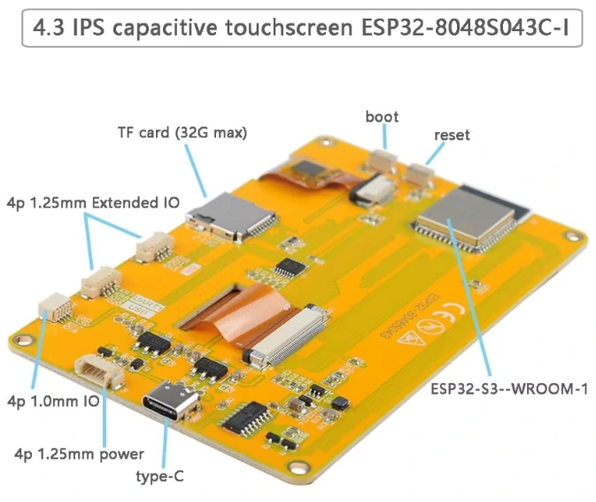

Le **Sunton ESP32-8048S043C** est une carte tout-en-un intégrant un ESP32-S3, un écran IPS de 4,3 pouces en 800 × 480 pixels et un écran tactile capacitif. Le processeur, l’écran et le contrôleur tactile sont réunis sur une seule carte. Elle convient aux projets nécessitant un écran tactile relativement grand sans devoir associer séparément un ESP32 et un module d’affichage.

> **Note de vérification :** ce guide s’appuie sur la documentation du fabricant, des références matérielles publiques et des projets d’exemple. Embedded Nerd n’a pas testé cette carte de manière indépendante pour cet article. Le brochage peut varier selon la révision : vérifiez le schéma de votre carte avant de connecter des périphériques.

> **Information affiliée :** le lien AliExpress de ce guide est un lien affilié. Embedded Nerd peut recevoir une commission si vous effectuez un achat, sans coût supplémentaire pour vous.

Avant l’achat, vérifiez plusieurs détails. Sunton commercialise des cartes aux noms proches, avec tactile capacitif ou résistif. La révision matérielle exacte peut modifier le brochage et la configuration recommandée.

Ce guide couvre les caractéristiques, l’écran et le tactile, les GPIO importants, la compatibilité logicielle, les problèmes fréquents et les critères à prendre en compte avant l’achat du 8048S043C.

> **Vous ne savez pas quel écran tactile ESP32 convient à votre projet ?** Consultez notre [guide des écrans tactiles ESP32]({{ site.url }}/esp32-touchscreen-displays-guide/) pour comparer les cartes selon la résolution et la mémoire nécessaires.



*Image de la carte fournie par Embedded Nerd.*

## Caractéristiques techniques du Sunton ESP32-8048S043C

| Caractéristique | Détails |
|---|---|
| MCU | ESP32-S3 double cœur, Wi-Fi et Bluetooth LE |
| Flash / PSRAM | 16 Mo de Flash et 8 Mo de PSRAM Octal sur la version N16R8 courante |
| Écran | IPS 4,3 pouces, 800 × 480 pixels |
| Interface écran | RGB parallèle 16 bits |
| Tactile | Capacitif, contrôleur GT911 via I²C |
| Stockage | Emplacement microSD |
| USB | USB-C |
| Autres connexions | Bouton BOOT sur GPIO0, connecteurs d’extension ; haut-parleur et batterie variables selon la révision |

> **Vérifiez la révision exacte avant l’achat.** Sunton vend plusieurs cartes aux références similaires, notamment la 4827S043C et des variantes résistives « R ». Comparez l’inscription sur le circuit imprimé avec les informations du vendeur avant de vous fier aux numéros GPIO, à la mémoire ou aux exemples.

## Le Sunton ESP32-8048S043C est-il un bon choix ?

Le 8048S043C est intéressant si vous recherchez un écran tactile relativement grand et souhaitez réunir l’ESP32, l’écran et le contrôleur tactile sur une seule carte.

### Un bon choix si vous avez besoin de

- Un **écran tactile de 4,3 pouces en 800 × 480 pixels**
- Un **ESP32-S3** avec Wi-Fi et Bluetooth LE
- Un tactile capacitif intégré
- De la PSRAM pour des interfaces graphiques plus exigeantes
- Une carte tout-en-un plutôt qu’un ESP32 et un écran séparés
- Une interface basée sur **LVGL**
- Un panneau de commande tactile compact

Les applications possibles comprennent les tableaux de bord, interfaces domotiques, commandes de machines, affichages de capteurs et autres projets où un grand écran tactile est plus pratique qu’un petit écran OLED ou alphanumérique.

### Envisagez une autre carte si vous avez besoin de

- Documentation officielle très complète et de nombreux exemples du fabricant
- Une autre taille ou résolution d’écran
- GPIO plus facilement accessibles
- Une autre technologie tactile
- Une carte dont la configuration logicielle est plus simple

## Version capacitive C ou résistive R : laquelle acheter ?

C’est l’un des points les plus importants à vérifier avant de commander.

La **version C** utilise un contrôleur tactile capacitif **GT911** sur le bus I²C. Elle offre une interaction tactile comparable à celle des écrans modernes de smartphone.

La **version R** utilise un matériel tactile résistif et nécessite un autre contrôleur ainsi qu’un pilote différent.

Si vous souhaitez explicitement un écran tactile capacitif, vérifiez que l’annonce indique **8048S043C** et non une variante R.

Le nom général **8048S043** apparaît parfois sans suffixe dans les dépôts d’exemples et la documentation. Les annonces peuvent notamment proposer trois configurations :

- **8048S043C** — tactile capacitif, généralement avec GT911.
- **8048S043R** — tactile résistif ; n’utilisez pas la configuration GT911 de la version C.
- **8048S043N** — indiqué dans certaines références comme version sans tactile.

Vérifiez le suffixe et demandez au vendeur de confirmer la carte réelle, le contrôleur d’écran et le matériel tactile. Les noms de modèles et les démonstrations fournies ne sont pas uniformes d’une annonce à l’autre.

## Documentation, schémas et projets d’exemple

Ces ressources constituent de bons points de départ pour vérifier la révision de la carte et préparer un projet fonctionnel :

- [Documentation Makerfabs/Sunton et démonstrations écran](https://wiki.makerfabs.com/Sunton_ESP32_S3_4.3_inch_800x400_IPS_with_Touch.html) — guides de configuration du fabricant et liens vers des démonstrations écran et LVGL.
- [Référence matérielle ESP3D pour ESP32-8048S043C](https://esp3d.io/esp3d-tft/version_1x/hardware/esp32-s3/sunton-43-8048/) — brochage, connexions microSD et remarques sur la modification de l’interruption GT911.
- [Archive de documentation et de démonstrations Sunton ESP32-8048S043](http://pan.jczn1688.com/directlink/1/ESP32%20module/4.3inch_ESP32-8048S043.zip) — archive hébergée par le fabricant et regroupant des ressources communautaires. Vérifiez son contenu et la révision concernée.
- [Projet Arduino_GFX + GT911 + LVGL](https://github.com/clumsyCoder00/Sunton-ESP32-8048S043) — projet PlatformIO utilisant Arduino_GFX, GT911 et LVGL 9.1.
- [Exemple ESP-IDF + LVGL](https://github.com/limpens/esp32-8048S043) — autre exemple basé sur ESP-IDF et le composant tactile GT911.

## Brochage : écran, tactile, microSD et connecteurs d’extension

L’écran est relié à l’ESP32-S3 par un bus RGB parallèle 16 bits. Le contrôleur tactile GT911 utilise I²C. Ces connexions sont déjà réalisées sur la carte : n’utilisez donc pas ces GPIO pour d’autres périphériques.

### Broches tactiles et de commande

| Fonction | GPIO | Remarques |
|---|---:|---|
| GT911 I²C SDA | 19 | Données tactiles |
| GT911 I²C SCL | 20 | Horloge I²C |
| GT911 Reset (RST) | 38 | Réinitialisation du contrôleur tactile |
| GT911 Interrupt (INT) | 18 | Généralement non relié au contrôleur sans modification matérielle |
| Rétroéclairage LCD | 2 | Commande du rétroéclairage |
| Bouton BOOT | 0 | Sélection du mode de démarrage |

Selon la configuration, le GT911 utilise généralement l’adresse I²C **0x5D** ou **0x14**. La ligne d’interruption tactile peut nécessiter une modification matérielle. Si elle n’est pas connectée, une interrogation périodique (polling) peut être utilisée.

### Broches microSD (SPI)

| Fonction | GPIO |
|---|---:|
| CS carte SD | 10 |
| MOSI carte SD | 11 |
| SCK carte SD | 12 |
| MISO carte SD | 13 |

### Signaux de l’écran RGB

| Signal | GPIO |
|---|---|
| DE / VSYNC / HSYNC / PCLK | 40 / 41 / 39 / 42 |
| Rouge (R0–R4) | 45, 48, 47, 21, 14 |
| Vert (G0–G5) | 5, 6, 7, 15, 16, 4 |
| Bleu (B0–B4) | 8, 3, 46, 9, 1 |

### Connecteurs d’extension

La référence matérielle publiée indique les affectations suivantes :

| Connecteur | Broches / fonctions |
|---|---|
| P1 (type UART) | GND, RX, TX, +5 V |
| P2 (type SPI) | GPIO13, GPIO12, GPIO11, GPIO19 |
| P3 | GPIO20, GPIO19, GPIO18, GPIO17 |
| P4 | GPIO18, GPIO17, 3,3 V, GND |

**Ces broches ne sont pas toutes utilisables indépendamment.** GPIO19/20 sont utilisés par le tactile I²C, GPIO11–13 par la microSD et GPIO18 est lié à la modification facultative de l’interruption GT911. Avant tout branchement, vérifiez l’orientation du connecteur et le schéma de votre révision. Le bus RGB utilise de nombreux autres GPIO.

Dans la référence de brochage ESP3D publiée, **GPIO17 est marqué NC dans la liste principale, mais figure sur les connecteurs P3/P4**. Il constitue le candidat le plus plausible pour un signal numérique simple supplémentaire. Considérez-le toutefois comme *potentiellement disponible*, et non comme garanti libre, tant que vous n’avez pas vérifié le schéma de votre carte. GPIO33/34 sont indiqués NA et GPIO35–37 NC/NA. Ne supposez pas que ces broches sont accessibles ou utilisables. Évitez GPIO43/44 pour les périphériques génériques, car ils servent à la liaison série USB-UART.

## Compatibilité logicielle et bibliothèques

Le 8048S043C peut être utilisé avec plusieurs bibliothèques graphiques courantes pour ESP32 :

| Bibliothèque | Utilisation | Remarques |
|---|---|---|
| **LVGL** | Interfaces tactiles complètes avec boutons, curseurs et graphiques | Nécessite un pilote d’écran sous-jacent |
| **Arduino_GFX** | Graphiques simples, texte et tests rapides | Fournit un pilote de panneau RGB pour ESP32-S3 |
| **LovyanGFX** | Dessin rapide et configuration flexible | Nécessite une configuration d’écran adaptée à la carte |

Pour de nombreux projets, une combinaison d’un pilote de panneau RGB de bas niveau, comme Arduino_GFX, et de **LVGL** pour l’interface constitue une bonne approche.

Point important avant l’achat : la carte peut afficher des interfaces tactiles élaborées, mais la configuration de l’écran doit correspondre exactement au matériel utilisé.

## Exemple Arduino : écran et tactile

Le sketch suivant est un **programme de test minimal pour l’écran Arduino_GFX et le tactile GT911**, basé sur le brochage courant du 8048S043C. Il affiche un message de test et envoie les coordonnées tactiles sur le port série. Cet exemple repose sur des références matérielles publiées et n’a pas été testé sur banc par Embedded Nerd. Le timing et le comportement tactile peuvent varier selon la révision.

Installez **Arduino_GFX** et **TAMC_GT911** via le gestionnaire de bibliothèques. Installez également le package de cartes ESP32 d’Espressif, sélectionnez **ESP32S3 Dev Module**, activez **OPI PSRAM** et choisissez la taille de Flash correspondant au module (généralement 16 Mo pour N16R8).

```cpp
#include <Arduino.h>
#include <Arduino_GFX_Library.h>
#include <TAMC_GT911.h>

#define SCREEN_WIDTH  800
#define SCREEN_HEIGHT 480
#define TFT_BL        2
#define TOUCH_SDA     19
#define TOUCH_SCL     20
#define TOUCH_RST     38
// The GT911 INT line is normally not connected on this board; use polling.
#define TOUCH_INT     -1

Arduino_ESP32RGBPanel *rgbPanel = new Arduino_ESP32RGBPanel(
  40, 41, 39, 42,
  45, 48, 47, 21, 14,
  5, 6, 7, 15, 16, 4,
  8, 3, 46, 9, 1,
  0, 8, 4, 8,
  0, 8, 4, 8,
  1, 12500000
);

Arduino_RGB_Display *gfx = new Arduino_RGB_Display(
  SCREEN_WIDTH, SCREEN_HEIGHT, rgbPanel
);

TAMC_GT911 touch(TOUCH_SDA, TOUCH_SCL, TOUCH_INT, TOUCH_RST,
                 SCREEN_WIDTH, SCREEN_HEIGHT);

void setup() {
  Serial.begin(115200);
  delay(300);

  pinMode(TFT_BL, OUTPUT);
  digitalWrite(TFT_BL, HIGH);

  if (!psramFound()) {
    Serial.println("PSRAM not found: enable OPI PSRAM in Tools.");
    while (true) delay(1000);
  }

  if (!gfx->begin()) {
    Serial.println("Display initialization failed.");
    while (true) delay(1000);
  }
  gfx->fillScreen(BLACK);
  gfx->setTextColor(WHITE);
  gfx->setTextSize(2);
  gfx->setCursor(24, 24);
  gfx->println("8048S043C display OK");

  touch.begin();
  touch.setRotation(ROTATION_NORMAL);
  Serial.println("Touch initialized; tap the screen to read coordinates.");
}

void loop() {
  touch.read();
  if (touch.isTouched) {
    Serial.printf("Touch: x=%d, y=%d\n",
                  touch.points[0].x, touch.points[0].y);
    delay(100);
  }
  delay(10);
}
```

Si l’écran reste noir ou instable, n’inventez pas de nouvelles valeurs de timing. Comparez le timing de l’écran et les GPIO avec la [référence matérielle ESP3D](https://esp3d.io/esp3d-tft/version_1x/hardware/esp32-s3/sunton-43-8048/) et la révision de votre carte. Pour un projet LVGL complet, vous pouvez utiliser l’[exemple Sunton ESP32-8048S043](https://github.com/clumsyCoder00/Sunton-ESP32-8048S043), qui inclut également la configuration des bibliothèques.

Ordre conseillé pour la première mise en service :

1. Vérifiez qu’il s’agit bien de la version capacitive **8048S043C**.
2. Installez le support ESP32-S3 et ouvrez le projet d’exemple dans PlatformIO.
3. Compilez et téléversez d’abord la démonstration sans modification.
4. Vérifiez le fonctionnement de l’écran RGB avant de modifier l’interface.
5. Contrôlez les coordonnées tactiles et la rotation de l’écran avant d’ajouter des widgets LVGL.
6. Ne connectez la microSD ou d’autres périphériques qu’après avoir vérifié les GPIO partagés.

**État de vérification :** l’exemple provient d’un tiers et n’a pas été testé par Embedded Nerd. Vérifiez la licence et les dépendances avant de réutiliser le code dans votre projet.

## SquareLine Studio et LVGL

[SquareLine Studio](https://squareline.io/) permet de concevoir visuellement une interface LVGL et d’exporter le code correspondant. L’outil ne remplace toutefois pas les pilotes matériels de l’écran et du tactile. Le code généré doit encore être intégré à un pilote de panneau RGB fonctionnel, au pilote d’entrée GT911 et à une version compatible de LVGL. Avant d’importer les fichiers générés, vérifiez la cible d’exportation et la version de LVGL.

## ESPHome

Cette carte est également utilisée avec ESPHome et Home Assistant. La [référence ESPHome Devices](https://devices.esphome.io/devices/sunton-esp32-8048s043c/) contient une configuration pour l’écran 800 × 480 et le contrôleur tactile GT911. La [documentation du composant LVGL d’ESPHome](https://esphome.io/components/lvgl/) explique comment créer des pages interactives.

Les configurations ESPHome dépendent de la version, notamment pour les écrans RGB et les pilotes tactiles. Commencez par une configuration connue comme compatible avec votre version d’ESPHome et la révision de votre carte. Ajoutez ensuite les entités Home Assistant et les widgets.

## Réglages de l’IDE Arduino

Pour la version N16R8 courante, les réglages Arduino IDE suivants sont importants :

1. Installez le **package de cartes ESP32** d’Espressif via le gestionnaire de cartes.
2. Sélectionnez **ESP32S3 Dev Module**.
3. Réglez **PSRAM** sur **OPI PSRAM**.
4. Réglez **Flash Size** sur **16 MB**.
5. Pour la version N16R8, utilisez le mode Flash **QIO 80 MHz**.
6. Pour les projets volumineux, choisissez un schéma de partition adapté à la Flash de 16 Mo.

Sans configuration correcte de la PSRAM, les applications graphiques peuvent ne pas réussir à réserver un framebuffer. Cela peut provoquer un écran noir ou une boucle de redémarrage.

> **Important :** ces réglages concernent la configuration N16R8 courante. Vérifiez la révision exacte de la carte et les informations du vendeur avant de les appliquer.
{: .notice--warning}

## Problèmes fréquents et points à connaître avant l’achat

Le 8048S043C est plus sensible à la configuration qu’un simple écran SPI. Il est donc utile de connaître les problèmes typiques avant de choisir cette carte.

### L’écran reste noir alors que la carte fonctionne

Une configuration incorrecte de la PSRAM, de l’écran ou du rétroéclairage peut laisser l’ESP32 opérationnel sans afficher d’image.

Vérifiez que :

- la PSRAM est réglée sur **OPI PSRAM** ;
- le profil de carte sélectionné est **ESP32-S3** ;
- le rétroéclairage est correctement configuré ;
- le timing de l’écran correspond à une configuration fonctionnelle pour cette carte précise.

### Boucle de redémarrage après le téléversement

Des réglages incorrects de PSRAM ou de Flash sont souvent en cause. Pour la version N16R8 courante, vérifiez d’abord les paramètres de l’IDE Arduino avant de modifier le code de l’application.

### Le tactile ne répond pas

La version capacitive utilise un GT911 via I²C. Si l’écran fonctionne mais pas le tactile :

1. Vérifiez les broches I²C.
2. Lancez un scan I²C.
3. Recherchez le GT911 à l’adresse **0x5D** ou **0x14**.
4. Vérifiez que le logiciel utilise un pilote GT911 et non un pilote pour tactile résistif.

Notre [outil de recherche d’adresses I²C]({{ site.url }}/tools/i2c-address-lookup/) peut vous aider à identifier une adresse. Le [tutoriel du scanner I²C]({{ site.url }}/i2c-scanner-tutorial/) est utile pour le dépannage.

### Le tactile est inversé ou décalé

La cause est généralement logicielle. Vérifiez l’orientation des axes X/Y et les paramètres de rotation dans la configuration du tactile et de l’écran.

### L’image scintille ou se décale

Le timing RGB ou la bande passante de la PSRAM peuvent être en cause. Commencez par les valeurs d’une démonstration fonctionnelle pour cette carte au lieu de deviner.

### Peu de GPIO restent disponibles

L’écran RGB utilise une grande partie des GPIO. Le tactile et la microSD en occupent également plusieurs. Consultez les tableaux de brochage avant de prévoir des périphériques supplémentaires.

## Ressources complémentaires

- [Guide des écrans tactiles ESP32]({{ site.url }}/esp32-touchscreen-displays-guide/)
- [Scanner I²C pour Arduino, ESP32 et ESP8266]({{ site.url }}/i2c-scanner-tutorial/)
- [Recherche d’adresse I²C et vérification de compatibilité]({{ site.url }}/tools/i2c-address-lookup/)
- [Sunton ESP32-8048S043C — page produit]({{ site.url }}/products/sunton-esp32-8048s043c/) — caractéristiques et options d’achat actuelles.
