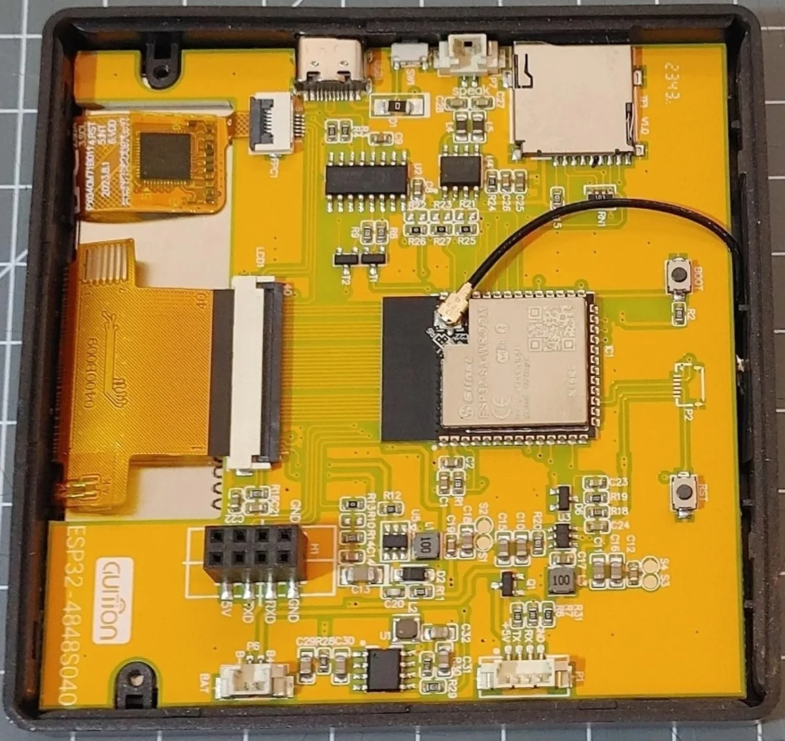
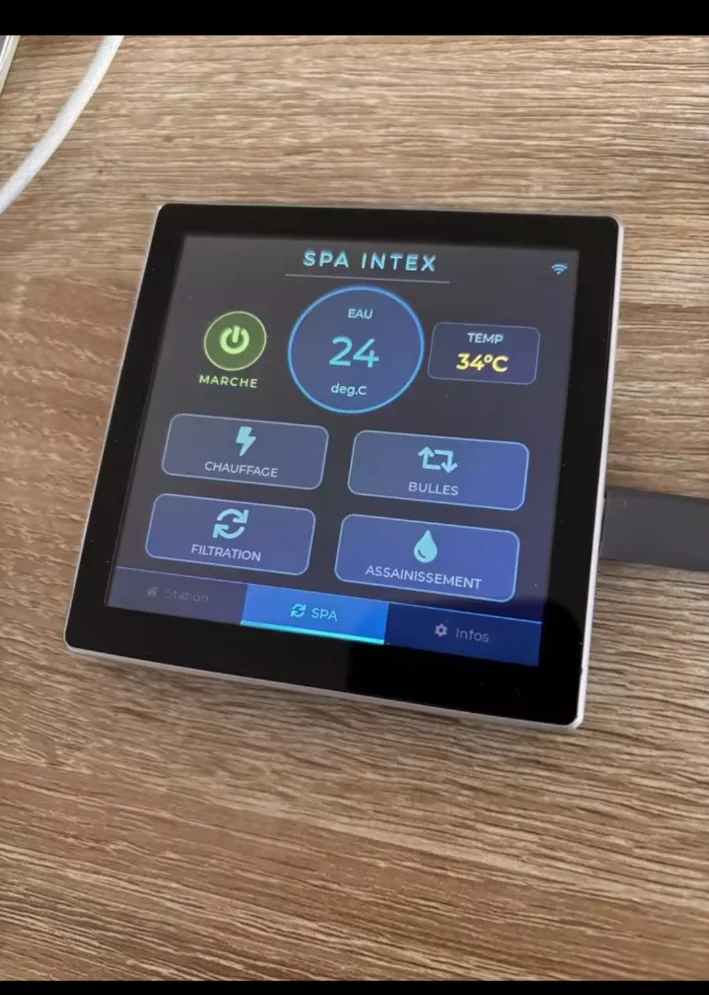
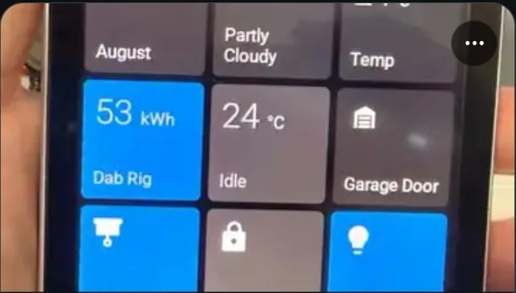



Para consultar las especificaciones completas, la valoración editorial, las variantes disponibles y las opciones de compra, visite la [página de producto del Guition ESP32-S3-4848S040](/es/products/guition-esp32-s3-4848s040/).

Esta guía se centra en el pinout del 4848S040, las interfaces de pantalla y táctil, las consideraciones importantes sobre GPIO y el uso de una configuración ESPHome existente como punto de partida.

> **Importante:** El pinout y los GPIO disponibles pueden variar según la revisión de la placa. Utilice las tablas como referencia y compárelas con la documentación de su unidad concreta antes de conectar hardware externo.

## Resumen del hardware

Esta familia de placas combina un ESP32-S3 con una pantalla RGB de 480 × 480 basada en ST7701S y táctil capacitivo GT911. La memoria, el hardware de relé y las opciones de carcasa deben comprobarse según la revisión exacta y el anuncio del vendedor. La [página de producto incluye las especificaciones completas y las opciones de compra](/es/products/guition-esp32-s3-4848s040/).

## Pinout del Guition ESP32-S3-4848S040

Las siguientes asignaciones aparecen en el perfil ESPHome Devices. Compruebe la revisión de su placa antes de utilizar estos datos para realizar conexiones.

### Pines de la pantalla RGB

| Señal de pantalla | GPIO |
|---|---:|
| Datos rojos | 11, 12, 13, 14, 0 |
| Datos verdes | 8, 20, 3, 46, 9, 10 |
| Datos azules | 4, 5, 6, 7, 15 |
| Display Enable (DE) | 18 |
| Sincronización horizontal (HSYNC) | 16 |
| Sincronización vertical (VSYNC) | 17 |
| Reloj de píxel (PCLK) | 21 |

### Inicialización de la pantalla ST7701S

| Señal | GPIO |
|---|---:|
| CS | 39 |
| CLK | 48 |
| DATA | 47 |

Estas señales se utilizan para inicializar la pantalla. Son independientes de las señales de datos RGB y de temporización.

### Controlador táctil GT911 y retroiluminación

| Función | GPIO |
|---|---:|
| Táctil I²C SDA | 19 |
| Táctil I²C SCL | 45 |
| Retroiluminación PWM | 38 |

El GT911 se comunica mediante I²C. En el perfil de referencia, GPIO38 se utiliza para controlar por PWM la retroiluminación.

*Demostración de pantalla del Guition ESP32-S3-4848S040.*

### Resumen de asignaciones GPIO

El perfil asigna **26 GPIO diferentes** a la pantalla, su inicialización, el controlador táctil y la retroiluminación:

`GPIO0, GPIO3, GPIO4, GPIO5, GPIO6, GPIO7, GPIO8, GPIO9, GPIO10, GPIO11, GPIO12, GPIO13, GPIO14, GPIO15, GPIO16, GPIO17, GPIO18, GPIO19, GPIO20, GPIO21, GPIO38, GPIO39, GPIO45, GPIO46, GPIO47, GPIO48`

Esta lista describe las asignaciones de la configuración de referencia. **No demuestra** que todos los demás GPIO estén disponibles para componentes externos. Otros pines pueden estar reservados para Flash o PSRAM, componentes integrados u otras funciones específicas de la placa.

## ¿Qué GPIO están libres?

No dé por hecho que un GPIO está disponible solo porque no aparece en las tablas anteriores. Antes de utilizar un pin para un sensor, relé, botón u otro periférico:

1. Consulte el esquema y la documentación de la revisión concreta de su placa.
2. Compruebe qué GPIO están físicamente expuestos en la placa.
3. Verifique si un pin está reservado para Flash, PSRAM, USB, configuración de arranque u otro componente integrado.
4. Compare la asignación prevista con la configuración ESPHome que vaya a utilizar.

El perfil de la placa es un punto de partida útil, pero no sustituye al esquema de su versión concreta de hardware.

## Versiones con y sin relé

El 4848S040 se vende en variantes que pueden incluir un módulo de relé y distintas opciones de montaje. Si está comparando versiones, la [página de producto explica las variantes y los aspectos que conviene comprobar antes de comprar](/es/products/guition-esp32-s3-4848s040/).

- **Versión sin relé:** compruebe en la documentación de la placa qué conexiones están expuestas y qué periféricos admite.
- **Versión con relé:** no presuponga una asignación GPIO ni una capacidad eléctrica concreta. Consulte el esquema y la documentación de esa variante antes de conectar una carga.
- **Montaje en pared:** la versión con relé puede no caber en una caja redonda europea estándar de empotrar de 60 mm. Compruebe las dimensiones y el tipo de montaje antes de comprar.

Nunca conecte una carga de tensión de red basándose únicamente en un pinout genérico. Compruebe los valores nominales del relé, el aislamiento, la carcasa y los requisitos de cableado del producto concreto.

## Primeros pasos con ESPHome

Una configuración ESPHome existente puede facilitar el inicio, pero debe revisarse antes de flashear la placa. Estos recursos de la comunidad son buenos puntos de partida:

- [ESPHome Devices: Guition ESP32-S3-4848S040](https://devices.esphome.io/devices/guition-esp32-s3-4848s040/)
- [Configuración ESPHome de la comunidad](https://github.com/jtenniswood/esphome-lvgl/tree/main/guition-esp32-s3-4848s040)

El siguiente procedimiento reduce el riesgo de utilizar una configuración diseñada para otra revisión de placa:

1. Abra la configuración y revise los archivos YAML y todos los paquetes incluidos.
2. Compruebe que los GPIO de pantalla, táctil y retroiluminación coinciden con su placa.
3. Sustituya los nombres de dispositivo de ejemplo, las credenciales Wi-Fi y los secretos por sus propios valores.
4. Revise los componentes adicionales y los paquetes externos utilizados por la configuración.
5. Valide la configuración en ESPHome antes de flashear el firmware.
6. Siga el procedimiento documentado para el primer flasheo de su placa y revisión.

Esta guía no afirma que la configuración de la comunidad se haya probado en todas las revisiones de placa. Si la placa no arranca o la pantalla queda negra, vuelva a revisar la configuración y compare el pinout con la documentación del hardware antes de modificar el cableado.

*Ejemplo de un panel de control en la pantalla táctil.*

## Pregunta frecuente

### ¿Puedo utilizar esta pantalla con ESPHome?

El perfil ESPHome Devices enlazado y la configuración de la comunidad ofrecen un punto de partida. Revise los archivos YAML, compare las asignaciones GPIO con la revisión de su placa y valide la configuración antes de flashearla.

## Próximos pasos

¿Está pensando en elegir esta placa? Visite la [página de producto del Guition ESP32-S3-4848S040](/es/products/guition-esp32-s3-4848s040/) para consultar las especificaciones, la valoración editorial, las variantes y las opciones de compra.

## Recursos relacionados

- [Guition JC8048W550: pantalla ESP32-S3 de 5 pulgadas](/products/guition-jc8048w550/): una alternativa más grande en formato horizontal con 800 × 480 píxeles.
- [Guition ESP32-S3-4848S040 – página de producto](/es/products/guition-esp32-s3-4848s040/)
- [Selector de pantallas táctiles ESP32](/tools/esp32-touchscreen-selector/)
- [Guía de pantallas táctiles ESP32](/esp32-touchscreen-displays-guide/)
- [Perfil ESPHome Devices](https://devices.esphome.io/devices/guition-esp32-s3-4848s040/)
- [Configuración ESPHome de la comunidad](https://github.com/jtenniswood/esphome-lvgl/tree/main/guition-esp32-s3-4848s040)

## Sobre el autor

**Embedded Nerd** publica guías prácticas sobre placas ESP32, hardware embebido, pantallas, sensores y herramientas de desarrollo. Esta guía se basa en referencias de hardware publicadas y recursos de la comunidad. La placa no se ha probado de forma independiente para este artículo.
