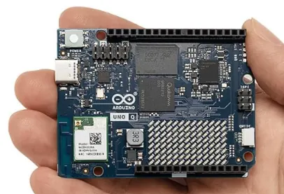
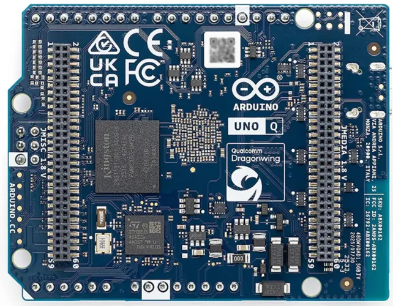

Die **Arduino UNO Q** ist keine gewöhnliche Arduino-Platine mit einem schnelleren Mikrocontroller. Sie kombiniert einen Linux-fähigen Anwendungsprozessor mit einem separaten Echtzeit-Mikrocontroller auf einer Platine im UNO-Format. Der Qualcomm Dragonwing QRB2210 führt Debian Linux und Anwendungen auf höherer Ebene aus, während der STM32U585 die deterministische Steuerung von Sensoren, Aktoren und anderer Hardware übernimmt.

Diese Dual-Prozessor-Architektur macht die UNO Q besonders interessant für **Edge-KI, Bildverarbeitung, Robotik und vernetzte Geräte**, die sowohl Linux-Software als auch eine latenzarme Hardwaresteuerung benötigen.

Es gibt zwei Speicherkonfigurationen: **2GB RAM mit 16GB eMMC** und **4GB RAM mit 32GB eMMC**. Prozessor und grundlegende Platinenarchitektur sind identisch; RAM und Speicherplatz sind die wesentlichen Unterschiede.

*Arduino UNO Q mit Verkaufsverpackung.*

## Lohnt sich der Kauf der Arduino UNO Q?

Die UNO Q ist sinnvoll, wenn ein Projekt mehr benötigt, als ein herkömmlicher Mikrocontroller bequem leisten kann. Sie kann Linux-Anwendungen, Python-Code und containerisierte Dienste ausführen, während der STM32U585 weiterhin Echtzeit-Ein-/Ausgänge verwaltet.

Für einfache LED-, Sensor- oder Automatisierungsprojekte ist sie weniger attraktiv. Wenn Linux, lokale KI oder Bildverarbeitung nicht benötigt werden, sind ein klassisches Arduino-Board, ESP32 oder Raspberry Pi Pico meist günstiger und einfacher.

**Die wichtigste Kaufentscheidung ist 2GB oder 4GB.** Die 2GB-Version eignet sich für eine dedizierte Embedded-Anwendung mit überschaubarer Arbeitslast. Wählen Sie 4GB, wenn Sie Monitor, Tastatur und Maus anschließen, mehrere Linux-Dienste parallel ausführen oder größere KI- und Bildverarbeitungsaufgaben bearbeiten möchten.

## Arduino UNO Q 2GB vs. 4GB

| Merkmal | UNO Q 2GB | UNO Q 4GB |
|---|---|---|
| RAM | 2GB LPDDR4 | 4GB LPDDR4 |
| eMMC-Speicher | 16GB | 32GB |
| MPU | Qualcomm Dragonwing QRB2210 | Qualcomm Dragonwing QRB2210 |
| MCU | STM32U585 | STM32U585 |
| Linux | Debian | Debian |
| Geeignet für | Dedizierte Embedded-Anwendungen, IoT-Gateways und leichtere KI-Aufgaben | Eigenständige SBC-Nutzung, Multitasking und größere KI-/Bildverarbeitungsaufgaben |

Die 4GB-Version ist die sicherere Wahl, wenn Sie die UNO Q als kleinen Linux-Computer mit Display, Tastatur und Maus verwenden möchten. Arduino empfiehlt für den eigenständigen Betrieb die 4GB-Konfiguration. Die 2GB-Version bleibt für gezielte Anwendungen mit kontrolliertem Speicherbedarf geeignet.

Die Varianten verwenden nicht unterschiedliche Prozessoren: Beide besitzen den QRB2210 und den STM32U585. Der zusätzliche RAM und eMMC-Speicher unterscheiden das 4GB-Modell.

## Technische Daten der Arduino UNO Q

Die technischen Daten sind bereits im Spezifikationsbereich oben zusammengefasst. Um eine doppelte Tabelle zu vermeiden, verwenden Sie für Details auf Steckverbinder-Ebene und revisionsabhängige elektrische Angaben das [offizielle Arduino-UNO-Q-Datenblatt](https://docs.arduino.cc/resources/datasheets/ABX00162-datasheet.pdf). Anschlussfunktionen und Signalspannungsbereiche sind nicht austauschbar: Prüfen Sie das Datenblatt, bevor Sie externe Hardware anschließen.

## Ansichten der Arduino UNO Q

Die Bauteilseite und die Rückseite zeigen das Platinenlayout, die Anschlüsse und die Erweiterungsleisten.

## Arduino UNO Q Pinout

Die UNO Q bietet separate Anschlüsse für MCU und MPU. Die wichtigsten Maker-Ein-/Ausgänge befinden sich an den MCU-seitigen Leisten; dedizierte Anschlüsse führen außerdem Prozessorsteuerungs-, Kamera- und Displaysignale.

| Anschluss | Signale | Wichtiger Hinweis |
|---|---|---|
| JDIGITAL | Digitale Pins D0–D21 und alternative Funktionen wie UART, I²C, SPI, PWM und CAN | MCU-E/A, 3,3V-Logik |
| JANALOG | Analoge Eingänge A0–A5 einschließlich alternativer Funktionen | A0 und A1 sind **nicht 5V-tolerant** |
| Qwiic | GND, 3,3V, SDA und SCL | I²C4 am STM32U585 |
| JSPI | MISO, SCK, MOSI, RESET, 5V und GND | SPI2-Signale mit 3,3V |
| JCTL | Boot-, Reset-, Wake- und Konsolensignale | 1,8V-MPU-Domäne; keine universellen 3,3V-E/A |
| JMEDIA | MIPI-Kamera-/Display-Lanes und zugehörige Signale | 1,8V-Hochgeschwindigkeitssignale; keine GPIOs |
| JMISC | Gemischte MCU-/MPU-Funktionen, darunter PSSI, I²C, Audio und Stromversorgung | Gemischte 3,3V-MCU- und 1,8V-MPU-Domänen |

Das Pinout-Diagramm ordnet die Arduino-Pinnummern den STM32U585-Pins und Peripheriefunktionen zu. Prüfen Sie es vor dem Verdrahten eines Moduls: **Legen Sie weder 5V an A0/A1 noch 3,3V-Signale an die 1,8V-MPU-Anschlüsse.** Die MIPI-Lanes von JMEDIA sind keine GPIOs.

- [Vollständiges offizielles Arduino-UNO-Q-Pinout als PDF herunterladen](https://docs.arduino.cc/resources/pinouts/ABX00162-full-pinout.pdf)
- [Offizielles Arduino-UNO-Q-Datenblatt öffnen](https://docs.arduino.cc/resources/datasheets/ABX00162-datasheet.pdf)

## So funktioniert die Dual-Prozessor-Architektur

Die UNO Q teilt die Aufgaben zwischen zwei Prozessoren auf.

### Qualcomm Dragonwing QRB2210: Linux und Rechenleistung

Der Quad-Core-Cortex-A53-Prozessor führt Debian Linux aus. Er übernimmt Python-Anwendungen, Netzwerkfunktionen, Datenverarbeitung, Bildverarbeitung und KI-Inferenz. Die integrierte Adreno-GPU und Bildsignalprozessoren unterstützen Multimedia- und Vision-Anwendungen.

### STM32U585: Echtzeit-Hardwaresteuerung

Der STM32U585 ist ein separater Cortex-M33-Mikrocontroller, auf dem Arduino Core unter Zephyr OS läuft. Er übernimmt die hardwarenahe Seite eines Projekts: Sensoren auslesen, Ausgänge steuern und zeitkritische Abläufe verwalten.

Diese Trennung ist der zentrale Vorteil der UNO Q. Linux kann komplexe Anwendungen ausführen, ohne dass zeitkritische Steuerungsaufgaben als gewöhnlicher Linux-Prozess laufen müssen.

## KI, Bildverarbeitung und Robotik

Der QRB2210 macht die UNO Q für Edge-Computing-Projekte geeigneter als ein klassisches Arduino-MCU-Board. Mögliche Anwendungen sind:

- **Bildverarbeitung:** Bildklassifizierung, Objekterkennung und kamerabasierte Inspektion.
- **Intelligente Geräte:** lokale Verarbeitung von Sensordaten und vernetzte Automatisierung.
- **Robotik:** Linux-basierte Planung und Bildverarbeitung zusammen mit MCU-gesteuerter Motor- und Sensorsteuerung.
- **Industrial IoT:** lokale Datensammlung, Gateways und containerisierte Dienste.
- **Interaktive Systeme:** Python-Anwendungen, Kameraeingang, Displays und physische Bedienelemente kombinieren.

Die tatsächliche Leistung hängt vom Modell, der Kamera, dem Software-Stack und dem verfügbaren Speicher ab. Nicht jedes KI-Modell läuft automatisch effizient, nur weil die Platine einen Qualcomm-Prozessor besitzt.

## Debian Linux, Python und Arduino App Lab

Der MPU führt Debian Linux aus, während der STM32U585 Arduino Core unter Zephyr OS verwendet. So lassen sich Linux-Werkzeuge und Python mit klassischen Arduino-Sketches kombinieren.

Arduino App Lab soll diese Komponenten zusammenführen. Die Umgebung bietet einen Workflow für Arduino-Code, Python und vorgefertigte Anwendungskomponenten namens Bricks. Docker und Docker Compose ermöglichen außerdem, Linux-Dienste in Containern zu paketieren.

Beginnen Sie mit der [offiziellen UNO-Q-Dokumentation](https://docs.arduino.cc/hardware/uno-q/) und der [Arduino-App-Lab-Dokumentation](https://docs.arduino.cc/software/app-lab/).

## Stromversorgung, USB-C und Displayausgabe

Die Platine kann über USB-C mit 5V und bis zu 3A oder über den VIN-Eingang mit 7–24V versorgt werden. USB-C unterstützt außerdem den Wechsel zwischen Host- und Gerätebetrieb sowie die DisplayPort-Videoausgabe.

Für den eigenständigen Betrieb mit Monitor, Tastatur und Maus benötigen Sie einen USB-C-Hub oder Adapter, der sowohl Videoausgabe als auch USB Power Delivery unterstützt. Prüfen Sie, ob Adapter und Netzteil die erforderliche Leistung liefern können; ein einfacher USB-C-Hub ohne geeignete Stromversorgung reicht möglicherweise nicht aus.

Die Platine führt außerdem MIPI-DSI-Signale am JMEDIA-Anschluss heraus. Das ist nicht dasselbe wie die DisplayPort-Ausgabe über USB-C.

## Zubehör für die Arduino UNO Q

Die UNO Q besitzt nur einen USB-C-Anschluss. Einige Zubehörteile erleichtern daher den eigenständigen Betrieb und die Hardware-Erweiterung.

- **USB-C-Hub mit Videoausgang und Power Delivery:** für den Betrieb mit Monitor, Tastatur und Maus. Wählen Sie einen Hub, der Videoausgabe und PD-Passthrough ausdrücklich unterstützt. [USB-C-Hubs bei Amazon ansehen](https://www.amazon.com/s?k=USB-C+hub+HDMI+Power+Delivery&tag=embeddednerd2-20){:target="_blank" rel="nofollow sponsored noopener"}
- **5V-/3A-USB-C-Netzteil:** die Platine ist für bis zu 5V/3A über USB-C ausgelegt. Prüfen Sie, ob Netzteil und Kabel die benötigte Leistung liefern. [USB-C-Netzteile bei Amazon ansehen](https://www.amazon.com/s?k=USB-C+power+supply+5V+3A&tag=embeddednerd2-20){:target="_blank" rel="nofollow sponsored noopener"}
- **Qwiic-Kabel und Sensoren:** der 3,3V-Qwiic-Anschluss ermöglicht eine lötfreie I²C-Erweiterung mit kompatiblen Modulen. [Qwiic-Sensoren bei Amazon ansehen](https://www.amazon.com/s?k=Qwiic+sensors+cables&tag=embeddednerd2-20){:target="_blank" rel="nofollow sponsored noopener"}

Als Affiliate-Website kann Embedded Nerd bei qualifizierten Käufen eine Provision erhalten, ohne dass Ihnen zusätzliche Kosten entstehen.

## Kompatibilität und Erweiterung

Die UNO Q behält die bekannte UNO-Platinenform bei und misst 68,85 × 53,34mm. Der vertraute Formfaktor garantiert jedoch nicht, dass jedes ältere Shield elektrisch und mechanisch kompatibel ist.

Achten Sie besonders auf die unterschiedlichen Spannungsbereiche der Platine. Die STM32-Seite bietet 3,3V-orientierte Schnittstellen, während einige Qualcomm-MPU-Signale an dedizierten Anschlüssen mit 1,8V arbeiten. Prüfen Sie Pinout und Datenblatt, bevor Sie Peripherie verdrahten oder ein Shield anschließen.

Der Qwiic-Anschluss bietet eine praktische 3,3V-I²C-Erweiterungsmöglichkeit für kompatible Sensoren und Module.

## Preis und Bezugsquellen der Arduino UNO Q

Die UNO Q wird in Konfigurationen mit 2GB und 4GB angeboten. Der aktuelle Preis kann je nach Land, Händler, Versand und Lagerbestand variieren. Verwenden Sie die Händlerlinks unten, um den aktuellen Preis zu prüfen und sicherzustellen, welche Speicherversion enthalten ist.

  <a class="en-buy-button preferred" href="https://link.amazon/B05l32CeC" target="_blank" rel="nofollow sponsored noopener">
    <i class="fab fa-amazon"></i>
    <strong>Arduino UNO Q bei Amazon ansehen</strong><small>2GB-/4GB-Version und Lieferung prüfen</small>
    <i class="fas fa-chevron-right"></i>
  </a>
  <a class="en-buy-button" href="https://s.click.aliexpress.com/e/_c3w4434P" target="_blank" rel="nofollow sponsored noopener">
    <i class="fas fa-cart-shopping"></i>
    <strong>Arduino UNO Q bei AliExpress ansehen</strong><small>Verkäufer, Speicherversion und Lieferung prüfen</small>
    <i class="fas fa-chevron-right"></i>
  </a>

Der offizielle Arduino Store listet die UNO Q 2GB derzeit für **59,90€** und die 4GB-Version für **82,90€** (Preise geprüft am **11. November 2026**). [Beide Konfigurationen im offiziellen Arduino-UNO-Q-Store vergleichen](https://store.arduino.cc/pages/uno-q). Händlerpreise, Versandkosten und Verfügbarkeit können abweichen.

Als Affiliate-Website kann Embedded Nerd bei qualifizierten Käufen eine Provision erhalten, ohne dass Ihnen zusätzliche Kosten entstehen.

## Arduino UNO Q vs. Raspberry Pi

Der Vergleich hängt davon ab, welchen Raspberry Pi Sie meinen. Hier steht Raspberry Pi für einen Linux-Einplatinencomputer wie Raspberry Pi 4 oder Raspberry Pi 5 – nicht für den Pico, der eine Mikrocontrollerplatine ist.

| Merkmal | Arduino UNO Q | Raspberry Pi 4 / 5 |
|---|---|---|
| Hauptaufgabe | Hybrid aus Linux-Computer und Mikrocontroller | Allgemeiner Linux-Einplatinencomputer |
| Betriebssystem | Debian Linux auf dem QRB2210 | Raspberry Pi OS und andere Linux-Distributionen |
| Echtzeitsteuerung | Dedizierter STM32U585 mit Zephyr/Arduino Core | Meist GPIO-Software oder externer Mikrocontroller |
| Format | Arduino-UNO-Formfaktor | Raspberry-Pi-SBC-Format |
| Erweiterung | UNO-MCU-Leisten, Qwiic und dedizierte MPU-Anschlüsse | 40-poliger GPIO-Header und modellspezifische Anschlüsse |
| Ideal für | Linux, KI/Bildverarbeitung und direkte Echtzeit-E/A | Linux-Desktop, Server, Netzwerk und allgemeine Computeraufgaben |

Wählen Sie die **Arduino UNO Q**, wenn Sie Linux und einen dedizierten Mikrocontroller auf derselben Platine benötigen, insbesondere für Projekte mit anspruchsvoller Verarbeitung und Echtzeitsteuerung von Sensoren oder Aktoren.

Wählen Sie einen **Raspberry Pi 4 oder 5**, wenn ein allgemeiner Linux-Computer, eine Desktop-Umgebung, ein Heimserver oder das breitere Raspberry-Pi-Softwareökosystem im Vordergrund steht. Für praktische Linux-Serverprojekte lesen Sie unseren [Raspberry-Pi-IT-Projekte-Leitfaden](/raspberry-pi-it-projects/).

## Arduino UNO Q vs. Arduino UNO R4 WiFi

Diese Platinen richten sich an unterschiedliche Projekte. Der UNO R4 WiFi ist eine klassische Mikrocontroller-Entwicklungsplatine. Die UNO Q ergänzt einen Linux-fähigen Anwendungsprozessor und deutlich mehr Systemspeicher.

| Merkmal | Arduino UNO Q | Arduino UNO R4 WiFi |
|---|---|---|
| Architektur | Qualcomm-MPU + STM32-MCU | Renesas-RA4M1-MCU |
| Linux | Debian Linux | Kein Linux-MPU |
| Programmierung | Python, Arduino-Sketches und Linux-Anwendungen | Arduino-Sketches |
| KI und Bildverarbeitung | Für Edge-Aufgaben ausgelegt | Nicht der Hauptzweck |
| Ideal für | Linux, Edge-KI, Robotik und anspruchsvolle Anwendungen | Klassische Embedded-Steuerung, Lernen und vernetzte MCU-Projekte |

Wählen Sie den UNO R4 WiFi für klassische Mikrocontrollerprojekte. Wählen Sie die UNO Q, wenn Sie Linux und einen Echtzeit-Mikrocontroller auf derselben Platine benötigen.

## Häufig gestellte Fragen

### Ist die Arduino UNO Q besser als ein Raspberry Pi?

Keine der beiden Plattformen ist grundsätzlich besser. Die Arduino UNO Q kombiniert Debian Linux mit einem dedizierten STM32U585-Mikrocontroller und eignet sich, wenn Linux-Anwendungen und Echtzeit-Hardwaresteuerung auf einer Platine benötigt werden. Ein Raspberry Pi 4 oder 5 ist ein vielseitigerer Linux-Computer und passt oft besser zu Desktop-Nutzung, Heimservern und klassischen SBC-Projekten. Der Raspberry Pi Pico gehört in eine andere Kategorie: Er ist ein Mikrocontrollerboard und kein Linux-Computer.

### Was ist die Arduino UNO Q?

Die Arduino UNO Q ist eine Hybrid-Entwicklungsplatine mit Qualcomm Dragonwing QRB2210 und STM32U585. Sie kann Debian Linux und Anwendungen auf höherer Ebene ausführen, während der STM32 die Echtzeit-Hardwaresteuerung übernimmt.

### Was ist der Unterschied zwischen Arduino UNO Q 2GB und 4GB?

Die 2GB-Version besitzt 2GB LPDDR4-RAM und 16GB eMMC-Speicher. Die 4GB-Version verdoppelt diese Kapazitäten auf 4GB RAM und 32GB eMMC. Beide verwenden denselben QRB2210-Prozessor und STM32U585-Mikrocontroller.

### Wie viel kostet die Arduino UNO Q?

Im offiziellen Arduino Store wird die UNO Q 2GB mit **59,90€** und die 4GB-Version mit **82,90€** gelistet (Preise geprüft am **11. November 2026**). Preise können je nach Land, Steuern, Versand und Verfügbarkeit variieren. Prüfen Sie den Endpreis auf der [offiziellen Arduino-UNO-Q-Store-Seite](https://store.arduino.cc/pages/uno-q).

### Wo kann man die Arduino UNO Q kaufen?

Vergleichen Sie Händlerangebote im Abschnitt [Preis und Bezugsquellen](#preis-und-bezugsquellen-der-arduino-uno-q) oder prüfen Sie beide Speichervarianten direkt im [offiziellen Arduino Store](https://store.arduino.cc/pages/uno-q).

### Läuft Linux auf der Arduino UNO Q?

Ja. Der Qualcomm Dragonwing QRB2210 führt Debian Linux aus. Der separate STM32U585 verwendet Arduino Core unter Zephyr OS.

### Kann ich die Arduino UNO Q mit Python programmieren?

Ja. Python-Anwendungen können auf der Debian-Linux-Seite laufen. Der STM32-Mikrocontroller kann Arduino-Sketches ausführen, sodass Python- und Arduino-Code in einem Projekt zusammenarbeiten können.

### Unterstützt die Arduino UNO Q Docker?

Ja. Arduino nennt Docker- und Docker-Compose-Unterstützung für die Linux-Seite der UNO Q.

### Eignet sich die Arduino UNO Q für KI?

Sie ist für Edge-KI und Bildverarbeitung ausgelegt. Ob ein bestimmtes Modell geeignet ist, hängt von Größe, Speicherbedarf, Framework-Unterstützung und Leistungsanforderungen ab. Für größere Modelle und intensiveres Multitasking ist die 4GB-Version vorzuziehen.

### Kann die Arduino UNO Q als eigenständiger Computer verwendet werden?

Ja. Über einen USB-C-Hub oder Adapter mit Videoausgabe und Power Delivery lassen sich Monitor, Tastatur und Maus anschließen. Für diesen Einsatzzweck ist die 4GB-Version die bessere Wahl.

### Unterstützt die Arduino UNO Q Wi-Fi und Bluetooth?

Ja. Sie besitzt Dualband-Wi-Fi 5 mit 2,4GHz und 5GHz sowie Bluetooth 5.1.

### Ist die Arduino UNO Q mit Arduino-UNO-Shields kompatibel?

Sie behält den UNO-Formfaktor bei, aber die mechanische Passform garantiert keine elektrische Kompatibilität. Prüfen Sie vor dem Anschluss die Spannungsanforderungen, Pinbelegung und Dokumentation des UNO Q.

## Weitere Entwicklungsplatinen entdecken

- [Arduino Nano ESP32](/products/arduino-nano-esp32/) – kompakte drahtlose Mikrocontrollerplatine.
- [Arduino UNO Q](/products/arduino-uno-q/) – Linux, Edge-KI und Echtzeitsteuerung auf einer Platine.
- [ESP32 DevKit](/products/esp32-devkit/) – einfachere und kostengünstigere Plattform für viele Wi-Fi- und Bluetooth-Projekte.
- [Raspberry Pi Pico](/products/raspberry-pi-pico/) – Mikrocontroller-Alternative für Embedded-Projekte.
- [Entwicklungsplatinen](/products/development-boards/) – weitere Platinen für Embedded-Entwicklung entdecken.
