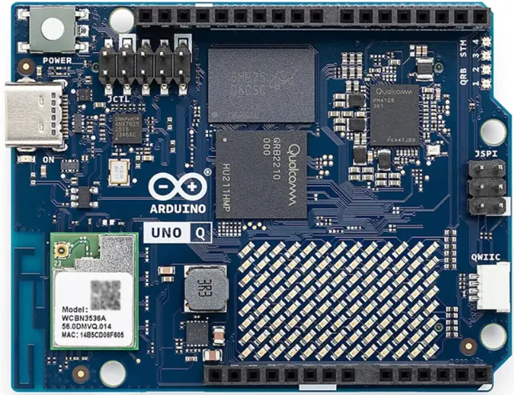

L’**Arduino UNO Q** n’est pas une carte Arduino classique équipée d’un microcontrôleur plus rapide. Elle associe un processeur applicatif capable d’exécuter Linux à un microcontrôleur temps réel distinct, sur une carte au format UNO. Le Qualcomm Dragonwing QRB2210 exécute Debian Linux et les applications de haut niveau, tandis que le STM32U585 assure le contrôle déterministe des capteurs, actionneurs et autres composants matériels.

Cette architecture à deux processeurs rend l’UNO Q particulièrement intéressante pour **l’IA en périphérie, la vision par ordinateur, la robotique et les appareils connectés** qui nécessitent à la fois des logiciels Linux et un contrôle matériel à faible latence.

Deux configurations mémoire sont proposées : **2 Go de RAM avec 16 Go eMMC** et **4 Go de RAM avec 32 Go eMMC**. Le processeur et l’architecture principale sont identiques ; la RAM et le stockage constituent les principales différences.

*Arduino UNO Q et son emballage.*

## Arduino UNO Q 2 Go vs 4 Go

La principale différence concerne la mémoire et le stockage intégré. Les deux versions utilisent le même processeur Qualcomm Dragonwing QRB2210 et le même microcontrôleur STM32U585.

| Caractéristique | Arduino UNO Q 2 Go | Arduino UNO Q 4 Go |
|---|---|---|
| RAM | 2 Go LPDDR4 | 4 Go LPDDR4 |
| Stockage eMMC | 16 Go | 32 Go |
| MPU | Qualcomm Dragonwing QRB2210 | Qualcomm Dragonwing QRB2210 |
| MCU | STM32U585 | STM32U585 |
| Système d’exploitation | Debian Linux | Debian Linux |
| Utilisation conseillée | Applications embarquées ciblées, passerelles IoT et charges d’IA légères | Utilisation SBC autonome, multitâche et charges d’IA/vision plus importantes |

### Arduino UNO Q 2 Go

Choisissez le modèle 2 Go pour les applications embarquées dédiées, les passerelles IoT et les projets dont les besoins en mémoire restent modérés.

### Arduino UNO Q 4 Go

Choisissez le modèle 4 Go pour une utilisation comme petit ordinateur autonome, avec écran, clavier et souris, ainsi que pour le multitâche et les charges d’IA ou de vision par ordinateur plus importantes.

## Prix de l’Arduino UNO Q : 2 Go vs 4 Go

| Version | Prix sur la boutique officielle Arduino |
|---|---:|
| Arduino UNO Q 2 Go (16 Go eMMC) | **59,90 €** |
| Arduino UNO Q 4 Go (32 Go eMMC) | **82,90 €** |

<small>Prix vérifiés le **21 novembre 2026** sur la [page officielle Arduino UNO Q](https://store.arduino.cc/pages/uno-q). Les prix, taxes, frais de livraison et disponibilités peuvent varier selon la destination.</small>

## Dimensions et encombrement

L’Arduino UNO Q mesure **68,85 × 53,34 mm** et conserve le format physique familier de l’Arduino UNO. Les versions 2 Go et 4 Go ont les mêmes dimensions.

## Spécifications

Les principales caractéristiques matérielles sont récapitulées dans le panneau de spécifications ci-dessus. Les deux variantes partagent le processeur applicatif QRB2210, le microcontrôleur STM32U585, la connectivité sans fil et les dimensions au format UNO.

## Fiche technique et documentation officielle

Consultez les ressources officielles d’Arduino pour obtenir les dernières instructions de configuration, les détails des connecteurs, les limites électriques et les informations sur les révisions de la carte :

- [Documentation officielle Arduino® UNO Q](https://docs.arduino.cc/hardware/uno-q/) — configuration, informations matérielles et ressources logicielles.
- [Fiche technique Arduino® UNO Q (PDF)](https://docs.arduino.cc/resources/datasheets/ABX00162-datasheet.pdf) — architecture, connecteurs, détails électriques et caractéristiques techniques.
- [Brochage complet Arduino UNO Q (PDF)](https://docs.arduino.cc/resources/pinouts/ABX00162-full-pinout.pdf) — brochage et fonctions alternatives.
- [Page produit officielle Arduino® UNO Q](https://store.arduino.cc/pages/uno-q) — comparaison des configurations 2 Go et 4 Go.

Les fonctions des connecteurs et les domaines de tension des signaux ne sont pas interchangeables : consultez la fiche technique avant de connecter du matériel externe.

## L’Arduino UNO Q vaut-elle son prix ?

L’UNO Q est pertinente lorsqu’un projet nécessite davantage que ce qu’un microcontrôleur traditionnel peut gérer confortablement. Elle peut exécuter des applications Linux, du code Python et des services conteneurisés, tandis que le STM32U585 continue de gérer les entrées/sorties temps réel.

Elle est moins intéressante pour un simple projet de LED, de capteur ou d’automatisation. Si Linux, l’IA locale ou la vision par ordinateur ne sont pas nécessaires, une Arduino classique, une ESP32 ou une Raspberry Pi Pico sera généralement moins chère et plus simple.

**Le principal choix à l’achat oppose 2 Go et 4 Go.** Choisissez le modèle 2 Go pour une application embarquée dédiée dont la charge de travail reste limitée. Optez pour 4 Go si vous comptez connecter un écran, un clavier et une souris, exécuter plusieurs services Linux simultanément ou utiliser des charges d’IA et de vision plus importantes.

## Vues de la carte Arduino UNO Q

La face composants et la face arrière montrent la disposition de la carte, les connecteurs et les broches d’extension.

## Brochage de l’Arduino UNO Q

L’UNO Q dispose de connexions distinctes pour le MCU et le MPU. Les principales entrées/sorties destinées aux projets maker se trouvent sur les connecteurs côté MCU ; des connecteurs dédiés transportent également les signaux de contrôle du processeur, de caméra et d’affichage.

| Connecteur | Signaux disponibles | Point important |
|---|---|---|
| JDIGITAL | Broches numériques D0–D21 et fonctions alternatives, notamment série, I²C, SPI, PWM et CAN | E/S du MCU, logique 3,3 V |
| JANALOG | Entrées analogiques A0–A5 et fonctions alternatives | A0 et A1 **ne tolèrent pas le 5 V** |
| Qwiic | GND, 3,3 V, SDA et SCL | I²C4 sur le STM32U585 |
| JSPI | MISO, SCK, MOSI, RESET, 5 V et GND | Signaux SPI2 en 3,3 V |
| JCTL | Signaux de démarrage, réinitialisation, réveil et console | Domaine MPU 1,8 V ; pas des E/S générales 3,3 V |
| JMEDIA | Lignes MIPI caméra/écran et signaux associés | Signaux haute vitesse 1,8 V ; pas des GPIO généraux |
| JMISC | Fonctions mixtes MCU et MPU, dont PSSI, I²C, audio et alimentation | Domaines mixtes MCU 3,3 V et MPU 1,8 V |

Le schéma de brochage associe les numéros de broches Arduino aux broches du STM32U585 et à leurs fonctions périphériques. Consultez-le avant le câblage : **n’appliquez pas 5 V sur A0/A1 et ne connectez pas de signaux 3,3 V aux connecteurs MPU 1,8 V.** Les lignes MIPI de JMEDIA ne sont pas des GPIO.

- [Télécharger le PDF officiel du brochage complet Arduino UNO Q](https://docs.arduino.cc/resources/pinouts/ABX00162-full-pinout.pdf)
- [Consulter la fiche technique officielle Arduino UNO Q](https://docs.arduino.cc/resources/datasheets/ABX00162-datasheet.pdf)

## Fonctionnement de l’architecture à deux processeurs

L’UNO Q répartit les tâches entre deux processeurs.

### Qualcomm Dragonwing QRB2210 : Linux et calcul de haut niveau

Le processeur Cortex-A53 quadricœur exécute Debian Linux. Il prend en charge les applications Python, le réseau, le traitement des données, la vision par ordinateur et l’inférence IA. Le GPU Adreno intégré et les processeurs de signal d’image prennent en charge les applications multimédias et de vision.

### STM32U585 : contrôle matériel temps réel

Le STM32U585 est un microcontrôleur Cortex-M33 distinct qui exécute Arduino Core sur Zephyr OS. Il gère la partie matérielle du projet : lecture des capteurs, commande des sorties et opérations sensibles au temps.

Cette séparation constitue le principal avantage de l’UNO Q. Linux peut exécuter des applications complexes sans imposer que le contrôle critique en temps réel fonctionne comme un processus Linux ordinaire.

## IA, vision par ordinateur et robotique

Le QRB2210 rend l’UNO Q mieux adaptée aux projets d’edge computing qu’une carte Arduino classique à microcontrôleur. Exemples d’applications possibles :

- **Vision par ordinateur :** classification d’images, détection d’objets et inspection par caméra.
- **Appareils intelligents :** traitement local des données de capteurs et automatisation connectée.
- **Robotique :** planification et vision sous Linux avec commande des moteurs et capteurs par le MCU.
- **IoT industriel :** agrégation locale de données, passerelles et services conteneurisés.
- **Systèmes interactifs :** association d’applications Python, d’une caméra, d’écrans et de commandes physiques.

Les performances réelles dépendent du modèle, de la caméra, de la pile logicielle et de la mémoire disponible. La présence d’un processeur Qualcomm ne garantit pas que tous les modèles d’IA fonctionneront efficacement.

## Debian Linux, Python et Arduino App Lab

Le MPU exécute Debian Linux, tandis que le STM32U585 utilise Arduino Core sur Zephyr OS. Un projet peut ainsi associer les outils Linux et Python aux sketches Arduino classiques.

Arduino App Lab vise à réunir ces éléments. Il propose un flux de travail pour le code Arduino, Python et des composants applicatifs préconfigurés appelés Bricks. La prise en charge de Docker et Docker Compose permet également de regrouper des services Linux dans des conteneurs.

Pour commencer, consultez la [documentation officielle de l’UNO Q](https://docs.arduino.cc/hardware/uno-q/) et la [documentation Arduino App Lab](https://docs.arduino.cc/software/app-lab/).

## Alimentation, USB-C et sortie vidéo

La carte peut être alimentée en USB-C sous 5 V, jusqu’à 3 A, ou par son entrée VIN spécifiée pour 7–24 V. L’USB-C prend également en charge la commutation des rôles hôte/périphérique et la sortie vidéo DisplayPort.

Pour une utilisation autonome avec écran, clavier et souris, utilisez un hub ou adaptateur USB-C prenant en charge à la fois la sortie vidéo et l’USB Power Delivery. Vérifiez que l’adaptateur et l’alimentation peuvent fournir la puissance nécessaire ; un hub USB-C basique sans alimentation adaptée peut ne pas suffire.

La carte expose également des signaux MIPI DSI via le connecteur JMEDIA. Il ne s’agit pas de la même connexion que la sortie DisplayPort sur USB-C.

## Accessoires pour Arduino UNO Q

L’UNO Q ne possède qu’un seul port USB-C. Quelques accessoires rendent donc l’utilisation autonome et l’extension matérielle plus pratiques.

- **Hub USB-C avec sortie vidéo et Power Delivery :** nécessaire pour l’utilisation avec écran, clavier et souris. Choisissez un hub indiquant explicitement la prise en charge de la vidéo et du passthrough PD. [Voir les hubs USB-C sur Amazon](https://www.amazon.com/s?k=USB-C+hub+HDMI+Power+Delivery&tag=embeddednerd2-20){:target="_blank" rel="nofollow sponsored noopener"}
- **Alimentation USB-C 5 V / 3 A :** la carte est prévue pour jusqu’à 5 V / 3 A en USB-C. Vérifiez que l’alimentation et le câble peuvent fournir la puissance requise. [Voir les alimentations USB-C sur Amazon](https://www.amazon.com/s?k=USB-C+power+supply+5V+3A&tag=embeddednerd2-20){:target="_blank" rel="nofollow sponsored noopener"}
- **Câbles et capteurs Qwiic :** le connecteur Qwiic 3,3 V permet une extension I²C sans soudure avec les modules compatibles. [Voir les capteurs Qwiic sur Amazon](https://www.amazon.com/s?k=Qwiic+sensors+cables&tag=embeddednerd2-20){:target="_blank" rel="nofollow sponsored noopener"}

En tant que site affilié, Embedded Nerd peut percevoir une commission sur les achats éligibles, sans frais supplémentaires pour vous.

## Compatibilité et extension

L’UNO Q conserve le contour familier des cartes UNO et mesure 68,85 × 53,34 mm. Toutefois, un format identique ne garantit pas la compatibilité électrique ou mécanique de tous les anciens shields.

Faites particulièrement attention aux différents domaines de tension de la carte. Les interfaces côté STM32 sont orientées 3,3 V, tandis que certains signaux du MPU Qualcomm disponibles sur des connecteurs dédiés fonctionnent en 1,8 V. Consultez le brochage et la fiche technique avant de câbler des périphériques ou de connecter un shield.

Le connecteur Qwiic fournit une solution pratique d’extension I²C 3,3 V pour les capteurs et modules compatibles.

## Prix de l’Arduino UNO Q et où l’acheter

L’UNO Q est proposée en versions 2 Go et 4 Go. Le prix actuel peut varier selon le pays, le vendeur, la livraison et les stocks. Utilisez les liens des revendeurs ci-dessous pour vérifier le prix en vigueur et confirmer la version mémoire incluse.

  <a class="en-buy-button preferred" href="https://link.amazon/B05l32CeC" target="_blank" rel="nofollow sponsored noopener">
    <i class="fab fa-amazon"></i>
    <strong style="font-weight:400">Voir Arduino UNO Q sur Amazon</strong><small style="font-weight:700">Vérifiez la version 2 Go / 4 Go et la livraison</small>
    <i class="fas fa-chevron-right"></i>
  </a>
  <a class="en-buy-button" href="https://s.click.aliexpress.com/e/_c3w4434P" target="_blank" rel="nofollow sponsored noopener">
    <i class="fas fa-cart-shopping"></i>
    <strong style="font-weight:400">Voir Arduino UNO Q sur AliExpress</strong><small style="font-weight:700">Vérifiez le vendeur, la mémoire et la livraison</small>
    <i class="fas fa-chevron-right"></i>
  </a>

La boutique officielle Arduino affiche actuellement l’UNO Q 2 Go à **59,90 €** et la version 4 Go à **82,90 €** (prix vérifiés le **21 novembre 2026**). [Comparez les deux configurations sur la boutique officielle Arduino UNO Q](https://store.arduino.cc/pages/uno-q). Les prix des revendeurs, les frais de livraison et la disponibilité peuvent varier.

En tant que site affilié, Embedded Nerd peut percevoir une commission sur les achats éligibles, sans frais supplémentaires pour vous.

## Arduino UNO Q ou Raspberry Pi

La comparaison dépend du modèle de Raspberry Pi. Ici, Raspberry Pi désigne un ordinateur monocarte Linux comme le Raspberry Pi 4 ou 5, et non le Pico, qui est une carte à microcontrôleur.

| Caractéristique | Arduino UNO Q | Raspberry Pi 4 / 5 |
|---|---|---|
| Rôle principal | Ordinateur Linux hybride et plateforme microcontrôleur | Ordinateur monocarte Linux généraliste |
| Système d’exploitation | Debian Linux sur le QRB2210 | Raspberry Pi OS et autres distributions Linux |
| Contrôle matériel temps réel | MCU STM32U585 dédié sous Zephyr/Arduino Core | Généralement logiciel GPIO ou microcontrôleur externe |
| Format | Format Arduino UNO | Format SBC Raspberry Pi |
| Extension matérielle | Connecteurs MCU type UNO, Qwiic et connecteurs MPU dédiés | GPIO 40 broches et connecteurs propres au modèle |
| Usage idéal | Projets associant Linux, IA/vision et E/S temps réel directes | Bureau Linux, serveurs, réseau et informatique généraliste |

Choisissez l’**Arduino UNO Q** si vous souhaitez Linux et un microcontrôleur dédié sur la même carte, notamment pour des projets associant traitement de haut niveau et contrôle temps réel de capteurs ou d’actionneurs.

Choisissez un **Raspberry Pi 4 ou 5** si votre priorité est un ordinateur Linux généraliste, un environnement de bureau, un serveur domestique ou l’écosystème logiciel Raspberry Pi. Pour des projets pratiques de serveurs Linux, consultez notre [guide des projets informatiques Raspberry Pi](/raspberry-pi-it-projects/).

## Arduino UNO Q ou Arduino UNO R4 WiFi

Ces cartes répondent à des besoins différents. L’UNO R4 WiFi est une carte de développement à microcontrôleur classique. L’UNO Q ajoute un processeur applicatif compatible Linux et beaucoup plus de mémoire système.

| Caractéristique | Arduino UNO Q | Arduino UNO R4 WiFi |
|---|---|---|
| Architecture | MPU Qualcomm + MCU STM32 | MCU Renesas RA4M1 |
| Linux | Debian Linux | Pas de MPU Linux |
| Programmation | Python, sketches Arduino et applications Linux | Sketches Arduino |
| IA et vision par ordinateur | Conçue pour les charges edge | Ce n’est pas son objectif principal |
| Usage idéal | Linux, IA en périphérie, robotique et applications avancées | Contrôle embarqué classique, apprentissage et projets MCU connectés |

Choisissez l’UNO R4 WiFi pour les projets classiques à microcontrôleur. Choisissez l’UNO Q lorsque vous avez besoin de Linux et d’un microcontrôleur temps réel sur la même carte.

## Foire aux questions

### L’Arduino UNO Q est-elle meilleure qu’un Raspberry Pi ?

Aucune n’est universellement meilleure. L’Arduino UNO Q associe Debian Linux à un microcontrôleur STM32U585 dédié ; elle est donc utile lorsqu’un projet nécessite des applications Linux et un contrôle matériel temps réel sur une seule carte. Un Raspberry Pi 4 ou 5 est un ordinateur Linux plus généraliste, souvent mieux adapté au bureau, aux serveurs domestiques et aux projets SBC classiques. Le Raspberry Pi Pico appartient à une autre catégorie : c’est une carte à microcontrôleur, pas un ordinateur Linux.

### Qu’est-ce que l’Arduino UNO Q ?

L’Arduino UNO Q est une carte de développement hybride qui associe un processeur applicatif Qualcomm Dragonwing QRB2210 à un microcontrôleur STM32U585. Elle peut exécuter Debian Linux et des applications de haut niveau tandis que le STM32 gère le contrôle matériel temps réel.

### Quelle différence entre Arduino UNO Q 2 Go et 4 Go ?

La version 2 Go possède 2 Go de RAM LPDDR4 et 16 Go de stockage eMMC. La version 4 Go double ces capacités avec 4 Go de RAM et 32 Go eMMC. Les deux utilisent le même processeur QRB2210 et le même microcontrôleur STM32U585.

### Combien coûte l’Arduino UNO Q ?

Sur la boutique officielle Arduino, l’UNO Q 2 Go est affichée à **59,90 €** et la version 4 Go à **82,90 €** (prix vérifiés le **21 novembre 2026**). Les prix peuvent varier selon le pays, les taxes, la livraison et la disponibilité. Confirmez le montant final sur la [boutique officielle Arduino UNO Q](https://store.arduino.cc/pages/uno-q).

### Où acheter l’Arduino UNO Q ?

Comparez les offres dans la section [prix et points de vente](#prix-de-larduino-uno-q-et-où-lacheter), ou consultez directement les deux configurations sur la [boutique officielle Arduino](https://store.arduino.cc/pages/uno-q).

### L’Arduino UNO Q fonctionne-t-elle sous Linux ?

Oui. Le Qualcomm Dragonwing QRB2210 exécute Debian Linux. Le microcontrôleur STM32U585 distinct exécute Arduino Core sur Zephyr OS.

### Puis-je programmer l’Arduino UNO Q en Python ?

Oui. Les applications Python peuvent fonctionner sur la partie Debian Linux de la carte. Le microcontrôleur STM32 peut exécuter des sketches Arduino, ce qui permet de faire coopérer Python et Arduino dans un même projet.

### L’Arduino UNO Q prend-elle en charge Docker ?

Oui. Arduino indique la prise en charge de Docker et Docker Compose sur la partie Linux de l’UNO Q.

### L’Arduino UNO Q convient-elle à l’IA ?

Elle est conçue pour l’IA en périphérie et les applications de vision par ordinateur. L’adéquation d’un modèle dépend de sa taille, de sa mémoire requise, de la prise en charge des frameworks et des performances attendues. La version 4 Go est préférable pour les modèles plus grands et le multitâche intensif.

### Peut-on utiliser l’Arduino UNO Q comme ordinateur autonome ?

Oui. Un écran, un clavier et une souris peuvent être connectés via un hub ou adaptateur USB-C avec sortie vidéo et Power Delivery. La version 4 Go est préférable pour cet usage.

### L’Arduino UNO Q prend-elle en charge le Wi-Fi et le Bluetooth ?

Oui. Elle intègre le Wi-Fi 5 double bande à 2,4 GHz et 5 GHz, ainsi que le Bluetooth 5.1.

### L’Arduino UNO Q est-elle compatible avec les shields Arduino UNO ?

Elle conserve le format UNO, mais la compatibilité mécanique ne garantit pas la compatibilité électrique. Vérifiez les tensions requises, l’utilisation des broches et la documentation des connecteurs avant de brancher un shield.

## Découvrir d’autres cartes de développement

- [Arduino Nano ESP32](/products/arduino-nano-esp32/) — une carte microcontrôleur sans fil compacte.
- [Arduino UNO Q](/products/arduino-uno-q/) — Linux, IA en périphérie et contrôle temps réel sur une seule carte.
- [ESP32 DevKit](/products/esp32-devkit/) — une plateforme plus simple et moins coûteuse pour de nombreux projets Wi-Fi et Bluetooth.
- [Raspberry Pi Pico](/products/raspberry-pi-pico/) — une alternative microcontrôleur pour les projets embarqués.
- [Cartes de développement](/products/development-boards/) — découvrez d’autres cartes pour le développement embarqué.
