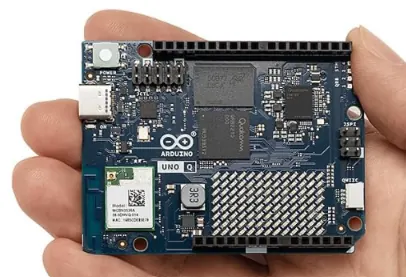
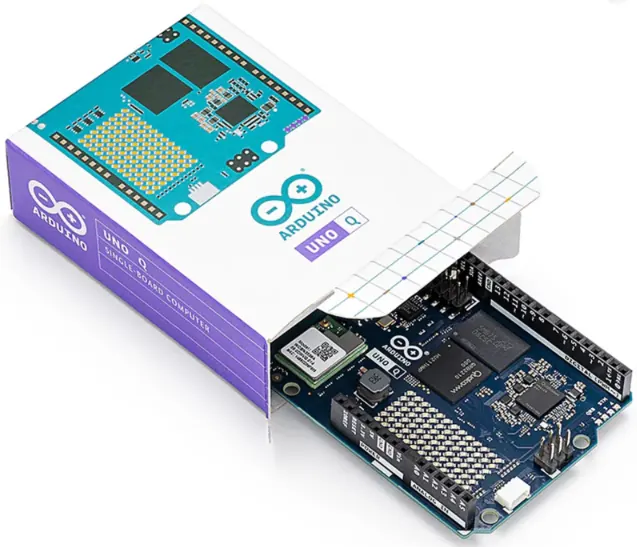
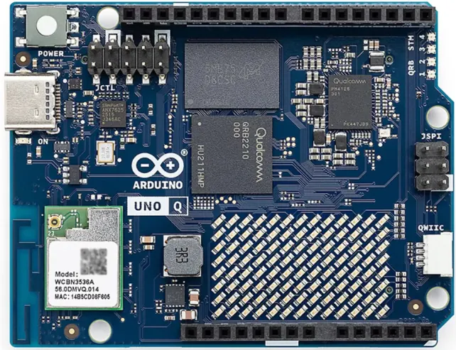
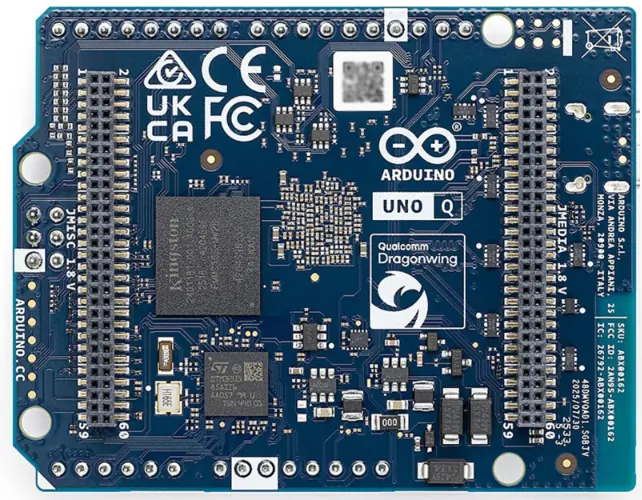

The **Arduino UNO Q** is not a conventional Arduino board with a faster microcontroller. It combines a Linux-capable application processor with a separate real-time microcontroller on one UNO-form-factor board. The Qualcomm Dragonwing QRB2210 runs Debian Linux and higher-level applications, while the STM32U585 handles deterministic control of sensors, actuators and other hardware.

That dual-processor design makes the UNO Q particularly interesting for **edge AI, computer vision, robotics and connected devices** that need both Linux software and low-latency hardware control.

There are two memory configurations: **2GB RAM with 16GB eMMC** and **4GB RAM with 32GB eMMC**. The processor and core board architecture are shared; memory and storage are the main differences when choosing a version.

*Arduino UNO Q retail packaging and board.*

## Is the Arduino UNO Q worth buying?

The UNO Q makes sense when a project needs more than a traditional microcontroller can comfortably provide. It can run Linux applications, Python code and containerized services while the STM32U585 continues to manage real-time I/O.

It is less compelling for a basic LED, sensor or simple automation project. A conventional Arduino, ESP32 or Raspberry Pi Pico will usually be cheaper and simpler if Linux, local AI or computer vision is not required.

**The main buying decision is 2GB versus 4GB.** Choose the 2GB model for a dedicated embedded application with a relatively focused workload. Choose 4GB if you intend to connect a monitor, keyboard and mouse, run several Linux services at once, or work with larger AI and vision workloads.

## Arduino UNO Q 2GB vs 4GB

| Feature | UNO Q 2GB | UNO Q 4GB |
|---|---|---|
| RAM | 2GB LPDDR4 | 4GB LPDDR4 |
| eMMC storage | 16GB | 32GB |
| MPU | Qualcomm Dragonwing QRB2210 | Qualcomm Dragonwing QRB2210 |
| MCU | STM32U585 | STM32U585 |
| Linux | Debian | Debian |
| Best suited to | Dedicated embedded applications, IoT gateways and lighter AI workloads | Standalone SBC use, multitasking and larger AI/vision workloads |

The 4GB version is the safer choice if you want to use the UNO Q as a small Linux computer with a display, keyboard and mouse. Arduino recommends the 4GB configuration for standalone use. The 2GB version remains suitable for focused applications where memory use is controlled.

The variants do not have different processor models: both use the QRB2210 and STM32U585. The extra RAM and eMMC capacity are what distinguish the 4GB model.

## Arduino UNO Q specifications

| Specification | Details |
|---|---|
| Main processor (MPU) | Qualcomm Dragonwing QRB2210 |
| MPU CPU | Quad-core Arm Cortex-A53, up to 2.0GHz |
| GPU | Adreno 3D graphics accelerator |
| Microcontroller (MCU) | STM32U585, Arm Cortex-M33 up to 160MHz |
| MCU memory | 2MB Flash and 786KB SRAM |
| RAM | 2GB or 4GB LPDDR4 |
| Storage | 16GB or 32GB eMMC |
| Wireless | Wi-Fi 5 dual-band 2.4/5GHz and Bluetooth 5.1 |
| USB | USB-C with host/device role switching and DisplayPort video output |
| Power via USB-C | 5V, up to 3A |
| VIN | 7–24V |
| Interfaces | I²C/I3C, SPI, PWM, CAN, UART, PSSI, GPIO, JTAG and ADC |
| Display connections | DisplayPort over USB-C; MIPI DSI signals on JMEDIA |
| LEDs | Four user-controllable RGB LEDs and an 8×13 blue LED matrix |
| Expansion | 3.3V Qwiic I²C connector |
| Audio | Microphone input, headphone output and line output on JMISC |
| Operating systems | Debian Linux on MPU; Arduino Core on Zephyr OS on MCU |
| Containers | Docker and Docker Compose |
| Dimensions | 68.85 × 53.34mm |

Specifications are based on Arduino's official product documentation and datasheet. Connector functions and signal voltage domains are not interchangeable: consult the datasheet before connecting external hardware.

## Arduino UNO Q board views

The component side and the reverse side show the board layout, connectors and expansion headers.

## How the Arduino UNO Q dual-brain architecture works

The UNO Q divides work between two processors.

### Qualcomm Dragonwing QRB2210: Linux and high-level computing

The quad-core Cortex-A53 processor runs Debian Linux. It is responsible for workloads such as Python applications, networking, data processing, computer vision and AI inference. The integrated Adreno GPU and image signal processors support multimedia and vision-oriented applications.

### STM32U585: real-time hardware control

The STM32U585 is a separate Cortex-M33 microcontroller running Arduino Core on Zephyr OS. It handles the hardware-facing side of a project: reading sensors, controlling outputs and managing time-sensitive operations.

This separation is the central advantage of the UNO Q. Linux can handle complex applications without forcing time-critical control to run as an ordinary Linux process.

## AI, computer vision and robotics

The QRB2210 makes the UNO Q more suitable for edge-computing projects than a traditional Arduino MCU board. Possible applications include:

- **Computer vision:** image classification, object detection and camera-based inspection.
- **Smart devices:** local processing of sensor data and connected automation.
- **Robotics:** Linux-based planning and vision alongside MCU-based motor and sensor control.
- **Industrial IoT:** local data aggregation, gateways and containerized services.
- **Interactive systems:** combine Python applications, camera input, displays and physical controls.

Actual performance depends on the model, camera, software stack and memory available. Do not assume every AI model will run efficiently just because the board includes a Qualcomm processor.

## Debian Linux, Python and Arduino App Lab

The MPU runs Debian Linux, while the STM32U585 runs Arduino Core on Zephyr OS. This allows a project to combine Linux tools and Python with conventional Arduino sketches.

Arduino App Lab is designed to bring these parts together. It provides a workflow for working with Arduino code, Python and prebuilt application components called Bricks. Docker and Docker Compose support also make it possible to package Linux-side services in containers.

For development, start with the [official UNO Q documentation](https://docs.arduino.cc/hardware/uno-q/) and the [Arduino App Lab documentation](https://docs.arduino.cc/software/app-lab/).

## Power, USB-C and display output

The board can be powered through USB-C at 5V, up to 3A, or through its VIN input, specified for 7–24V. USB-C also supports host/device role switching and DisplayPort video output.

For standalone use with a monitor, keyboard and mouse, use a USB-C hub or dongle that supports both video output and USB Power Delivery. Check that the adapter and power supply can provide the required power; a basic USB-C hub without suitable power delivery may not be sufficient.

The board also exposes MIPI DSI signals through the JMEDIA header. This is not the same connection as the DisplayPort output over USB-C.

## Arduino UNO Q compatibility and expansion

The UNO Q keeps the familiar UNO board outline, measuring 68.85 × 53.34mm. However, the presence of a familiar form factor should not be treated as a guarantee that every older shield is electrically or mechanically compatible.

Pay particular attention to the different voltage domains exposed by the board. The STM32 side provides 3.3V-oriented interfaces, while some Qualcomm MPU signals exposed on dedicated connectors operate at 1.8V. Check the pinout and datasheet before wiring peripherals or connecting a shield.

The Qwiic connector provides a convenient 3.3V I²C expansion option for compatible sensors and modules.

## Arduino UNO Q price and where to buy

The UNO Q is sold in 2GB and 4GB configurations. The live price can vary by country, seller, shipping and stock. Use the retailer links below to check the current price and confirm which memory version is included.

  <a class="en-buy-button preferred" href="https://s.click.aliexpress.com/e/_c3w4434P" target="_blank" rel="nofollow sponsored noopener">
    <i class="fas fa-cart-shopping"></i>
    <strong>Check Arduino UNO Q on AliExpress</strong><small>Check 2GB / 4GB option, seller and delivery</small>
    <i class="fas fa-chevron-right"></i>
  </a>
  <a class="en-buy-button" href="https://link.amazon/B05l32CeC" target="_blank" rel="nofollow sponsored noopener">
    <i class="fab fa-amazon"></i>
    <strong>Check Arduino UNO Q on Amazon</strong><small>Confirm memory version and seller</small>
    <i class="fas fa-chevron-right"></i>
  </a>

You can also compare the configurations on the [official Arduino UNO Q product page](https://store.arduino.cc/products/uno-q). Check the final delivered price, selected RAM/storage option and included accessories before ordering.

As an affiliate, Embedded Nerd may earn a commission from qualifying purchases at no extra cost to you.

## Arduino UNO Q vs Arduino UNO R4 WiFi

These boards target different types of projects. The UNO R4 WiFi is a conventional microcontroller development board. The UNO Q adds a Linux-capable application processor and much more system memory.

| Feature | Arduino UNO Q | Arduino UNO R4 WiFi |
|---|---|---|
| Main architecture | Qualcomm MPU + STM32 MCU | Renesas RA4M1 MCU |
| Linux | Debian Linux | No Linux MPU |
| Programming | Python, Arduino sketches and Linux applications | Arduino sketches |
| AI and computer vision | Designed for edge workloads | Not its primary purpose |
| Best fit | Linux, edge AI, robotics and high-level applications | Traditional embedded control, learning and connected MCU projects |

Choose the UNO R4 WiFi for conventional microcontroller projects. Choose the UNO Q when you need Linux and a real-time microcontroller on the same board.

## Frequently asked questions

### What is the Arduino UNO Q?

The Arduino UNO Q is a hybrid development board that combines a Qualcomm Dragonwing QRB2210 application processor with an STM32U585 microcontroller. It can run Debian Linux and high-level applications while the STM32 handles real-time hardware control.

### What is the difference between Arduino UNO Q 2GB and 4GB?

The 2GB version has 2GB LPDDR4 RAM and 16GB eMMC storage. The 4GB version doubles these capacities to 4GB RAM and 32GB eMMC. Both use the same QRB2210 processor and STM32U585 microcontroller.

### How much does the Arduino UNO Q cost?

The price depends on the 2GB or 4GB version, retailer, country, shipping and stock. Check the current AliExpress and Amazon offers above, and compare them with the official Arduino store before buying.

### Does Arduino UNO Q run Linux?

Yes. The Qualcomm Dragonwing QRB2210 runs Debian Linux. The separate STM32U585 microcontroller runs Arduino Core on Zephyr OS.

### Can I program Arduino UNO Q with Python?

Yes. Python applications can run on the Debian Linux side of the board. The STM32 microcontroller can run Arduino sketches, allowing Python and Arduino code to work together in a single project.

### Can Arduino UNO Q run Docker?

Yes. Arduino lists Docker and Docker Compose support for the Linux side of the UNO Q.

### Is Arduino UNO Q suitable for AI?

It is designed for edge AI and computer-vision applications. The suitability of a particular model depends on its size, memory requirements, framework support and performance needs. The 4GB version is preferable for larger models and heavier multitasking.

### Can Arduino UNO Q be used as a standalone computer?

Yes. It can connect to a monitor, keyboard and mouse through a USB-C hub or dongle with video output and Power Delivery. The 4GB version is the better choice for this use case.

### Does Arduino UNO Q support Wi-Fi and Bluetooth?

Yes. It includes dual-band Wi-Fi 5 at 2.4GHz and 5GHz, plus Bluetooth 5.1.

### Is Arduino UNO Q compatible with Arduino UNO shields?

It retains the UNO form factor, but physical fit does not guarantee electrical compatibility. Check the shield's voltage requirements, pin use and the UNO Q connector documentation before connecting it.

## Explore more development boards

- [Arduino Nano ESP32](/products/arduino-nano-esp32/) — a compact wireless microcontroller board.
- [ESP32 DevKit](/products/esp32-devkit/) — a simpler and lower-cost platform for many Wi-Fi and Bluetooth projects.
- [Raspberry Pi Pico](/products/raspberry-pi-pico/) — a microcontroller alternative for embedded projects.
- [Development Boards](/products/development-boards/) — browse more boards for embedded development.
