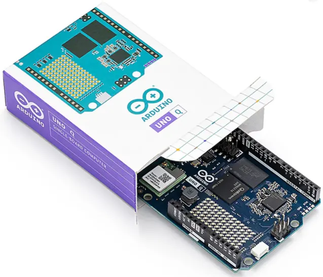

**Arduino UNO Q** nie jest zwykłą płytką Arduino z szybszym mikrokontrolerem. Łączy procesor aplikacyjny obsługujący Linux z oddzielnym mikrokontrolerem czasu rzeczywistego na płytce w formacie UNO. Qualcomm Dragonwing QRB2210 uruchamia Debian Linux i aplikacje wyższego poziomu, natomiast STM32U585 odpowiada za deterministyczne sterowanie czujnikami, elementami wykonawczymi i pozostałym sprzętem.

Dzięki architekturze dwóch procesorów UNO Q jest szczególnie interesująca dla **edge AI, wizji komputerowej, robotyki i urządzeń sieciowych**, które wymagają zarówno oprogramowania Linux, jak i sterowania sprzętem o niskich opóźnieniach.

Dostępne są dwie konfiguracje pamięci: **2GB RAM i 16GB eMMC** oraz **4GB RAM i 32GB eMMC**. Procesor i podstawowa architektura płytki są takie same; główne różnice dotyczą pamięci RAM i przestrzeni na dane.

*Arduino UNO Q wraz z opakowaniem detalicznym.*

## Czy warto kupić Arduino UNO Q?

UNO Q ma sens, gdy projekt wymaga więcej, niż może wygodnie zapewnić tradycyjny mikrokontroler. Może uruchamiać aplikacje Linux, kod Python i usługi w kontenerach, podczas gdy STM32U585 nadal obsługuje wejścia i wyjścia czasu rzeczywistego.

Jest mniej atrakcyjna do prostych projektów z diodą LED, czujnikiem lub podstawową automatyką. Jeśli Linux, lokalna AI i wizja komputerowa nie są potrzebne, klasyczne Arduino, ESP32 lub Raspberry Pi Pico będą zazwyczaj tańsze i prostsze.

**Najważniejszy wybór przy zakupie to 2GB czy 4GB.** Wersję 2GB wybierz do dedykowanej aplikacji embedded o stosunkowo niewielkim obciążeniu. Wybierz 4GB, jeśli planujesz podłączyć monitor, klawiaturę i mysz, uruchamiać kilka usług Linux jednocześnie lub korzystać z większych modeli AI i zadań wizyjnych.

## Arduino UNO Q 2GB czy 4GB

| Cecha | UNO Q 2GB | UNO Q 4GB |
|---|---|---|
| RAM | 2GB LPDDR4 | 4GB LPDDR4 |
| Pamięć eMMC | 16GB | 32GB |
| MPU | Qualcomm Dragonwing QRB2210 | Qualcomm Dragonwing QRB2210 |
| MCU | STM32U585 | STM32U585 |
| Linux | Debian | Debian |
| Najlepsze zastosowanie | Dedykowane aplikacje embedded, bramki IoT i lżejsze zadania AI | Samodzielna praca jako SBC, wielozadaniowość i większe zadania AI/wizyjne |

Wersja 4GB jest bezpieczniejszym wyborem, jeśli chcesz używać UNO Q jako małego komputera Linux z monitorem, klawiaturą i myszą. Arduino zaleca konfigurację 4GB do samodzielnej pracy. Wersja 2GB nadal nadaje się do wyspecjalizowanych zastosowań, w których zużycie pamięci jest kontrolowane.

Warianty nie mają różnych procesorów: oba wykorzystują QRB2210 i STM32U585. Model 4GB wyróżnia dodatkowa pamięć RAM i większa pojemność eMMC.

## Specyfikacja Arduino UNO Q

Pełne dane techniczne zostały już zebrane w panelu specyfikacji powyżej. Aby nie powielać tej samej tabeli, skorzystaj z [oficjalnej karty katalogowej Arduino UNO Q](https://docs.arduino.cc/resources/datasheets/ABX00162-datasheet.pdf), która zawiera szczegóły złączy i informacje elektryczne zależne od rewizji. Funkcje złączy i domeny napięciowe sygnałów nie są zamienne: przed podłączeniem zewnętrznego sprzętu sprawdź kartę katalogową.

## Widoki płytki Arduino UNO Q

Strona z komponentami i spód płytki pokazują jej układ, złącza oraz listwy rozszerzeń.

## Pinout Arduino UNO Q

UNO Q udostępnia oddzielne połączenia dla MCU i MPU. Główne wejścia i wyjścia dla projektów maker znajdują się na listwach po stronie MCU; osobne złącza przenoszą również sygnały sterujące procesorem, kamery i wyświetlacza.

| Złącze | Dostępne sygnały | Ważna informacja |
|---|---|---|
| JDIGITAL | Piny cyfrowe D0–D21 i funkcje alternatywne, m.in. UART, I²C, SPI, PWM i CAN | I/O MCU, logika 3,3V |
| JANALOG | Wejścia analogowe A0–A5 i funkcje alternatywne | A0 i A1 **nie są odporne na 5V** |
| Qwiic | GND, 3,3V, SDA i SCL | I²C4 w STM32U585 |
| JSPI | MISO, SCK, MOSI, RESET, 5V i GND | Sygnały SPI2 mają 3,3V |
| JCTL | Sygnały boot, reset, wake i konsoli | Domena MPU 1,8V; nie są to ogólne wejścia/wyjścia 3,3V |
| JMEDIA | Linie MIPI kamery/wyświetlacza i powiązane sygnały | Sygnały wysokiej szybkości 1,8V; nie są to ogólne GPIO |
| JMISC | Mieszane funkcje MCU i MPU, w tym PSSI, I²C, audio i zasilanie | Mieszane domeny MCU 3,3V i MPU 1,8V |

Diagram pinoutu mapuje numery pinów Arduino na piny STM32U585 i funkcje peryferyjne. Sprawdź go przed podłączeniem modułu: **nie podawaj 5V na A0/A1 ani sygnałów 3,3V na złącza MPU 1,8V.** Linie MIPI JMEDIA nie są GPIO.

- [Pobierz oficjalny PDF pełnego pinoutu Arduino UNO Q](https://docs.arduino.cc/resources/pinouts/ABX00162-full-pinout.pdf)
- [Otwórz oficjalną kartę katalogową Arduino UNO Q](https://docs.arduino.cc/resources/datasheets/ABX00162-datasheet.pdf)

## Jak działa architektura dwóch procesorów

UNO Q rozdziela zadania pomiędzy dwa procesory.

### Qualcomm Dragonwing QRB2210: Linux i obliczenia wyższego poziomu

Czterordzeniowy procesor Cortex-A53 uruchamia Debian Linux. Odpowiada za aplikacje Python, sieć, przetwarzanie danych, wizję komputerową i wnioskowanie AI. Zintegrowany układ graficzny Adreno i procesory obrazu wspierają multimedia oraz zastosowania wizyjne.

### STM32U585: sterowanie sprzętem w czasie rzeczywistym

STM32U585 to oddzielny mikrokontroler Cortex-M33 uruchamiający Arduino Core na Zephyr OS. Obsługuje sprzętową część projektu: odczyt czujników, sterowanie wyjściami i operacje wrażliwe na czas.

To rozdzielenie jest główną zaletą UNO Q. Linux może obsługiwać złożone aplikacje bez konieczności wykonywania krytycznego sterowania czasu rzeczywistego jako zwykłego procesu Linux.

## AI, wizja komputerowa i robotyka

QRB2210 sprawia, że UNO Q lepiej nadaje się do projektów edge computing niż tradycyjna płytka Arduino z MCU. Możliwe zastosowania obejmują:

- **Wizję komputerową:** klasyfikację obrazów, wykrywanie obiektów i inspekcję z użyciem kamery.
- **Inteligentne urządzenia:** lokalne przetwarzanie danych z czujników i automatykę sieciową.
- **Robotykę:** planowanie i wizję w Linuxie połączone ze sterowaniem silnikami i czujnikami przez MCU.
- **Przemysłowe IoT:** lokalną agregację danych, bramki i usługi w kontenerach.
- **Systemy interaktywne:** połączenie aplikacji Python, obrazu z kamery, wyświetlaczy i fizycznych elementów sterujących.

Rzeczywista wydajność zależy od modelu, kamery, stosu oprogramowania i dostępnej pamięci. Sam procesor Qualcomm nie oznacza, że każdy model AI będzie działać wydajnie.

## Debian Linux, Python i Arduino App Lab

MPU uruchamia Debian Linux, a STM32U585 korzysta z Arduino Core na Zephyr OS. Dzięki temu projekt może łączyć narzędzia Linux i Python z tradycyjnymi szkicami Arduino.

Arduino App Lab ma łączyć te elementy. Zapewnia środowisko pracy z kodem Arduino, Pythonem i gotowymi komponentami aplikacji nazywanymi Bricks. Obsługa Docker i Docker Compose pozwala również pakować usługi po stronie Linux w kontenery.

Na początek skorzystaj z [oficjalnej dokumentacji UNO Q](https://docs.arduino.cc/hardware/uno-q/) oraz [dokumentacji Arduino App Lab](https://docs.arduino.cc/software/app-lab/).

## Zasilanie, USB-C i wyjście obrazu

Płytkę można zasilać przez USB-C napięciem 5V i prądem do 3A albo przez wejście VIN o zakresie 7–24V. USB-C obsługuje także przełączanie ról host/urządzenie oraz wyjście wideo DisplayPort.

Do samodzielnej pracy z monitorem, klawiaturą i myszą potrzebny będzie hub lub adapter USB-C obsługujący zarówno wyjście wideo, jak i USB Power Delivery. Sprawdź, czy adapter i zasilacz zapewniają wymaganą moc; podstawowy hub USB-C bez odpowiedniego zasilania może nie wystarczyć.

Płytka udostępnia również sygnały MIPI DSI na złączu JMEDIA. To inne połączenie niż wyjście DisplayPort przez USB-C.

## Akcesoria do Arduino UNO Q

UNO Q ma tylko jeden port USB-C, dlatego kilka akcesoriów ułatwia samodzielną pracę i rozbudowę sprzętową.

- **Hub USB-C z wyjściem wideo i Power Delivery:** potrzebny do pracy z monitorem, klawiaturą i myszą. Wybierz hub, który wyraźnie obsługuje wideo i przekazywanie zasilania PD. [Sprawdź huby USB-C na Amazon](https://www.amazon.com/s?k=USB-C+hub+HDMI+Power+Delivery&tag=embeddednerd2-20){:target="_blank" rel="nofollow sponsored noopener"}
- **Zasilacz USB-C 5V / 3A:** płytka jest przystosowana do maksymalnie 5V / 3A przez USB-C. Sprawdź, czy zasilacz i przewód zapewniają wymaganą moc. [Sprawdź zasilacze USB-C na Amazon](https://www.amazon.com/s?k=USB-C+power+supply+5V+3A&tag=embeddednerd2-20){:target="_blank" rel="nofollow sponsored noopener"}
- **Przewody i czujniki Qwiic:** złącze Qwiic 3,3V umożliwia bezlutowe rozszerzenie I²C z kompatybilnymi modułami. [Sprawdź czujniki Qwiic na Amazon](https://www.amazon.com/s?k=Qwiic+sensors+cables&tag=embeddednerd2-20){:target="_blank" rel="nofollow sponsored noopener"}

Jako serwis afiliacyjny Embedded Nerd może otrzymać prowizję od kwalifikujących się zakupów bez dodatkowych kosztów dla Ciebie.

## Kompatybilność i rozbudowa

UNO Q zachowuje znany obrys płytki UNO i ma wymiary 68,85 × 53,34mm. Znany format nie gwarantuje jednak, że każda starsza nakładka będzie kompatybilna elektrycznie i mechanicznie.

Zwróć szczególną uwagę na różne domeny napięciowe płytki. Interfejsy po stronie STM32 są przeznaczone dla 3,3V, natomiast niektóre sygnały Qualcomm MPU dostępne na dedykowanych złączach działają przy 1,8V. Przed podłączeniem urządzeń peryferyjnych lub nakładki sprawdź pinout i kartę katalogową.

Złącze Qwiic zapewnia wygodną możliwość rozszerzenia I²C 3,3V dla kompatybilnych czujników i modułów.

## Cena Arduino UNO Q i gdzie kupić

UNO Q jest sprzedawana w konfiguracjach 2GB i 4GB. Aktualna cena może zależeć od kraju, sprzedawcy, wysyłki i dostępności. Skorzystaj z poniższych odnośników, aby sprawdzić bieżącą cenę i potwierdzić, którą wersję pamięci obejmuje oferta.

  <a class="en-buy-button preferred" href="https://link.amazon/B05l32CeC" target="_blank" rel="nofollow sponsored noopener">
    <i class="fab fa-amazon"></i>
    <strong>Sprawdź Arduino UNO Q na Amazon</strong><small>Sprawdź wersję 2GB / 4GB i dostawę</small>
    <i class="fas fa-chevron-right"></i>
  </a>
  <a class="en-buy-button" href="https://s.click.aliexpress.com/e/_c3w4434P" target="_blank" rel="nofollow sponsored noopener">
    <i class="fas fa-cart-shopping"></i>
    <strong>Sprawdź Arduino UNO Q na AliExpress</strong><small>Sprawdź sprzedawcę, pamięć i dostawę</small>
    <i class="fas fa-chevron-right"></i>
  </a>

Oficjalny sklep Arduino podaje obecnie cenę UNO Q 2GB na poziomie **59,90€**, a wersji 4GB — **82,90€** (ceny sprawdzone **11 listopada 2026 r.**). [Porównaj obie konfiguracje w oficjalnym sklepie Arduino UNO Q](https://store.arduino.cc/pages/uno-q). Ceny u sprzedawców, koszty wysyłki i dostępność mogą się różnić.

Jako serwis afiliacyjny Embedded Nerd może otrzymać prowizję od kwalifikujących się zakupów bez dodatkowych kosztów dla Ciebie.

## Arduino UNO Q a Raspberry Pi

Porównanie zależy od tego, o którym Raspberry Pi mówimy. W tym przypadku Raspberry Pi oznacza komputer jednopłytkowy z Linuxem, taki jak Raspberry Pi 4 lub Raspberry Pi 5, a nie Pico, które jest płytką mikrokontrolerową.

| Cecha | Arduino UNO Q | Raspberry Pi 4 / 5 |
|---|---|---|
| Główna rola | Hybrydowy komputer Linux i platforma mikrokontrolerowa | Uniwersalny komputer jednopłytkowy z Linuxem |
| System operacyjny | Debian Linux na QRB2210 | Raspberry Pi OS i inne dystrybucje Linux |
| Sterowanie sprzętem w czasie rzeczywistym | Dedykowany STM32U585 z Zephyr/Arduino Core | Zwykle programowa obsługa GPIO lub zewnętrzny mikrokontroler |
| Format | Format Arduino UNO | Format SBC Raspberry Pi |
| Rozbudowa sprzętowa | Listwy MCU typu UNO, Qwiic i dedykowane złącza MPU | 40-pinowe GPIO i złącza zależne od modelu |
| Najlepsze zastosowanie | Projekty łączące Linux, AI/wizję i bezpośrednie I/O czasu rzeczywistego | Linux desktop, serwery, sieć i uniwersalne zadania komputerowe |

Wybierz **Arduino UNO Q**, jeśli chcesz mieć Linux i dedykowany mikrokontroler na jednej płytce, szczególnie w projektach łączących zaawansowane przetwarzanie ze sterowaniem czujnikami lub elementami wykonawczymi w czasie rzeczywistym.

Wybierz **Raspberry Pi 4 lub 5**, jeśli priorytetem jest uniwersalny komputer Linux, środowisko graficzne, serwer domowy lub szerszy ekosystem oprogramowania Raspberry Pi. Praktyczne projekty serwerów Linux opisujemy w naszym [przewodniku po projektach IT z Raspberry Pi](/raspberry-pi-it-projects/).

## Arduino UNO Q a Arduino UNO R4 WiFi

Te płytki są przeznaczone do różnych typów projektów. UNO R4 WiFi to tradycyjna płytka deweloperska z mikrokontrolerem. UNO Q dodaje procesor aplikacyjny obsługujący Linux i znacznie więcej pamięci systemowej.

| Cecha | Arduino UNO Q | Arduino UNO R4 WiFi |
|---|---|---|
| Architektura | Qualcomm MPU + STM32 MCU | Renesas RA4M1 MCU |
| Linux | Debian Linux | Brak MPU z Linuxem |
| Programowanie | Python, szkice Arduino i aplikacje Linux | Szkice Arduino |
| AI i wizja komputerowa | Zaprojektowana do zadań edge | Nie jest to jej główne przeznaczenie |
| Najlepsze zastosowanie | Linux, edge AI, robotyka i zaawansowane aplikacje | Tradycyjne sterowanie embedded, nauka i projekty MCU z łącznością |

Wybierz UNO R4 WiFi do klasycznych projektów mikrokontrolerowych. Wybierz UNO Q, gdy potrzebujesz Linuxa i mikrokontrolera czasu rzeczywistego na jednej płytce.

## Najczęściej zadawane pytania

### Czy Arduino UNO Q jest lepsza od Raspberry Pi?

Żadna z tych platform nie jest uniwersalnie lepsza. Arduino UNO Q łączy Debian Linux z dedykowanym mikrokontrolerem STM32U585, dlatego sprawdza się, gdy projekt wymaga aplikacji Linux i sterowania sprzętem w czasie rzeczywistym na jednej płytce. Raspberry Pi 4 lub 5 to bardziej uniwersalny komputer Linux, często lepszy do pracy biurkowej, serwerów domowych i typowych projektów SBC. Raspberry Pi Pico należy do innej kategorii: to płytka mikrokontrolerowa, a nie komputer Linux.

### Czym jest Arduino UNO Q?

Arduino UNO Q to hybrydowa płytka deweloperska łącząca procesor aplikacyjny Qualcomm Dragonwing QRB2210 z mikrokontrolerem STM32U585. Może uruchamiać Debian Linux i aplikacje wyższego poziomu, podczas gdy STM32 odpowiada za sterowanie sprzętem w czasie rzeczywistym.

### Jaka jest różnica między Arduino UNO Q 2GB i 4GB?

Wersja 2GB ma 2GB pamięci LPDDR4 RAM i 16GB pamięci eMMC. Wersja 4GB podwaja te wartości do 4GB RAM i 32GB eMMC. Obie wykorzystują ten sam procesor QRB2210 i mikrokontroler STM32U585.

### Ile kosztuje Arduino UNO Q?

W oficjalnym sklepie Arduino model UNO Q 2GB jest wyceniony na **59,90€**, a wersja 4GB na **82,90€** (ceny sprawdzone **11 listopada 2026 r.**). Ceny mogą zależeć od kraju, podatków, wysyłki i dostępności. Potwierdź końcową kwotę na [oficjalnej stronie sklepu Arduino UNO Q](https://store.arduino.cc/pages/uno-q).

### Gdzie kupić Arduino UNO Q?

Możesz porównać oferty w sekcji [cena i gdzie kupić](#cena-arduino-uno-q-i-gdzie-kupic) albo sprawdzić obie konfiguracje bezpośrednio w [oficjalnym sklepie Arduino](https://store.arduino.cc/pages/uno-q).

### Czy Arduino UNO Q uruchamia Linux?

Tak. Qualcomm Dragonwing QRB2210 uruchamia Debian Linux. Oddzielny mikrokontroler STM32U585 korzysta z Arduino Core na Zephyr OS.

### Czy mogę programować Arduino UNO Q w Pythonie?

Tak. Aplikacje Python mogą działać po stronie Debian Linux. Mikrokontroler STM32 może uruchamiać szkice Arduino, dzięki czemu Python i Arduino mogą współpracować w jednym projekcie.

### Czy Arduino UNO Q obsługuje Docker?

Tak. Arduino podaje obsługę Docker i Docker Compose po stronie Linux w UNO Q.

### Czy Arduino UNO Q nadaje się do AI?

Płytka została zaprojektowana z myślą o edge AI i wizji komputerowej. Przydatność konkretnego modelu zależy od jego rozmiaru, wymagań pamięciowych, obsługi frameworków i oczekiwanej wydajności. Wersja 4GB jest lepsza do większych modeli i intensywnej wielozadaniowości.

### Czy Arduino UNO Q może działać jako samodzielny komputer?

Tak. Monitor, klawiaturę i mysz można podłączyć przez hub lub adapter USB-C z wyjściem wideo i Power Delivery. Do takiego zastosowania lepsza będzie wersja 4GB.

### Czy Arduino UNO Q obsługuje Wi-Fi i Bluetooth?

Tak. Płytka ma dwupasmowe Wi-Fi 5 w pasmach 2,4GHz i 5GHz oraz Bluetooth 5.1.

### Czy Arduino UNO Q jest zgodna z nakładkami Arduino UNO?

Zachowuje format UNO, ale fizyczne dopasowanie nie gwarantuje zgodności elektrycznej. Przed podłączeniem nakładki sprawdź wymagania napięciowe, wykorzystanie pinów i dokumentację złączy.

## Poznaj więcej płytek deweloperskich

- [Arduino Nano ESP32](/products/arduino-nano-esp32/) — kompaktowa bezprzewodowa płytka mikrokontrolerowa.
- [Arduino UNO Q](/products/arduino-uno-q/) — Linux, edge AI i sterowanie czasu rzeczywistego na jednej płytce.
- [ESP32 DevKit](/products/esp32-devkit/) — prostsza i tańsza platforma do wielu projektów Wi-Fi i Bluetooth.
- [Raspberry Pi Pico](/products/raspberry-pi-pico/) — alternatywa mikrokontrolerowa do projektów embedded.
- [Płytki deweloperskie](/products/development-boards/) — zobacz więcej płytek do systemów embedded.
