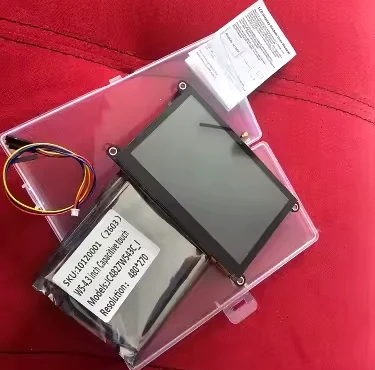
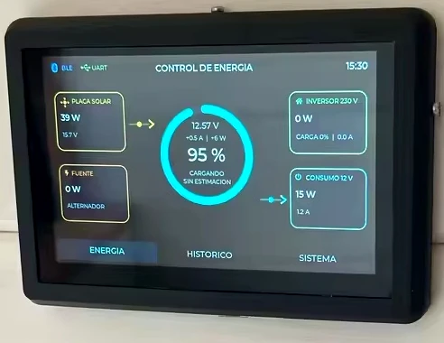
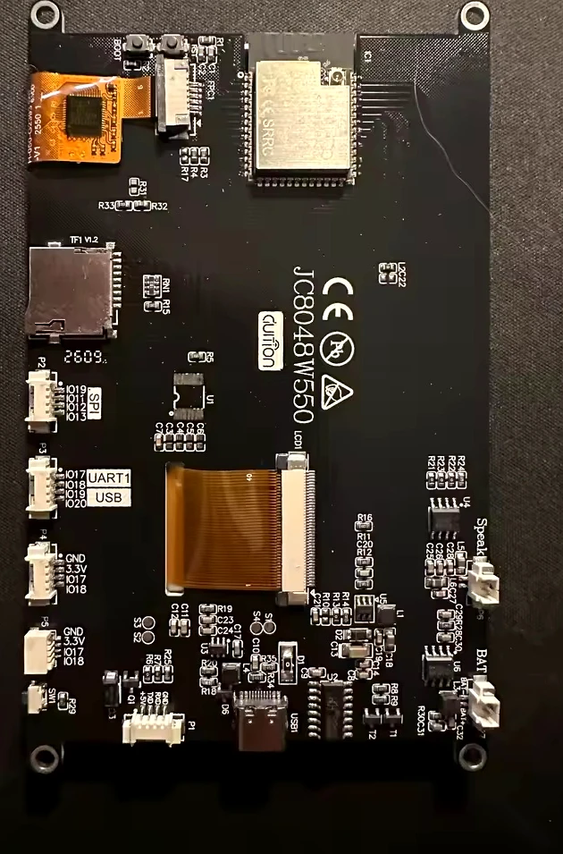
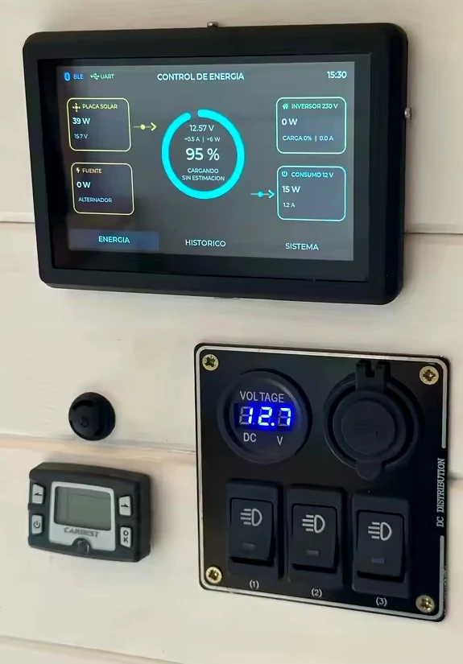

Das **Guition JC8048W550** ist ein 5-Zoll-HMI-Displaymodul mit ESP32-S3, IPS-Panel mit 800 × 480 Pixeln, 8 MB PSRAM und 16 MB Flash. Das große Querformat eignet sich für Smart-Home-Dashboards, Energiemonitore und eigene Bedienoberflächen.

Das verlinkte AliExpress-Angebot bewirbt eine Version mit kapazitivem Touch. GUITION dokumentiert drei Varianten: JC8048W550N_I (ohne Touch), JC8048W550R_I (resistiver Touch) und JC8048W550C_I (kapazitiver Touch). Prüfen Sie vor der Bestellung unbedingt das gewählte Suffix.

## Ist das Guition JC8048W550 eine gute Wahl?

Ja. Das JC8048W550 kombiniert ein 5-Zoll-IPS-Display mit 800 × 480 Pixeln und einen ESP32-S3 mit 8 MB PSRAM und 16 MB Flash. Damit ist es eine leistungsfähige Basis für größere LVGL-Dashboards und eingebettete Bedienpanels. Entscheidend beim Kauf ist die richtige Touch-Variante: N steht für keinen Touch, R für resistiven und C für kapazitiven Touch.

## Produktfotos

<div class="product-image-gallery" style="display:grid;grid-template-columns:repeat(auto-fit,minmax(180px,1fr));gap:1rem;margin:1.5rem 0;">
  <figure><figcaption>JC8048W550-Displaymodul und im Händlerangebot gezeigtes Zubehör</figcaption></figure>
  <figure><figcaption>Beispiel einer Energieüberwachungsoberfläche mit 800 × 480 Pixeln</figcaption></figure>
  <figure><figcaption>Rückseite der Platine und Anschlussstellen</figcaption></figure>
  <figure><figcaption>Beispiel einer Installation in einem Bedienpanel</figcaption></figure>
</div>

Das 5-Zoll-Format mit 800 × 480 Pixeln bietet deutlich mehr Bildschirmfläche als kompakte ESP32-Displays. Mehrere Bedienelemente, Statuskarten, Diagramme und Energiedaten lassen sich gleichzeitig darstellen.

Der ESP32-S3 sowie 8 MB PSRAM und 16 MB Flash bilden eine gute Hardwarebasis für grafisch anspruchsvolle Oberflächen. Community-Konfigurationen für ESPHome und LVGL sind verfügbar; Firmware und Pinbelegung müssen jedoch mit der jeweiligen Platinenrevision abgeglichen werden.

## Modellvarianten und Abmessungen

Die GUITION-Dokumentation nennt drei Touch-Varianten:

| Modellkennung | Touch-Konfiguration |
|---|---|
| **JC8048W550N_I** | Kein Touch (NTP) |
| **JC8048W550R_I** | Resistiver Touch (RTP) |
| **JC8048W550C_I** | Kapazitiver Touch (CTP) |

Der Hersteller gibt eine Modulgröße von **134,0 × 80,0 mm** und eine aktive Displayfläche von **108,0 × 64,8 mm** an. Die mechanische Zeichnung zeigt Befestigungslaschen an den Ecken, nennt aber keinen eindeutigen Lochabstand. Planen Sie ein Gehäuse daher nicht allein anhand der Außenmaße; beschaffen Sie die aktuelle Zeichnung oder messen Sie Ihre Platinenrevision.

## Display, Touch und Hardware

Das 5-Zoll-IPS-Panel bietet 800 × 480 Pixel und verwendet den Displaycontroller ST7262. Das Querformat eignet sich für Dashboards, HMI-Bildschirme und Überwachungsoberflächen.

Die JC8048W550-Familie ist ohne Touch, mit resistivem oder mit kapazitivem Touch erhältlich. Das Suffix kennzeichnet die Variante: **N_I** ohne Touch, **R_I** resistiv und **C_I** kapazitiv.

Auf den Platinenfotos sind ein TF-Kartensteckplatz, USB-Type-C-Anschluss, Lautsprecheranschluss, Batterieanschluss und mehrere Erweiterungsleisten zu sehen. Prüfen Sie Anschlüsse und Pinbelegung vor dem Anschluss externer Hardware anhand Ihrer konkreten Platinenrevision.

## ESP32-S3, Speicher und Konnektivität

Dokumentiert ist ein ESP32-S3-WROOM-1 mit 8 MB PSRAM und 16 MB Flash. WLAN und Bluetooth sind integriert und ermöglichen den Einsatz als vernetzte Oberfläche für IoT- und Smart-Home-Projekte.

PSRAM ist bei einem RGB-Display mit 800 × 480 Pixeln besonders nützlich, da Framebuffer und Grafikressourcen mehr Speicher benötigen können als bei kleinen SPI-Displays.

## ESPHome und LVGL

Für das JC8048W550 gibt es eine ESPHome-Konfiguration aus der Community. Die veröffentlichte YAML-Datei nennt den ESP32-S3, 16 MB Flash, ein RGB-Display mit 800 × 480 Pixeln, den Touchcontroller GT911 und die I²C-Pins. Dies ist ein anhand der Quelle nachvollziehbares Beispiel, wurde von Embedded Nerd jedoch nicht getestet.

Ein kurzer Auszug aus der veröffentlichten Konfiguration:

```yaml
esp32:
  variant: esp32s3
  flash_size: 16MB

display:
  - platform: mipi_rgb
    dimensions:
      width: 800
      height: 480

touchscreen:
  - platform: gt911
    i2c_id: bus_a

# I²C: SDA GPIO19, SCL GPIO20
```

- [ESPHome-YAML-Konfiguration aus der Community](https://github.com/agillis/esphome-modular-lvgl-buttons/blob/main/hardware/guition-esp32-jc8048w550.yaml)
- [GUITION-Herstellerinformationen](https://www.guition.com/esp32-display-module/5-inch-esp32s3-display-module)
- [Guition-Boards im ESP Component Registry](https://components.espressif.com/components/guition/guition_boards/versions/0.2.0/readme?language=en)

Verwenden Sie diese Community-YAML-Datei als Ausgangspunkt und nicht als garantiert sofort einsetzbare Konfiguration. Das Repository verlangt derzeit ESPHome 2026.7.0 oder neuer. Prüfen Sie Pinbelegung, Display-Timing und Touchcontroller vor dem Flashen anhand Ihrer Platine. Hintergrundinformationen finden Sie im [Leitfaden zu ESP32-Touchscreen-Displays](/de/esp32-touchscreen-displays-guide/).

## Für wen eignet sich dieses Display?

**Gut geeignet für:**
- Home-Assistant-Dashboards mit mehreren Bedienelementen und Datenfeldern
- Energieüberwachung mit Diagrammen und Messanzeigen
- Eigene LVGL-HMI-Projekte, die von einem 5-Zoll-Querformat profitieren
- Entwickler, die RGB-Display-Timing, GPIO-Belegung und Touch-Treiber prüfen können

**Weniger geeignet, wenn:**
- Sie vor dem Vermessen der Platine einen dokumentierten Lochabstand für ein Gehäuse benötigen
- Sie ein einfaches SPI-Display mit wenig Verkabelungs- und Konfigurationsaufwand suchen
- Sie ein vollständig getestetes, sofort flashbares ESPHome-Paket von Embedded Nerd erwarten
- Sie kein 5-Zoll-Display benötigen und ein kleineres, günstigeres Modul bevorzugen

## Was lässt sich damit bauen?

- **Energiemonitoring:** Solarerzeugung, Ladezustand des Akkus, Wechselrichterleistung und Haushaltsverbrauch.
- **Home-Assistant-Dashboards:** Raumsteuerung, Sensoren, Beleuchtung und Klimadaten.
- **IoT-Bedienpanels:** Statusanzeigen, Gerätesteuerung und lokale Einstellungsmenüs.
- **LVGL-Oberflächen:** Grafische Menüs, Diagramme, Messanzeigen und Touch-Steuerungen.

Die in den Produktfotos gezeigte Energieüberwachungsinstallation veranschaulicht, welche Oberfläche von einem 5-Zoll-Display mit 800 × 480 Pixeln profitieren kann. Sie bedeutet nicht, dass die Platine die Firmware enthält oder für dieses System vorkonfiguriert ist.

## Kaufhinweise

Prüfen Sie vor der Bestellung die ausgewählte Variante:

1. Bestätigen Sie **5 Zoll, 800 × 480 Pixel und kapazitiven Touch (CTP)**.
2. Prüfen Sie, ob nur das Displaymodul oder auch Kabel, Gehäuse, Lautsprecher und weiteres Zubehör enthalten sind.
3. Klären Sie Platinenrevision sowie Anschlüsse und Pinbelegung, bevor Sie ein Gehäuse konstruieren oder Peripherie anschließen.
4. Prüfen Sie Preis, Versand und Lieferbedingungen des Händlers.

Die Kaufschaltfläche oben öffnet das verlinkte AliExpress-Angebot. Wenn Sie Touch-Eingabe benötigen, wählen Sie **JC8048W550C_I / kapazitiver Touch** und kontrollieren Sie Lieferumfang, Versand und Endpreis an der Kasse.

## Häufig gestellte Fragen

### Verwendet das Guition JC8048W550 einen ESP32-S3?
Ja. Die Herstellerdokumentation beschreibt eine Platine auf Basis des ESP32-S3-WROOM-1 mit Dual-Core-Prozessor, WLAN und Bluetooth.

### Welche Auflösung hat das Display?
Das Display ist 5 Zoll groß und hat eine Auflösung von 800 × 480 Pixeln.

### Welche Touch-Varianten gibt es?
GUITION führt JC8048W550N_I (ohne Touch), JC8048W550R_I (resistiv) und JC8048W550C_I (kapazitiv).

### Wie viel Speicher ist vorhanden?
Die angegebene Konfiguration bietet 8 MB PSRAM und 16 MB Flash.

### Kann das Display mit ESPHome verwendet werden?
Eine ESPHome-Konfiguration aus der Community ist verfügbar. Prüfen Sie Pinbelegung, Abhängigkeiten und Kompatibilität mit Ihrer Platinenrevision vor dem Flashen.

### Eignet es sich für Home Assistant oder ein Energie-Dashboard?
Das 5-Zoll-Querformatdisplay, der ESP32-S3 und die Touch-Option machen es zu einer geeigneten Hardwarebasis für eigene Dashboards. Oberfläche und Integrationen müssen für das jeweilige System noch entwickelt und konfiguriert werden.

## Vergleich mit anderen ESP32-Touchscreen-Displays

| Platine | Display | Touch | PSRAM / Flash | Geeignet für |
|---|---|---|---|---|
| **Guition JC8048W550** | 5 Zoll, 800 × 480 | NTP / RTP / CTP | 8 MB / 16 MB | Größere HMI- und Monitoring-Dashboards im Querformat |
| [Guition ESP32-S3-4848S040](/de/products/guition-esp32-s3-4848s040/) | 4 Zoll, 480 × 480 | Kapazitiv | Produktangebot prüfen | Kompakte quadratische Dashboards |
| [Sunton ESP32-8048S043C](/de/products/sunton-esp32-8048s043c/) | 4,3 Zoll, 800 × 480 | Kapazitiv GT911 | 8 MB / 16 MB | Kleinere ESP32-S3-Projekte mit 800 × 480 |
| [Waveshare ESP32-S3-Touch-LCD-4.3](/de/products/waveshare-esp32-s3-touch-lcd-4-3/) | 4,3 Zoll, 800 × 480 | Kapazitiv GT911 | 8 MB / 16 MB | Alternative 4,3-Zoll-Touchscreen-Plattform |
| [Waveshare ESP32-S3-Touch-LCD-7](/de/products/waveshare-esp32-s3-touch-lcd-7/) | 7 Zoll, 800 × 480 | Kapazitiv, 5 Punkte | 8 MB / 16 MB | Größeres 7-Zoll-Panel mit CAN- und RS485-Schnittstellen |

Vergleichen Sie weitere 800 × 480-Boards im [ESP32-Touchscreen-Auswahlassistenten](/de/tools/esp32-touchscreen-selector/800x480/) oder entdecken Sie weitere Größen und Schnittstellen im [vollständigen ESP32-Touchscreen-Auswahlassistenten](/de/tools/esp32-touchscreen-selector/).