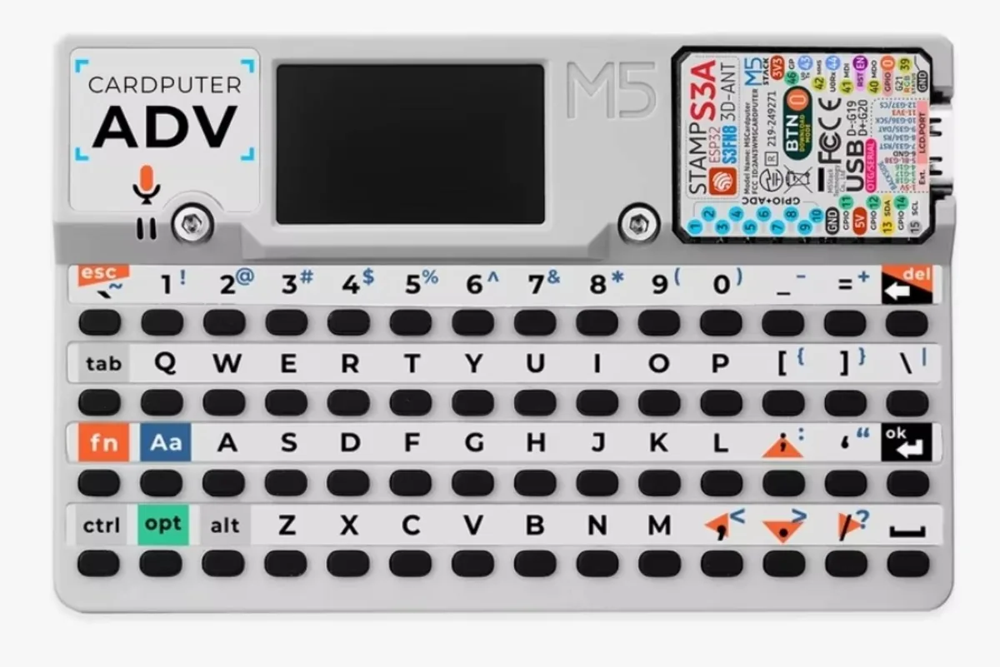
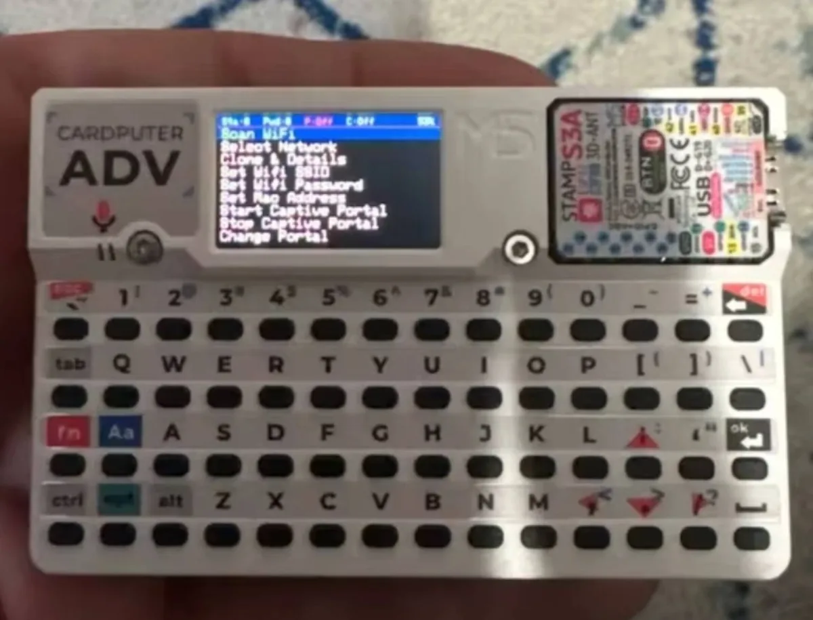
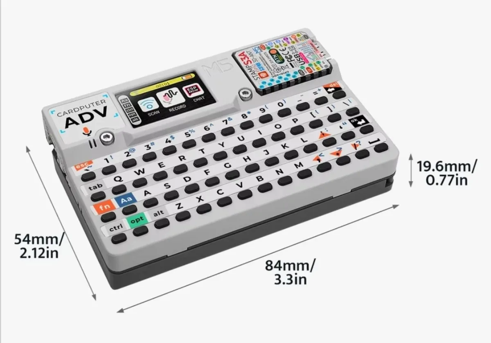

The **M5Stack Cardputer-Adv** is a card-sized computer built around the ESP32-S3. It combines a 56-key keyboard, a 1.14-inch colour display, audio hardware, a motion sensor, microSD storage and expansion connectors in a portable enclosure.

It is more than a tiny ESP32 development board: the screen, keyboard, speaker, microphone and battery make it useful for building self-contained handheld tools and interfaces without wiring a separate display and input devices.

The standalone Cardputer-Adv does **not** include a LoRa radio. For LoRa or Meshtastic, you need a compatible Cap or the complete [Cardputer Mesh Kit](/products/m5stack-cardputer-mesh-kit/).

## M5Stack Cardputer-Adv price and where to buy

The official M5Stack store lists the Cardputer-Adv at **US$29.90** at the time this page was prepared. Treat this as a reference price, not a guaranteed checkout price: shipping, tax, promotions and regional availability can change the total.

[Check the official M5Stack Cardputer-Adv listing](https://shop.m5stack.com/products/m5stack-cardputer-adv-version-esp32-s3)

Embedded Nerd will add marketplace purchase buttons when the exact Cardputer-Adv-only listings and affiliate destinations have been verified. Make sure a listing is for the standalone ADV if that is what you intend to buy; bundles with LoRa Caps are different products.

*Affiliate disclosure: some links on this page may be affiliate links. If you buy through them, Embedded Nerd may earn a commission at no extra cost to you.*

## Which Cardputer-Adv version or kit should you buy?

| If you want to… | Choose | Why |
|---|---|---|
| Learn ESP32, prototype or build a pocket tool | **Cardputer-Adv (board only)** | The most direct and least expensive way to get the keyboard, screen and ESP32-S3 platform |
| Run Meshtastic or experiment with LoRa | **Cardputer Mesh Kit** or ADV + Cap LoRa-1262 | The LoRa radio and GNSS are on the Cap, not on the standalone handheld |
| Experiment with sub-GHz radio and NFC | **Cardputer-Adv + Cap CC1101 & NFC** | Adds the CC1101 transceiver and NFC hardware |
| Add sensors or peripherals | **Cardputer-Adv + compatible Grove/EXT modules** | Uses the built-in Grove connector and 14-pin expansion bus |

**Buying tip:** if Meshtastic is your main reason for buying, choose the complete [Cardputer Mesh Kit](/products/m5stack-cardputer-mesh-kit/) rather than assuming that the standalone ADV includes the radio or the kit's device-registration eligibility.

## Cardputer-Adv specifications

| Specification | Details |
|---|---|
| Core module | M5Stack Stamp-S3A |
| SoC | ESP32-S3FN8 |
| CPU | Dual-core Xtensa LX7, up to 240 MHz |
| Flash | 8 MB |
| External storage | microSD card |
| Display | 1.14-inch ST7789V2 LCD |
| Resolution | 240 × 135 pixels |
| Keyboard | 56 keys, 4 × 14 |
| Key actuation | 160 gf |
| IMU | Bosch BMI270, 6-axis |
| Audio codec | ES8311 |
| Speaker | NS4150B amplifier, 8 Ω / 1 W speaker |
| Microphone | MEMS, 65 dB SNR stated by M5Stack |
| Headphone output | 3.5 mm jack |
| Infrared | IR emitter |
| Expansion ports | HY2.0-4P Grove + EXT 2.54-14P |
| Battery | 1500 mAh in latest documentation revision; store listing still states 1750 mAh |
| Dimensions | 84.0 × 54.0 × 19.6 mm |
| Weight | 81 g |
| Operating temperature | 0–40 °C |

### A note about the battery specification

There is a discrepancy in M5Stack's own material. The Cardputer-Adv documentation includes a version-change note dated **13 July 2026** stating that the battery capacity changed from 1750 mAh to **1500 mAh**. However, the official store listing still displays 1750 mAh.

For that reason, this page reports the latest documentation revision and flags the store discrepancy rather than presenting the capacity as settled for every unit. Check the seller's hardware revision and package details before purchase.

## Cardputer-Adv vs Cardputer v1.1

The Cardputer-Adv keeps the same basic pocket-computer concept, keyboard layout and 1.14-inch display, but updates several parts of the hardware.

| Feature | Cardputer-Adv | Cardputer v1.1 |
|---|---|---|
| Main module | Stamp-S3A | Stamp-S3A |
| Processor | ESP32-S3FN8, dual-core LX7 | ESP32-S3FN8, dual-core LX7 |
| Display | 1.14-inch ST7789V2, 240 × 135 | 1.14-inch ST7789V2, 240 × 135 |
| Keyboard | 56 keys, TCA8418 controller | 56 keys, 74HC138-based scanning |
| Audio | ES8311 codec, NS4150B amplifier | NS4168 and SPM1423 |
| Headphone jack | 3.5 mm | Not listed |
| IMU | BMI270 included | Not included |
| Expansion | Grove + 14-pin EXT bus | Grove |
| Battery | 1500 mAh in latest docs; store listing says 1750 mAh | 120 mAh + 1400 mAh |

The ADV's meaningful upgrades are the audio subsystem, integrated BMI270 IMU, headphone jack and 14-pin expansion bus. Its battery figure needs care because M5Stack's current documentation and store listing do not agree.

### Is it worth upgrading from v1.1?

If you already own a working v1.1, the upgrade is most useful if you need the BMI270, improved audio path, headphone output or the 14-pin expansion interface for Caps. If you mainly use the keyboard, screen and basic ESP32-S3 features, the older model may still be sufficient.

If you are buying your first Cardputer, the ADV is the current model to compare first.

## Cardputer-Adv Caps and accessories

The expansion bus is one of the most important differences between the ADV and the earlier Cardputer. It allows compatible Caps to attach directly to the handheld.

### Cap LoRa-1262: LoRa and GNSS

The Cap LoRa-1262 adds a Semtech SX1262 LoRa transceiver and a GNSS receiver. It is intended for long-range radio experiments, location-aware projects and compatible mesh-network firmware.

The Cap is an add-on: the standalone Cardputer-Adv does not contain the SX1262 radio or GNSS receiver.

If your goal is a ready-to-use Meshtastic device, compare the complete [Cardputer Mesh Kit](/products/m5stack-cardputer-mesh-kit/). M5Stack documents the kit and its registration process separately from the standalone ADV.

### Cap CC1101 & NFC

This Cap adds a CC1101 sub-GHz transceiver and NFC functionality. It is intended for compatible radio and NFC experiments. Check the official documentation and local regulations before transmitting; supported frequencies and permitted uses vary by region.

### Protective case

A small carry case can help protect the keyboard and screen when the Cardputer is in a bag. It is an optional convenience accessory rather than a requirement for operation.

For current Caps and accessory availability, see [M5Stack's official Cardputer-Adv accessories collection](https://shop.m5stack.com/collections/for-cardputer-adv).

## What can you build with the Cardputer-Adv?

- **Portable ESP32 tools:** combine the keyboard, screen and buttons into a self-contained diagnostic or control interface.
- **IoT controllers:** build a compact interface for Wi-Fi-connected devices, sensors or home-automation prototypes.
- **Data logging:** use the microSD slot to store measurements, logs or configuration files.
- **Motion-aware projects:** use the BMI270 accelerometer and gyroscope for orientation, movement or gesture experiments.
- **Audio projects:** use the MEMS microphone, codec, speaker and headphone output for sound-related interfaces.
- **Expansion projects:** connect compatible sensors and modules through Grove or the 14-pin EXT bus.
- **Radio experiments:** add the appropriate Cap for LoRa or CC1101/NFC projects.

The device is a development platform, not a guarantee that every community firmware or add-on works without adaptation. Check each project's supported hardware and firmware version.

## Programming and development

M5Stack lists the following development environments for the Cardputer-Adv:

- **Arduino IDE:** a familiar route for sketches and ESP32 projects.
- **PlatformIO:** useful for structured projects and library management.
- **ESP-IDF:** Espressif's framework for lower-level ESP32-S3 development.
- **UiFlow2:** M5Stack's visual programming environment.

The official documentation includes a pin map, schematics, Arduino quick-start material and UiFlow2 instructions. Consult it before assigning pins: the display, keyboard, audio codec and IMU already use several GPIOs.

## Limitations to consider

- **Small display:** 240 × 135 pixels is useful for compact interfaces, but restrictive for dashboards with lots of information.
- **Compact keyboard:** the 56-key layout is convenient for a handheld device, not a replacement for a full-size keyboard.
- **No built-in LoRa:** LoRa and GNSS require a compatible Cap.
- **Limited onboard flash:** 8 MB is adequate for many embedded projects but can constrain large firmware or asset collections.
- **Battery-life depends on workload:** display brightness, Wi-Fi, audio, peripherals and firmware all affect runtime. Do not assume a fixed operating time from capacity alone.
- **Battery listing discrepancy:** the latest documentation revision says 1500 mAh, while the official store listing still says 1750 mAh.

## Frequently asked questions

### What is the difference between the Cardputer and Cardputer-Adv?

The ADV uses the Stamp-S3A and adds an updated audio subsystem, a BMI270 IMU, a 3.5 mm audio jack and a 14-pin expansion bus. The original Cardputer uses the Stamp-S3 and has a different audio and expansion arrangement.

### Does the Cardputer-Adv have LoRa?

No. The standalone Cardputer-Adv does not include a LoRa transceiver. Add the Cap LoRa-1262 or buy the complete Cardputer Mesh Kit if you need LoRa hardware.

### Do I need the Mesh Kit for Meshtastic?

For a standard Cardputer-Adv with LoRa, the Cap LoRa-1262 provides the radio hardware. However, M5Stack's documented authorized-device registration process applies to the complete Cardputer Mesh Kit, not a standalone Cardputer-Adv. If that registration matters to you, buy the complete kit.

### How do I program the Cardputer-Adv?

M5Stack lists Arduino, UiFlow2, ESP-IDF and PlatformIO as development options. Start with the official Cardputer-Adv documentation for setup instructions and pin definitions.

### Is the Cardputer-Adv compatible with original Cardputer apps?

Compatibility depends on how each app uses the hardware. Apps that rely on the original audio components, keyboard scanning or GPIO assignments may need changes. Check the individual project's supported devices and ADV-specific releases rather than assuming every original app works unchanged.

### How much does the Cardputer-Adv cost?

The official M5Stack store listing showed **US$29.90** when this page was prepared. The price can change and does not necessarily include shipping, VAT or import charges. Check the seller's final checkout price for your country.

## Related product

If you specifically want LoRa, GNSS and Meshtastic in a matched bundle, read the [M5Stack Cardputer Mesh Kit guide](/products/m5stack-cardputer-mesh-kit/).

## Sources and verification

- [M5Stack Cardputer-Adv documentation](https://docs.m5stack.com/en/core/Cardputer-Adv)
- [M5Stack Cardputer-Adv official store listing](https://shop.m5stack.com/products/m5stack-cardputer-adv-version-esp32-s3)
- [M5Stack Cardputer-Adv accessories](https://shop.m5stack.com/collections/for-cardputer-adv)
- [M5Stack Cardputer-Adv launch article](https://shop.m5stack.com/blogs/news/m5stack-launches-cardputer-adv-upgraded-card-sized-computer-for-rapid-iot-development)

*Editorial note: This is a documentation-based product guide, not a hands-on review. Prices, availability, accessory compatibility and hardware revisions can change; verify the exact seller listing before ordering.*
