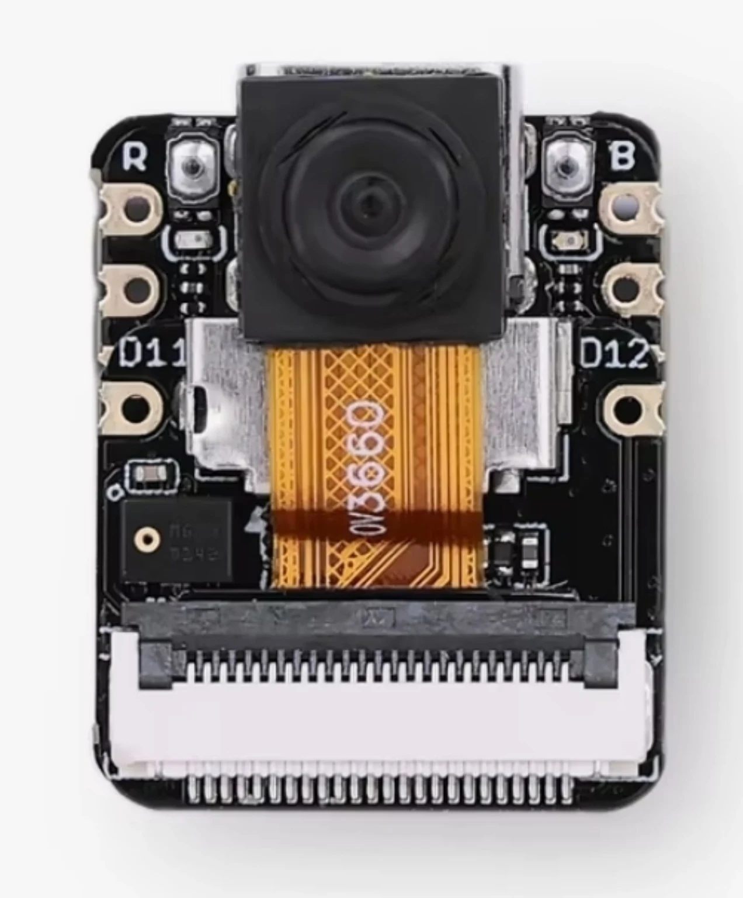
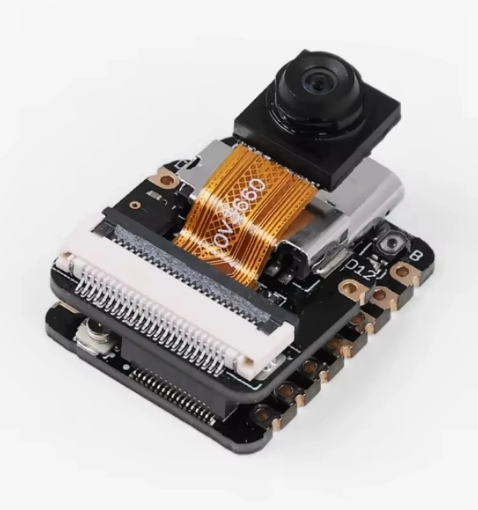
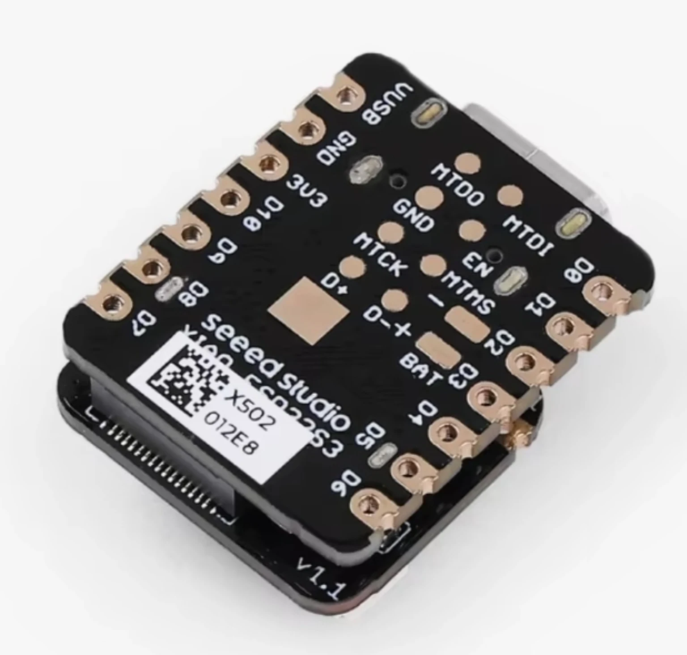

**Seeed Studio XIAO ESP32S3 Sense** to niewielka jak kciuk płytka ESP32-S3 z odłączaną płytką rozszerzeń zawierającą kamerę, mikrofon cyfrowy i gniazdo microSD. Jest wyszukiwana również jako **XIAO ESP32-S3 Sense** lub **Seeed XIAO ESP32S3 Sense**. Przed zakupem upewnij się, że oferta dotyczy wersji **Sense**: zwykła XIAO ESP32S3 wygląda niemal identycznie, ale nie ma kamery, mikrofonu ani gniazda SD.

Przed podłączeniem urządzeń zwróć uwagę na **współdzielone piny**: mikrofon, karta SD i dioda użytkownika korzystają z GPIO dostępnych również na złączu pinów. Poniższe tabele pokazują dokładnie, które.

## Zdjęcia produktu

<div class="product-image-gallery" style="display:grid;grid-template-columns:repeat(auto-fit,minmax(180px,1fr));gap:1rem;margin:1.5rem 0;">
  <figure><figcaption>Widok z przodu: XIAO ESP32S3 Sense z modułem kamery</figcaption></figure>
  <figure><figcaption>Zespół kamery i płytki rozszerzeń</figcaption></figure>
  <figure><figcaption>Widok z tyłu: oznaczenia pinów i pola lutownicze</figcaption></figure>
</div>

## Czy warto kupić XIAO ESP32S3 Sense?

Wybierz tę płytkę, jeśli potrzebujesz kamery, mikrofonu lub zapisu na karcie SD w bardzo małym formacie, np. do kamery Wi-Fi, projektu audio lub głosowego, urządzenia noszonego albo rejestratora zasilanego z akumulatora. Jeśli potrzebujesz tylko małej płytki ESP32-S3, zwykła XIAO ESP32S3 ma taki sam układ pinów i znacznie mniejszy pobór prądu w deep sleep. Jeśli potrzebujesz większej liczby GPIO i 16 MB Flash, sprawdź XIAO ESP32-S3 Plus.

## XIAO ESP32S3, Sense czy Plus: którą wersję wybrać?

| Funkcja | XIAO ESP32S3 | XIAO ESP32S3 Sense | XIAO ESP32-S3 Plus |
|---|---|---|---|
| Kamera i mikrofon | Nie | Tak, płytka rozszerzeń | Nie |
| Gniazdo microSD | Nie | Tak, płytka rozszerzeń | Nie |
| Flash / PSRAM | 8 MB / 8 MB | 8 MB / 8 MB | 16 MB / 8 MB |
| GPIO z PWM | 11 | 11 | 18 |
| Prąd deep sleep (dane Seeed) | 14 µA | 3 mA z płytką rozszerzeń | 33,5 µA |
| Najlepsze zastosowanie | Małe, energooszczędne projekty | Obraz, audio i rejestrowanie danych | Więcej pinów i Flash |

Ceny zależą od sprzedawcy, miejsca dostawy, wysyłki i wybranego wariantu. Przed zakupem sprawdź aktualną ofertę, dołączone akcesoria i model kamery.

<div class="en-product-cta__buttons">
  <a class="en-buy-button" href="/go/hardware/seeed-xiao-esp32s3-sense/" target="_blank" rel="nofollow sponsored noopener"><span class="en-buy-icon"><i class="fas fa-cart-shopping"></i></span><span class="en-buy-text"><strong>Sprawdź cenę — XIAO ESP32S3 Sense</strong><small>AliExpress · sprawdź wersję kamery i złącza</small></span><span class="en-buy-arrow"><i class="fas fa-chevron-right"></i></span></a>
  <a class="en-buy-button" href="https://www.amazon.com/Seeed-Studio-XIAO-ESP32-Sense/dp/B0C69FFVHH?tag=embeddednerd2-20" target="_blank" rel="nofollow sponsored noopener"><span class="en-buy-icon"><i class="fab fa-amazon"></i></span><span class="en-buy-text"><strong>Sprawdź cenę — Amazon</strong><small>Sprawdź wersję Sense i dołączone akcesoria</small></span><span class="en-buy-arrow"><i class="fas fa-chevron-right"></i></span></a>
  <a class="en-buy-button" href="https://www.seeedstudio.com/Seeed-Studio-XIAO-ESP32S3-Sense-Pre-Soldered-p-6335.html?sensecap_affiliate=3jSyuVk&referring_service=link" target="_blank" rel="nofollow sponsored noopener"><span class="en-buy-icon"><i class="fas fa-store"></i></span><span class="en-buy-text"><strong>Kup — Seeed Studio (z przylutowanymi pinami)</strong><small>Oficjalny sklep · wersja z przylutowanymi złączami</small></span><span class="en-buy-arrow"><i class="fas fa-chevron-right"></i></span></a>
</div>

## Najważniejsze dane techniczne

| Parametr | Szczegóły |
|---|---|
| MCU | ESP32-S3R8, dwurdzeniowy Xtensa LX7, do 240 MHz |
| Flash | 8 MB |
| PSRAM | 8 MB |
| Kamera | Odłączana OV5640 z autofokusem (OV3660 w niektórych płytkach) |
| Mikrofon | Cyfrowy mikrofon PDM |
| Pamięć | Gniazdo microSD na płytce rozszerzeń, FAT do 32 GB |
| Łączność bezprzewodowa | Wi-Fi 2,4 GHz i Bluetooth LE 5.0 / Bluetooth Mesh |
| USB | USB Type-C |
| Akumulator | Li-ion 3,7 V z wbudowanym układem ładowania |
| Wymiary | 21 × 17,8 mm; 21 × 17,8 × 15 mm z płytką rozszerzeń |
| Temperatura pracy | −20 °C do 65 °C |

Dane pochodzą z Seeed Studio Wiki (sprawdzone 7 listopada 2026 r.). Seeed przechodzi z OV3660 na OV5640 z autofokusem; w okresie przejściowym płytki mogą być dostarczane z jednym z tych modułów.

## Kamera, mikrofon i microSD

Płytka rozszerzeń łączy się przez złącze board-to-board i zawiera kamerę, mikrofon PDM oraz gniazdo microSD. Przykłady Seeed obsługują OV5640, OV3660 i OV2640, więc te same szkice mogą działać z każdym z nich, ale tylko OV5640 ma autofokus. Moduł OV5640 jest również sprzedawany osobno jako część zamienna.

Seeed informuje, że od czerwca 2025 r. fabryczne oprogramowanie układowe domyślnie uruchamia punkt dostępowy Wi-Fi o opublikowanej nazwie i haśle. Wgraj własne firmware przed wdrożeniem płytki w miejscu dostępnym dla innych osób.

## Pinout XIAO ESP32S3 Sense: D0–D12 na GPIO

| Pin XIAO | GPIO | Funkcje | Uwagi |
|---|---:|---|---|
| D0 | GPIO1 | ADC, dotyk | Ogólne wejście/wyjście |
| D1 | GPIO2 | ADC, dotyk | Ogólne wejście/wyjście |
| D2 | GPIO3 | ADC, dotyk | Pin strapping (źródło JTAG) |
| D3 | GPIO4 | ADC, dotyk | Ogólne wejście/wyjście |
| D4 / SDA | GPIO5 | Dane I²C, ADC, dotyk | Domyślne I²C. Zobacz [wyszukiwarkę adresów I2C](/tools/i2c-address-lookup/) i [poradnik I2C Scanner](/i2c-scanner-tutorial/) |
| D5 / SCL | GPIO6 | Zegar I²C, ADC, dotyk | Domyślne I²C |
| D6 / TX | GPIO43 | UART TX | Wyjście szeregowe |
| D7 / RX | GPIO44 | UART RX | Wejście szeregowe |
| D8 / SCK | GPIO7 | Zegar SPI, ADC, dotyk | Współdzielony z zegarem SD |
| D9 / MISO | GPIO8 | SPI MISO, ADC, dotyk | Współdzielony z SD data-in |
| D10 / MOSI | GPIO9 | SPI MOSI, ADC, dotyk | Współdzielony z SD data-out |
| D11 | GPIO42 | Dotyk | Współdzielony z zegarem mikrofonu |
| D12 | GPIO41 | Dotyk | Współdzielony z danymi mikrofonu |

Seeed zaznacza, że D11 i D12 (GPIO42 i GPIO41), mimo oznaczenia jako piny analogowe, nie obsługują ADC w ESP32-S3. Do odczytów analogowych używaj D0–D5 oraz D8–D10.

Piny zasilania: **5V** to linia USB 5 V, **3V3** to stabilizowane wyjście 3,3 V, a **GND** to masa. Wszystkie GPIO pracują z logiką 3,3 V i nie mogą otrzymywać 5 V. Przy zasilaniu z akumulatora na pinie 5V nie ma napięcia.

## Dostępność GPIO: piny używane przez kamerę, mikrofon i kartę SD

Według mapy pinów Seeed kamera, mikrofon i karta SD nie nakładają się na siebie, ale niektóre funkcje współdzielą GPIO ze złączem pinów.

| Funkcja | GPIO | Współdzielony z |
|---|---|---|
| Zegar mikrofonu PDM | GPIO42 | Pin D11 |
| Dane mikrofonu PDM | GPIO41 | Pin D12 |
| Chip select karty SD | GPIO21 | Dioda użytkownika |
| Zegar / MISO / MOSI SD | GPIO7 / GPIO8 / GPIO9 | Piny SPI D8 / D9 / D10 |
| Dane / zegar I²C kamery | GPIO40 / GPIO39 | Piny JTAG MTDO / MTCK |
| Dane, zegar i synchronizacja kamery | GPIO10–18, 38, 47, 48 | Wyłącznie złącze board-to-board |

Jeśli używasz karty SD, dioda użytkownika na GPIO21 współdzieli linię chip select karty. Dodatkowe urządzenie SPI podłączone do D8–D10 współdzieli magistralę z kartą i wymaga własnego pinu chip select. Przy korzystaniu z mikrofonu piny D11 i D12 należy uznać za zajęte.

## Pobór prądu i zasilanie z akumulatora

Typowe wartości opublikowane przez Seeed dla Sense **z podłączoną płytką rozszerzeń**:

| Tryb | Typowy prąd |
|---|---:|
| Aktywne Wi-Fi | 110 mA |
| Aktywne Bluetooth LE | 102 mA |
| Modem-sleep | 44 mA |
| Light-sleep | 5 mA |
| Deep sleep | 3 mA |
| Serwer WWW kamery (USB) | około 140 mA średnio, 347 mA szczytowo |

Płytka może pracować z akumulatorem Li-ion 3,7 V i ładować go przez USB-C. Seeed podaje, że ujemne pole akumulatora znajduje się najbliżej portu USB; przed lutowaniem sprawdź polaryzację. Nie ma GPIO przeznaczonego do pomiaru napięcia akumulatora — potrzebny jest zewnętrzny dzielnik napięcia podłączony do pinu ADC.

## Arduino, MicroPython i pierwsze uruchomienie

Seeed dokumentuje Arduino i MicroPython dla serii XIAO ESP32-S3, a także instrukcje ESP-IDF i Zephyr. W Arduino IDE wybierz płytkę **XIAO_ESP32S3** i pakiet płytek ESP32 w wersji 2.0.8 lub nowszej.

```cpp
const int ledPin = LED_BUILTIN; // GPIO21 na płytce XIAO ESP32S3
const int analogPin = A0;       // D0 = GPIO1 (ADC)

void setup() {
  Serial.begin(115200);
  pinMode(ledPin, OUTPUT);
}

void loop() {
  // Dioda użytkownika działa w logice active-low: LOW ją włącza.
  digitalWrite(ledPin, LOW);
  delay(500);
  digitalWrite(ledPin, HIGH);
  delay(500);

  Serial.print("A0 = ");
  Serial.println(analogRead(analogPin));
}
```

Otwórz monitor portu szeregowego z prędkością **115200 baud**. Ponieważ GPIO21 jest również chip select karty SD, nie przełączaj diody podczas korzystania z karty. Jeśli port znika lub wgrywanie nie działa, przytrzymaj przycisk **Boot** podczas podłączania USB, aby uruchomić tryb bootloadera.

- [Poradnik Seeed Studio: pierwsze kroki](https://wiki.seeedstudio.com/xiao_esp32s3_getting_started/)
- [Poradnik Seeed Studio: multipleksowanie pinów](https://wiki.seeedstudio.com/xiao_esp32s3_pin_multiplexing/)

## Gdzie kupić

Sprawdź, czy oferta dotyczy wersji **Sense**, jaki model kamery jest dołączony, kto jest sprzedawcą i dokąd wysyła produkt. Seeed domyślnie dostarcza płytkę bez pinów goldpin, więc wybierz wersję z przylutowanymi złączami lub przygotuj się do samodzielnego lutowania. Oferty różnią się w zależności od regionu, a cena na tej stronie nie jest stała.

Jako partner afiliacyjny Embedded Nerd może otrzymać prowizję od kwalifikujących się zakupów bez dodatkowych kosztów dla Ciebie.

- [Seeed Studio XIAO ESP32S3 Sense (z przylutowanymi pinami) — oficjalny sklep](https://www.seeedstudio.com/Seeed-Studio-XIAO-ESP32S3-Sense-Pre-Soldered-p-6335.html?sensecap_affiliate=3jSyuVk&referring_service=link)

## Najczęściej zadawane pytania

### Czy XIAO ESP32S3 Sense jest tym samym co XIAO ESP32S3?

Nie. Obie płytki mają tę samą płytę główną i układ złącza pinów, ale Sense dodaje odłączaną płytkę rozszerzeń z kamerą, mikrofonem cyfrowym i gniazdem microSD. Zwykła XIAO ESP32S3 nie ma tych elementów i zużywa mniej energii w deep sleep.

### Jakiej kamery używa XIAO ESP32S3 Sense?

Obecne płytki korzystają z odłączanej kamery OV5640 z autofokusem; część dostaw w okresie przejściowym może zawierać OV3660. Starsze płytki miały OV2640, który został wycofany. Przykłady Seeed obsługują wszystkie trzy modele.

### Czy XIAO ESP32S3 Sense toleruje 5 V?

Nie. Piny GPIO pracują z logiką 3,3 V i nie mogą otrzymywać 5 V. Do czujników lub modułów 5 V użyj konwertera poziomów logicznych.

### Czy można jednocześnie używać kamery, mikrofonu i karty SD?

Według mapy pinów Seeed funkcje te nie nakładają się na siebie, więc mogą działać równocześnie. Mikrofon używa D11 i D12, karta SD współdzieli piny SPI D8–D10, a jej chip select jest tym samym GPIO co dioda użytkownika.

### Czy XIAO ESP32S3 Sense ładuje akumulator?

Tak. Płytka ma układ ładowania Li-ion i pola do podłączenia akumulatora. Przy zasilaniu z akumulatora pin 5V nie ma napięcia, a do pomiaru napięcia akumulatora nie ma dedykowanego pinu.

### Czy w zestawie są piny goldpin?

Seeed domyślnie dostarcza płytkę bez pinów goldpin. Sprawdź, czy oferta wskazuje wersję z przylutowanymi złączami, albo przylutuj własne.

### Czy XIAO ESP32S3 Sense działa z MicroPython?

Tak. Seeed dokumentuje Arduino i MicroPython dla serii XIAO ESP32-S3. Środowisko programistyczne nie zmienia ograniczeń 3,3 V ani mapowania pinów.

## Porównanie z innymi płytkami ESP32

| Płytka | Najlepsze zastosowanie |
|---|---|
| Seeed Studio XIAO ESP32S3 Sense | Małe projekty z kamerą, audio i rejestrowaniem danych |
| [Arduino Nano ESP32](/products/arduino-nano-esp32/) | Format Nano z ESP32-S3 i nazwami pinów Arduino |
| [ESP32 DevKit V1](/products/esp32-devkit/) | Niedrogie, uniwersalne prototypowanie |
| [Raspberry Pi Pico W](/products/raspberry-pi-pico-w/) | RP2040 z Wi-Fi, przyjazny dla MicroPython |

Nie wiesz, którą płytkę wybrać? Przeczytaj nasz przewodnik [Najlepsze płytki ESP32](/best-esp32-boards/) lub przejrzyj kategorię [Płytki rozwojowe](/products/development-boards/).
