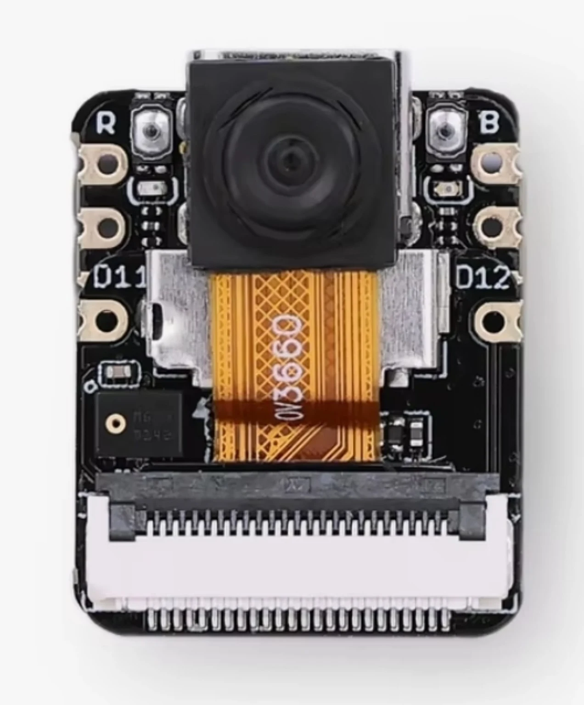
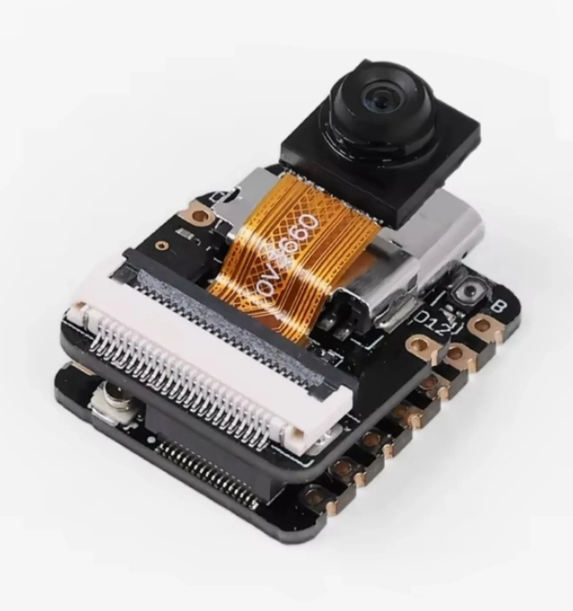
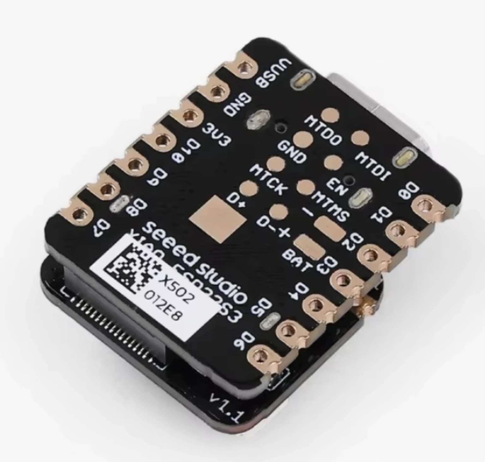

O **Seeed Studio XIAO ESP32S3 Sense** é uma placa ESP32-S3 do tamanho de um polegar, com uma placa de expansão amovível que inclui uma câmara, um microfone digital e uma ranhura microSD. Também é procurado como **XIAO ESP32-S3 Sense** ou **Seeed XIAO ESP32S3 Sense**. Antes de encomendar, confirma que o anúncio corresponde à versão **Sense**: o XIAO ESP32S3 normal é muito parecido, mas não inclui câmara, microfone nem ranhura SD.

Se precisas apenas da placa normal, sem câmara, microfone ou expansão microSD, consulta o nosso [guia de especificações e pinout da XIAO ESP32S3](/pt/products/seeed-xiao-esp32s3/).

O ponto mais importante antes de ligares periféricos são os **pinos partilhados**: o microfone, o cartão SD e o LED de utilizador reutilizam GPIO que também estão disponíveis no conector. As tabelas abaixo mostram exatamente quais.

<div class="en-product-cta__buttons">
  <a class="en-buy-button" href="/go/hardware/seeed-xiao-esp32s3-sense/" target="_blank" rel="nofollow sponsored noopener"><span class="en-buy-icon"><i class="fas fa-cart-shopping"></i></span><span class="en-buy-text"><strong>Consultar preço — XIAO ESP32S3 Sense</strong><small>AliExpress · confirma a câmara e os headers</small></span><span class="en-buy-arrow"><i class="fas fa-chevron-right"></i></span></a>
  <a class="en-buy-button" href="https://www.amazon.com/Seeed-Studio-XIAO-ESP32-Sense/dp/B0C69FFVHH?tag=embeddednerd2-20" target="_blank" rel="nofollow sponsored noopener"><span class="en-buy-icon"><i class="fab fa-amazon"></i></span><span class="en-buy-text"><strong>Consultar preço — Amazon</strong><small>Confirma a versão Sense e os acessórios incluídos</small></span><span class="en-buy-arrow"><i class="fas fa-chevron-right"></i></span></a>
  <a class="en-buy-button" href="https://www.seeedstudio.com/Seeed-Studio-XIAO-ESP32S3-Sense-Pre-Soldered-p-6335.html?sensecap_affiliate=3jSyuVk&referring_service=link" target="_blank" rel="nofollow sponsored noopener"><span class="en-buy-icon"><i class="fas fa-store"></i></span><span class="en-buy-text"><strong>Comprar na Seeed Studio (headers soldados)</strong><small>Loja oficial · versão com headers pré-soldados</small></span><span class="en-buy-arrow"><i class="fas fa-chevron-right"></i></span></a>
</div>

## Pinout do XIAO ESP32S3 Sense em resumo

O XIAO ESP32S3 e o XIAO ESP32S3 Sense partilham a mesma disposição de pinos no conector da placa principal. Na expansão Sense, D11 e D12 estão reservados por defeito para o microfone digital; D8–D10 são partilhados com o barramento SPI do cartão microSD.

- **I²C:** D4 / SDA = GPIO5, D5 / SCL = GPIO6
- **UART:** D6 / TX = GPIO43, D7 / RX = GPIO44
- **SPI:** D8 / SCK = GPIO7, D9 / MISO = GPIO8, D10 / MOSI = GPIO9 (partilhados com o microSD)
- **Analógico (ADC):** D0–D5 e D8–D10; D11 e D12 não suportam ADC
- **Microfone:** D11 (GPIO42), clock; D12 (GPIO41), dados
- **LED de utilizador / chip select do SD:** GPIO21
- Todos os GPIO usam lógica de 3,3 V e **não são tolerantes a 5 V**.

A Seeed reserva D11 e D12 para o microfone por defeito. Para os reutilizares com outras funções, é necessário modificar a ligação J1/J2 na placa de expansão.

## Fotografias do produto

<div class="product-image-gallery" style="display:grid;grid-template-columns:repeat(auto-fit,minmax(180px,1fr));gap:1rem;margin:1.5rem 0;">
  <figure>
    
    <figcaption>Vista frontal: XIAO ESP32S3 Sense com módulo de câmara</figcaption>
  </figure>
  <figure>
    
    <figcaption>Conjunto da câmara e da placa de expansão</figcaption>
  </figure>
  <figure>
    
    <figcaption>Vista traseira: identificação dos pinos e pads de soldadura</figcaption>
  </figure>
</div>

## Vale a pena comprar o XIAO ESP32S3 Sense?

Escolhe esta placa se precisas de uma câmara, um microfone ou gravação em cartão SD num dispositivo do tamanho de um polegar: por exemplo, uma pequena câmara Wi-Fi, um projeto de áudio ou voz, um dispositivo wearable ou um registador alimentado por bateria. Se só precisas de um ESP32-S3 compacto sem estes extras, o XIAO ESP32S3 normal tem a mesma disposição do conector e um consumo em deep sleep muito inferior. Se precisas de mais GPIO e 16 MB de Flash, considera o XIAO ESP32-S3 Plus.

## XIAO ESP32S3, Sense ou Plus: que versão deves escolher?

| Característica | XIAO ESP32S3 | XIAO ESP32S3 Sense | XIAO ESP32-S3 Plus |
|---|---|---|---|
| Câmara e microfone | Não | Sim (placa de expansão) | Não |
| Ranhura microSD | Não | Sim (placa de expansão) | Não |
| Flash / PSRAM | 8 MB / 8 MB | 8 MB / 8 MB | 16 MB / 8 MB |
| GPIO com PWM | 11 | 11 | 18 |
| Consumo em deep sleep (valor Seeed) | 14 µA | 3 mA com placa de expansão | 33,5 µA |
| Mais indicado para | Projetos compactos e de baixo consumo | Imagem, áudio e registo de dados | Mais pinos e Flash |

Os preços variam consoante o vendedor, o destino, os portes de envio e a variante escolhida. Antes de comprar, confirma o anúncio atual, os acessórios incluídos e o modelo da câmara.

## Pinout do XIAO ESP32S3 e Sense: D0–D12 para GPIO {#xiao-esp32s3-sense-pinout-d0d12-to-gpio}

| Pino XIAO | GPIO | Funções | Nota |
|---|---:|---|---|
| D0 | GPIO1 | ADC, toque | I/O geral |
| D1 | GPIO2 | ADC, toque | I/O geral |
| D2 | GPIO3 | ADC, toque | Pino de strapping (fonte JTAG) |
| D3 | GPIO4 | ADC, toque | I/O geral |
| D4 / SDA | GPIO5 | Dados I²C, ADC, toque | I²C por defeito. Consulta o [localizador de endereços I²C](/tools/i2c-address-lookup/) e o [tutorial I²C Scanner](/i2c-scanner-tutorial/). |
| D5 / SCL | GPIO6 | Clock I²C, ADC, toque | I²C por defeito |
| D6 / TX | GPIO43 | UART TX | Saída série |
| D7 / RX | GPIO44 | UART RX | Entrada série |
| D8 / SCK | GPIO7 | Clock SPI, ADC, toque | Partilhado com o clock do cartão SD |
| D9 / MISO | GPIO8 | SPI MISO, ADC, toque | Partilhado com a entrada de dados do cartão SD |
| D10 / MOSI | GPIO9 | SPI MOSI, ADC, toque | Partilhado com a saída de dados do cartão SD |
| D11 | GPIO42 | Toque | Partilhado com o clock do microfone |
| D12 | GPIO41 | Toque | Partilhado com os dados do microfone |

A Seeed indica que D11 e D12 (GPIO42 e GPIO41), apesar de aparecerem identificados como pinos analógicos, não suportam ADC no ESP32-S3. Para leituras analógicas, utiliza D0–D5 e D8–D10.

Pinos de alimentação: **5V** é a linha USB de 5 V, **3V3** é a saída regulada de 3,3 V e **GND** é a massa. Todos os GPIO usam lógica de 3,3 V e não podem receber 5 V. Quando a placa é alimentada por bateria, o pino 5V não tem tensão.

## GPIO utilizados pela câmara, microfone e cartão SD

De acordo com o mapa de pinos da Seeed, a câmara, o microfone e o cartão SD não entram em conflito entre si, mas algumas destas funções partilham GPIO com os pinos do conector.

| Função | GPIO | Partilhado com |
|---|---|---|
| Clock do microfone (PDM) | GPIO42 | Pino D11 |
| Dados do microfone (PDM) | GPIO41 | Pino D12 |
| Chip select do cartão SD | GPIO21 | LED de utilizador |
| Clock / MISO / MOSI do cartão SD | GPIO7 / GPIO8 / GPIO9 | Pinos SPI D8 / D9 / D10 |
| Dados / clock I²C da câmara | GPIO40 / GPIO39 | Pinos JTAG MTDO / MTCK |
| Dados, clock e sincronização da câmara | GPIO10–18, 38, 47, 48 | Apenas conector board-to-board |

Se utilizares o cartão SD, o LED de utilizador em GPIO21 também é a linha chip select do cartão. Qualquer dispositivo SPI adicional ligado a D8–D10 partilha o barramento com o cartão e precisa do seu próprio pino chip select. Se utilizares o microfone, considera D11 e D12 ocupados.

## Câmara, microfone e microSD

A placa de expansão liga-se através de um conector board-to-board e inclui a câmara, o microfone PDM e a ranhura microSD. Os exemplos de câmara da Seeed suportam OV5640, OV3660 e OV2640, pelo que os mesmos sketches podem funcionar com os três modelos, mas apenas a OV5640 tem focagem automática. O módulo OV5640 também é vendido separadamente como peça de substituição.

A Seeed indica que, desde junho de 2025, o firmware de fábrica ativa por defeito um ponto de acesso Wi-Fi com nome e palavra-passe publicados. Instala o teu próprio firmware antes de utilizares a placa num local acessível a outras pessoas.

## Especificações em resumo

| Especificação | Detalhes |
|---|---|
| MCU | ESP32-S3R8, Xtensa LX7 de dois núcleos, até 240 MHz |
| Flash | 8 MB |
| PSRAM | 8 MB |
| Comunicações sem fios | Wi-Fi de 2,4 GHz, Bluetooth LE 5.0 / Bluetooth Mesh |
| Câmara | OV5640 amovível com focagem automática (2592 × 1944); algumas placas incluem OV3660 (2048 × 1536); versões anteriores usavam OV2640 (1600 × 1200) |
| Microfone | Microfone digital (PDM) |
| Armazenamento | Ranhura microSD na placa de expansão, FAT até 32 GB |
| Interfaces | 1 × UART, 1 × I²C, 1 × I²S, 1 × SPI, 11 × GPIO com PWM, 9 × ADC |
| Botões e LEDs | Reset, Boot, LED de utilizador, LED de carregamento |
| Alimentação | USB Type-C de 5 V ou bateria Li-ion de 3,7 V |
| Antena | Conector U.FL; antena externa incluída no pacote |
| Dimensões | 21 × 17,8 mm; 21 × 17,8 × 15 mm com a placa de expansão |
| Temperatura de funcionamento | −20 °C a 65 °C |

As especificações seguem a Seeed Studio Wiki (consultada a 7 de novembro de 2026). A Seeed está a fazer a transição da OV3660 para a OV5640 com focagem automática; durante este período, as placas podem ser fornecidas com qualquer um dos dois modelos.

## Consumo de energia e utilização com bateria

Valores típicos publicados pela Seeed para a versão Sense **com a placa de expansão ligada**:

| Modo | Corrente típica |
|---|---:|
| Wi-Fi ativo | 110 mA |
| Bluetooth LE ativo | 102 mA |
| Modem-sleep | 44 mA |
| Light-sleep | 5 mA |
| Deep sleep | 3 mA |
| Servidor de câmara (USB) | cerca de 140 mA em média, 347 mA de pico |

A placa pode funcionar com uma bateria Li-ion de 3,7 V e carregá-la através de USB-C. A Seeed indica que o pad negativo da bateria é o que fica mais próximo da porta USB; confirma a polaridade antes de soldar. Não existe um GPIO dedicado à leitura da tensão da bateria; para a medir, é necessário um divisor de tensão externo ligado a um pino ADC.

## Arduino, MicroPython e primeiros passos

A Seeed disponibiliza documentação para Arduino e MicroPython na série XIAO ESP32-S3, além de guias para ESP-IDF e Zephyr. Na Arduino IDE, seleciona **XIAO_ESP32S3** como placa e utiliza o pacote de placas ESP32 na versão 2.0.8 ou posterior.

```cpp
const int ledPin = LED_BUILTIN; // GPIO21 no XIAO ESP32S3
const int analogPin = A0;       // D0 = GPIO1 (ADC)

void setup() {
  Serial.begin(115200);
  pinMode(ledPin, OUTPUT);
}

void loop() {
  // O LED de utilizador é ativo a LOW: LOW liga-o.
  digitalWrite(ledPin, LOW);
  delay(500);
  digitalWrite(ledPin, HIGH);
  delay(500);

  Serial.print("A0 = ");
  Serial.println(analogRead(analogPin));
}
```

Abre o Monitor Série a **115200 baud**. Como GPIO21 também é o chip select do cartão SD, não alternes o LED enquanto estiveres a utilizar o cartão. Se a porta desaparecer ou o carregamento falhar, mantém o botão **Boot** premido enquanto ligas o USB para entrar no modo bootloader.

- [Guia de primeiros passos da Seeed Studio](https://wiki.seeedstudio.com/xiao_esp32s3_getting_started/)
- [Guia de multiplexagem de pinos da Seeed Studio](https://wiki.seeedstudio.com/xiao_esp32s3_pin_multiplexing/)

## Onde comprar o XIAO ESP32S3 Sense

Confirma que o anúncio corresponde à versão **Sense**, qual o modelo da câmara incluído, quem é o vendedor e para que destino envia. Por defeito, a Seeed fornece a placa sem headers soldados; procura uma versão pré-soldada ou conta soldar os teus próprios conectores. As ofertas variam por região e esta página não apresenta um preço fixo.

Como afiliado, o Embedded Nerd pode receber uma comissão por compras elegíveis, sem custos adicionais para ti.

<ul>
  <li><a href="/go/hardware/seeed-xiao-esp32s3-sense/" target="_blank" rel="nofollow sponsored noopener">AliExpress — consultar preço e variante</a></li>
  <li><a href="https://www.amazon.com/Seeed-Studio-XIAO-ESP32-Sense/dp/B0C69FFVHH?tag=embeddednerd2-20" target="_blank" rel="nofollow sponsored noopener">Amazon — Seeed Studio XIAO ESP32S3 Sense</a></li>
  <li><a href="https://www.seeedstudio.com/Seeed-Studio-XIAO-ESP32S3-Sense-Pre-Soldered-p-6335.html?sensecap_affiliate=3jSyuVk&referring_service=link" target="_blank" rel="nofollow sponsored noopener">Seeed Studio XIAO ESP32S3 Sense (headers soldados) — loja oficial</a></li>
</ul>

## Perguntas frequentes

### O XIAO ESP32S3 Sense é igual ao XIAO ESP32S3?

Não. Partilham a mesma placa principal e a mesma disposição do conector, mas o Sense acrescenta uma placa de expansão amovível com câmara, microfone digital e ranhura microSD. O XIAO ESP32S3 normal não inclui estes componentes e consome menos em deep sleep.

### Que câmara utiliza o XIAO ESP32S3 Sense?

As placas atuais utilizam uma câmara OV5640 amovível com focagem automática, embora alguns envios ainda possam incluir a OV3660 durante a transição de produção. As placas anteriores utilizavam a OV2640, que foi descontinuada. Os exemplos da Seeed suportam os três modelos.

### O XIAO ESP32S3 Sense é tolerante a 5 V?

Não. Os pinos GPIO utilizam lógica de 3,3 V e não podem receber 5 V. Utiliza um conversor de níveis lógicos para sensores ou módulos de 5 V.

### Posso utilizar a câmara, o microfone e o cartão SD ao mesmo tempo?

De acordo com o mapa de pinos da Seeed, os sinais destes dispositivos não entram em conflito, pelo que podem ser utilizados em simultâneo. O microfone utiliza D11 e D12, o cartão SD partilha os pinos SPI D8–D10 e o respetivo chip select é o mesmo GPIO do LED de utilizador.

### O XIAO ESP32S3 Sense carrega uma bateria?

Sim. Tem gestão de carregamento para baterias Li-ion e pads para a respetiva ligação. Quando funciona a bateria, o pino 5V não tem tensão e não existe um pino dedicado à leitura da tensão da bateria.

### A placa inclui headers soldados?

Por defeito, a Seeed fornece a placa sem headers soldados. Confirma se o anúncio indica a versão pré-soldada ou prepara-te para soldar os teus próprios headers.

### O XIAO ESP32S3 Sense funciona com MicroPython?

Sim. A Seeed disponibiliza documentação para Arduino e MicroPython na série XIAO ESP32-S3. O ambiente de programação não altera os limites de 3,3 V nem o mapa de pinos indicado acima.

## Comparação com outras placas ESP32

| Placa | Mais indicada para |
|---|---|
| Seeed Studio XIAO ESP32S3 Sense | Pequenos projetos com câmara, áudio e registo de dados |
| [Arduino Nano ESP32](/products/arduino-nano-esp32/) | Formato Nano com ESP32-S3 e nomes de pinos Arduino |
| [ESP32 DevKit V1](/products/esp32-devkit/) | Prototipagem geral de baixo custo |
| [Raspberry Pi Pico W](/products/raspberry-pi-pico-w/) | RP2040 com Wi-Fi e boa integração com MicroPython |

Não sabes qual a placa mais adequada ao teu projeto? Consulta o nosso guia [Melhores placas ESP32](/best-esp32-boards/) ou explora a categoria [Placas de desenvolvimento](/products/development-boards/).
