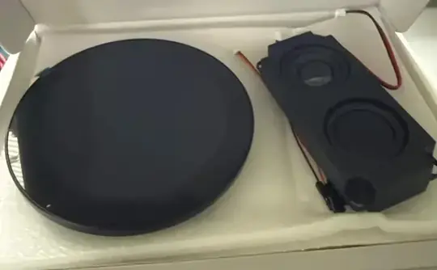
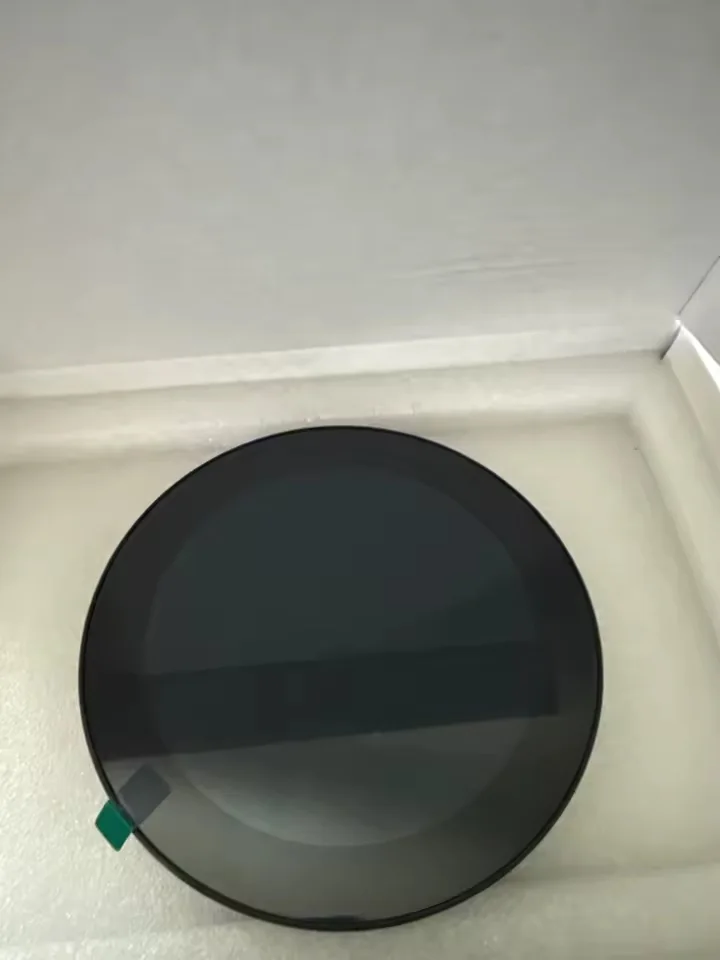
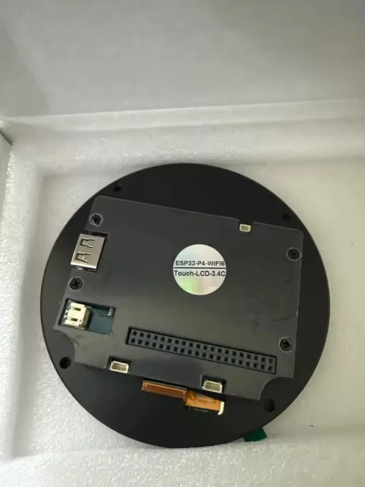

## Should You Choose the ESP32-P4 Round 3.4C?

Choose this board when you want a large, high-resolution circular interface for an advanced dashboard, control panel or LVGL project. The 800×800 MIPI-DSI panel and ESP32-P4 provide much more room for a polished UI than small SPI round displays.

It is less suitable for a compact, low-cost gadget: the board is physically large, the display interface is more involved, and the manufacturer's ESP-IDF demo is the sensible starting point.

## ESP32-P4 3.4C vs 7B

Both boards use the ESP32-P4 platform and ESP32-C6 wireless connectivity, but they target very different interface sizes and projects.

| Feature | [Waveshare ESP32-P4 3.4C](/products/waveshare-esp32-p4-wifi6-touch-lcd-3-4c/) | [Waveshare ESP32-P4 7B](/products/waveshare-esp32-p4-wifi6-touch-lcd-7b/) |
|---|---|---|
| Display | 3.4-inch round IPS | 7-inch IPS |
| Resolution | 800 × 800 | 1024 × 600 |
| Touch | 10-point capacitive (GT9271) | 5-point capacitive (GT911) |
| Best suited to | Circular dashboards, gauges and compact round HMIs | Larger control panels and widescreen HMIs |

For a broader look at the ESP32-P4 display family and how these boards compare with ESP32-S3 alternatives, see our [ESP32-P4 round touchscreen display projects and comparison guide](/esp32-p4-round-touchscreen-display-projects/).

## Key Features

- 3.4-inch round IPS touchscreen with 800×800 resolution
- 10-point capacitive touch using the GT9271 controller
- ESP32-P4 dual-core RISC-V processor
- 32 MB PSRAM and 32 MB flash
- ESP32-C6 for Wi-Fi 6 and Bluetooth 5 (LE)
- 2-lane MIPI-DSI display interface
- MIPI-CSI camera connector
- MicroSD slot, USB ports and GPIO expansion
- Microphone and speaker-related audio hardware
- LVGL support for graphical interfaces

## Interfaces, Dimensions & What's in the Box

| Interface | Details |
|---|---|
| Wireless | ESP32-C6-MINI-1 over SDIO: Wi-Fi 6 and Bluetooth 5 (LE) |
| USB | USB 2.0 OTG Type-A; 2× USB-C for power, flashing and debugging (one is USB-to-UART) |
| GPIO | 2×20 header, 28 programmable GPIOs; compatible with some Raspberry Pi HATs (adapter required) |
| I²C | SH1.0 4-pin ESP32-P4 I²C header |
| Camera | MIPI-CSI, 15-pin 1.0 mm connector for 2-lane cameras |
| Storage | microSD (TF) slot, SDIO 3.0 |
| Audio | ES8311 codec, ES7210 echo cancellation, dual microphones and speaker connector |
| Other | RTC battery header (rechargeable batteries only), BOOT and RESET buttons |

**Dimensions:** 115 × 115 mm board, with an 87.6 × 87.6 mm display area. Operating temperature: 0–60 °C.

**In the box (according to Waveshare):** the board, two 4-pin cables and a speaker. Contents may differ between marketplaces, so check the seller's listing before ordering.

The table above describes the available connectors and interfaces; it is not a GPIO pin map. For signal-level assignments, check the manufacturer's schematic and the relevant sections of the [official Waveshare documentation](https://docs.waveshare.com/ESP32-P4-WIFI6-Touch-LCD-XC).

## Photos

The round glass front makes this board a good fit for circular gauges, thermostats, timers and smart-home control panels. Check the rear connectors and board layout before designing an enclosure.

*Front view of the round touchscreen.*

*Closer view of the display glass and front bezel.*

*Rear view showing the board and connector layout.*

## Development Resources

Start with the [official Waveshare product page](https://www.waveshare.com/esp32-p4-wifi6-touch-lcd-3.4c.htm) and the manufacturer's ESP-IDF demo before integrating custom LVGL code. For UI examples, see our [round touchscreen projects guide](/esp32-p4-round-touchscreen-display-projects/). If you're still comparing hardware, use the [ESP32 display selector](/tools/esp32-touchscreen-selector/) to filter boards by screen size, resolution, touch and display interface.

Before ordering, verify the exact 3.4C model, included accessories, seller, shipping and return conditions.
