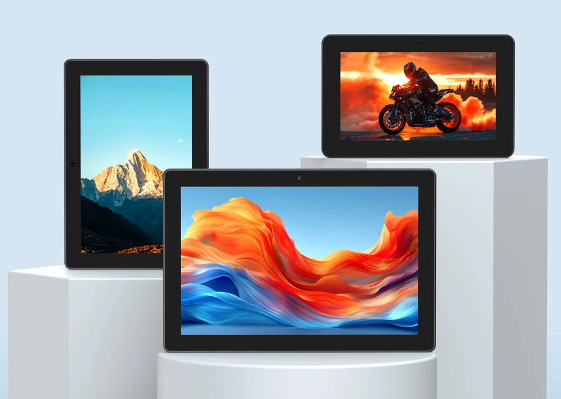
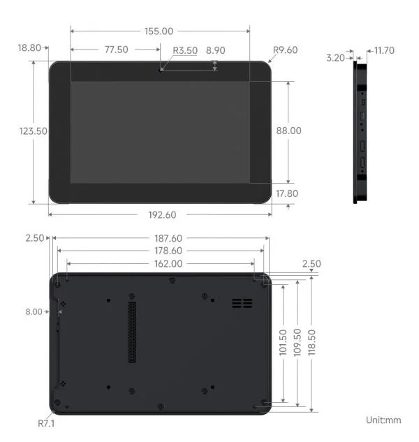
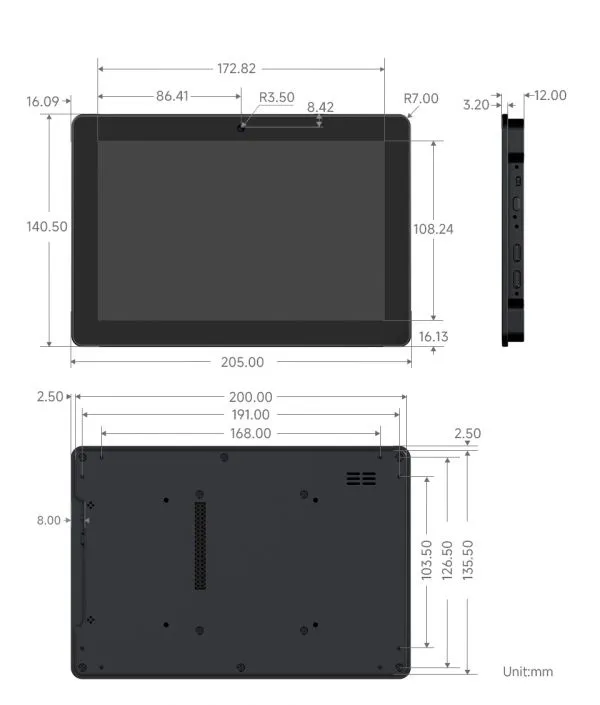
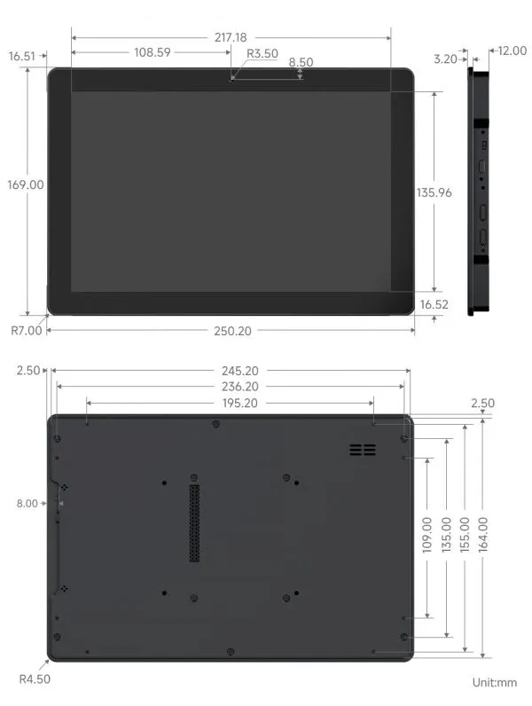
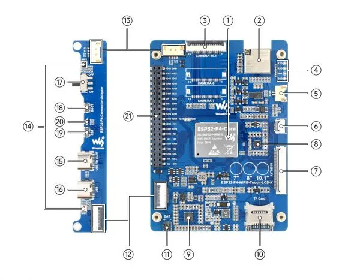
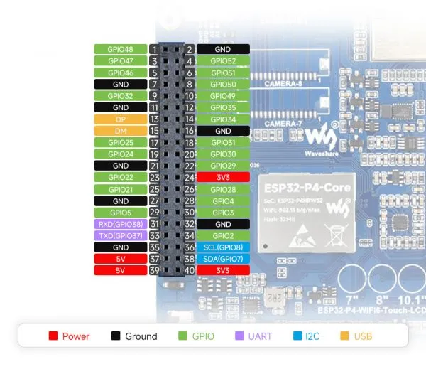
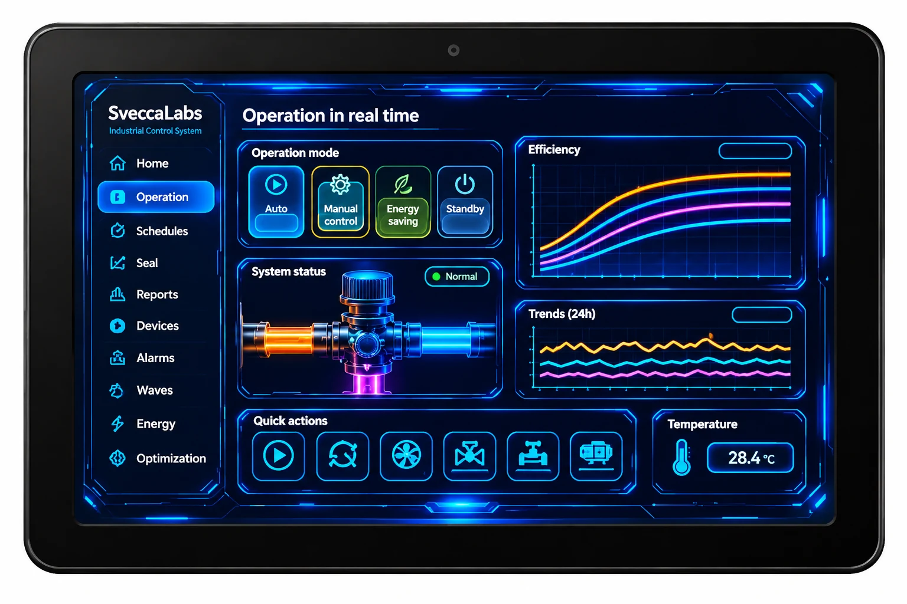

The **Waveshare ESP32-P4-WIFI6-Touch-LCD-X** is a family of large-format HMI development boards available with 7-inch, 8-inch and 10.1-inch displays. Each version combines an ESP32-P4 application processor with an ESP32-C6 wireless coprocessor, a MIPI-DSI touchscreen, camera support and onboard audio hardware.

If you're comparing display technologies or choosing between different ESP32 touchscreen sizes, start with our [ESP32 touchscreen displays guide](/esp32-touchscreen-displays-guide/). For a real-world example of a larger ESP32-P4 touchscreen system, see our [ESP32-P4 Weather Station architecture deep dive](/esp32-p4-weather-station/); that project uses a different 10.1-inch display, not this Touch-LCD-X board.

## Product photos and HMI examples

The official images below show the three display sizes, board layout and hardware connections. Dimensions are in millimetres.

### Display dimensions

<figure>
  
  <figcaption>7-inch model — mechanical dimensions.</figcaption>
</figure>

<figure>
  
  <figcaption>8-inch model — mechanical dimensions.</figcaption>
</figure>

<figure>
  
  <figcaption>10.1-inch model — mechanical dimensions.</figcaption>
</figure>

### Board layout and connections

## HMI interface example

The image below is an illustrative HMI concept showing the kind of dashboard that could be developed for a touchscreen of this class. It is **not** a photograph of the Waveshare board, official Waveshare software, or an application included with the product.

## Which size should you choose?

| Model | Display | Resolution | Display driver | Best fit |
|---|---:|---:|---|---|
| ESP32-P4-WIFI6-Touch-LCD-7 | 7 inches | 720 × 1280 | ILI9881C | A large portrait-oriented control panel |
| ESP32-P4-WIFI6-Touch-LCD-8 | 8 inches | 800 × 1280 | JD9365 | More room for dashboards and multi-panel interfaces |
| ESP32-P4-WIFI6-Touch-LCD-10.1 | 10.1 inches | 800 × 1280 | JD9365 | A tablet-sized HMI or wall-mounted interface |

All three use a two-lane MIPI-DSI display interface and the GT9271 capacitive touch controller with 10-point touch. The panel orientation is landscape by default and can be changed in software.

The 7-inch panel is listed at 450 cd/m², while the 8-inch and 10.1-inch panels are listed at 400 cd/m². Waveshare also mentions customized high-brightness versions; do not assume those are the standard configuration.

## Key hardware features

- ESP32-P4NRW32 with dual-core high-performance RISC-V processing up to 360 MHz and a low-power core.
- 32 MB PSRAM integrated in the chip package and 32 MB onboard NOR Flash.
- ESP32-C6-MINI wireless coprocessor connected over SDIO, providing 2.4 GHz Wi-Fi 6 and Bluetooth 5 LE.
- 2-lane MIPI-DSI display interface and MIPI-CSI camera interface.
- 5 MP OV5647 front camera.
- GT9271 10-point capacitive touch.
- ES8311 audio codec, ES7210 echo-cancellation circuit, dual microphones and speaker.
- MicroSD slot with SDIO 3.0.
- USB-to-UART Type-C and USB 2.0 OTG High-Speed Type-C.
- 40-pin expansion header and board-to-board connectors.

## ESP32-P4 performance and development

The ESP32-P4 is designed for more demanding human-machine interfaces, multimedia and edge-processing projects than typical entry-level ESP32 boards. Its RISC-V processing cores, memory configuration, graphics-related peripherals and MIPI interfaces make this family suitable for sophisticated graphical interfaces.

There is an important software consideration: Waveshare currently recommends **ESP-IDF** for development because ESP32-P4 support in Arduino is limited. Start with the official examples and documentation for the exact screen size and SKU before building a custom application.

For LVGL interfaces, check the manufacturer's current examples and component versions. Do not assume that an ESP32-S3 configuration or display driver can be reused unchanged: the 7-inch model uses ILI9881C, while the 8-inch and 10.1-inch models use JD9365.

## Is it suitable for a Home Assistant dashboard?

The large touchscreens and HMI-focused hardware make this family interesting for a custom smart-home control panel. However, **do not treat it as a plug-and-play ESPHome display**.

ESPHome support for ESP32-P4 and MIPI-DSI panels depends on the exact board, display driver, touch controller and framework support. The manufacturer's current documentation recommends ESP-IDF for development. Before buying specifically for Home Assistant, verify that a maintained ESPHome configuration exists for the exact size and hardware revision, or be prepared to develop a custom ESP-IDF/LVGL application that communicates with Home Assistant.

If ease of ESPHome integration is more important than screen size and processing power, compare the [Guition ESP32-S3-4848S040](/products/guition-esp32-s3-4848s040/) and [Guition JC8048W550](/products/guition-jc8048w550/) first. You can also read our [ESP32 touchscreen displays guide](/esp32-touchscreen-displays-guide/) for a broader comparison of display interfaces and controller choices.

## ESP32-P4-WIFI6-Touch-LCD-X vs 7B

These are separate Waveshare product families, despite the similar names.

| Feature | Touch-LCD-X family | Touch-LCD-7B |
|---|---|---|
| Screen options | 7, 8 and 10.1 inches | 7 inches |
| 7-inch resolution | 720 × 1280 | 1024 × 600 |
| Touch | 10-point, GT9271 | 5-point, GT911 |
| Display interface | 2-lane MIPI-DSI | MIPI-DSI |
| Main processor | ESP32-P4 | ESP32-P4 |
| Wireless coprocessor | ESP32-C6 | ESP32-C6 |
| Memory | 32 MB PSRAM + 32 MB NOR Flash | 32 MB PSRAM + 32 MB NOR Flash |

If you specifically need a landscape 1024 × 600 7-inch display, see the separate [Waveshare ESP32-P4-WIFI6-Touch-LCD-7B page](/products/waveshare-esp32-p4-wifi6-touch-lcd-7b/).

## Price and where to buy

- **[View the AliExpress offer](https://s.click.aliexpress.com/e/_c3Bms5Dz)** — select 7-inch, 8-inch or 10.1-inch, with or without battery.
- **[Read the official documentation](https://docs.waveshare.com/ESP32-P4-WIFI6-Touch-LCD-X)** — confirm the exact SKU and setup requirements.
- **[Browse the manufacturer's example code](https://github.com/waveshareteam/ESP32-P4-WIFI6-Touch-LCD-X)** — review the current development examples.

The AliExpress listing supplied by Embedded Nerd offers the 7-inch, 8-inch and 10.1-inch versions, with the option to select the model with or without the 3.7 V battery. Check the selected screen size, battery option, final price, shipping, taxes and stock on the listing before ordering. This listing is for the Touch-LCD-X family, not the separate 7B model.

## Frequently asked questions

### What sizes are available?

The ESP32-P4-WIFI6-Touch-LCD-X family is available in 7-inch, 8-inch and 10.1-inch versions.

### Do all three models have the same resolution?

No. The 7-inch model is 720 × 1280. The 8-inch and 10.1-inch models are 800 × 1280.

### Does the family support capacitive touch?

Yes. The three models use the GT9271 capacitive touch controller and support 10-point touch.

### Does it include Wi-Fi and Bluetooth?

Yes. An ESP32-C6-MINI module provides 2.4 GHz Wi-Fi 6 and Bluetooth 5 LE through an SDIO connection to the ESP32-P4.

### Can I program it with Arduino?

Waveshare notes that ESP32-P4 support in Arduino is limited and recommends ESP-IDF for development. Check the latest examples and framework support before choosing your development environment.

### Is it compatible with ESPHome and Home Assistant?

Do not assume plug-and-play compatibility. Verify a maintained configuration for the exact display model and driver. A custom ESP-IDF/LVGL application may be required for a Home Assistant control panel.

### Is the 7-inch Touch-LCD-X the same as the 7B?

No. The Touch-LCD-X 7-inch model is 720 × 1280 with 10-point GT9271 touch. The separate 7B model is 1024 × 600 with 5-point GT911 touch.
